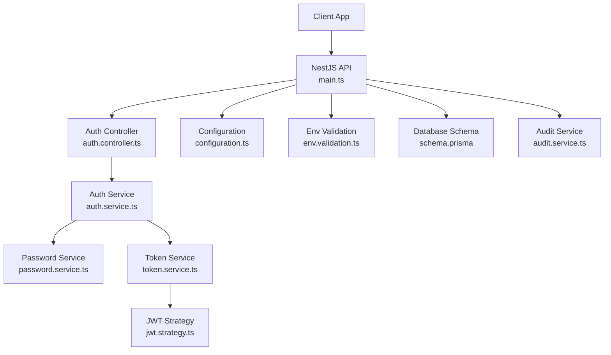
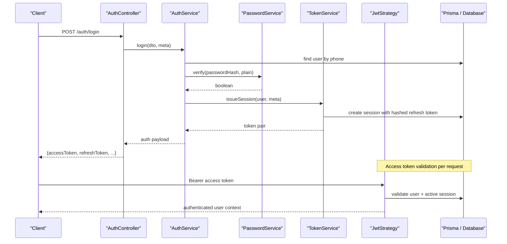
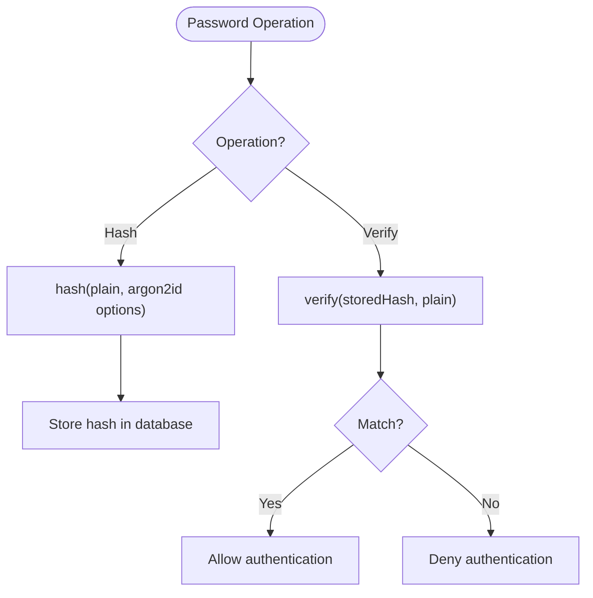
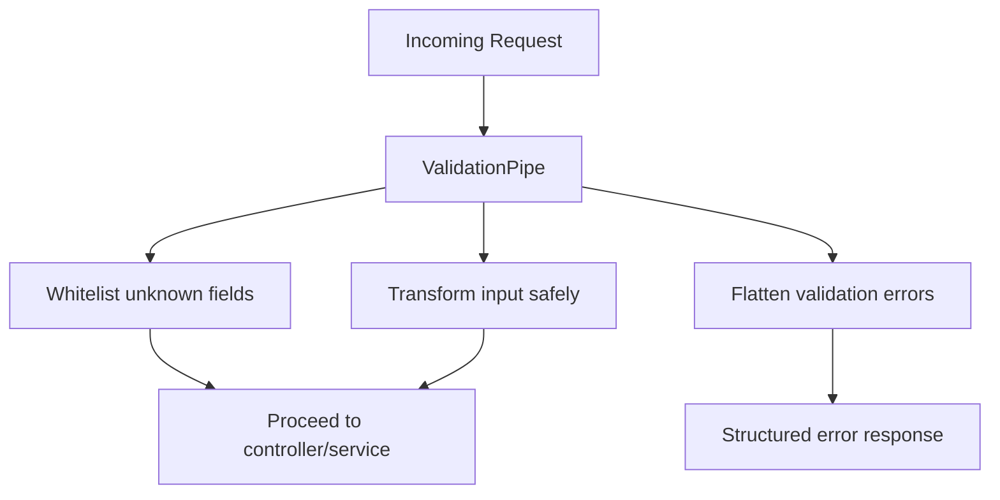
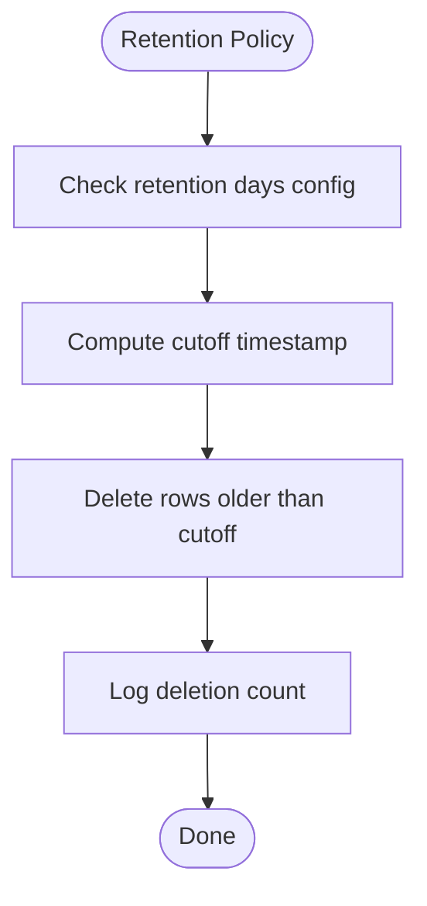
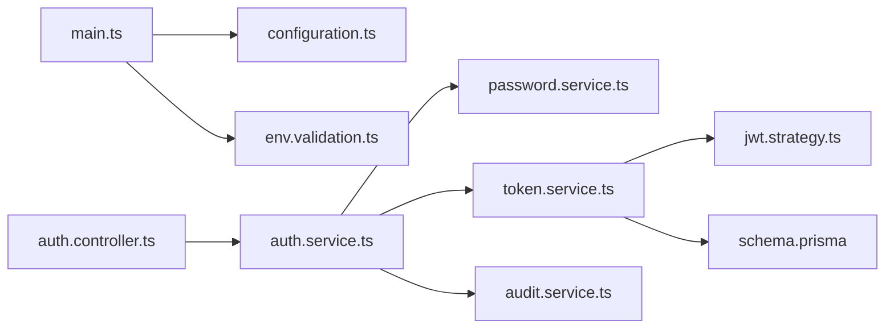

# Data Protection

<cite>
**Referenced Files in This Document**
- [password.service.ts](file://backend/src/common/security/password.service.ts)
- [token.service.ts](file://backend/src/auth/token.service.ts)
- [jwt.strategy.ts](file://backend/src/auth/strategies/jwt.strategy.ts)
- [configuration.ts](file://backend/src/config/configuration.ts)
- [env.validation.ts](file://backend/src/config/env.validation.ts)
- [main.ts](file://backend/src/main.ts)
- [validation.ts](file://backend/src/common/utils/validation.ts)
- [auth.controller.ts](file://backend/src/auth/auth.controller.ts)
- [auth.service.ts](file://backend/src/auth/auth.service.ts)
- [schema.prisma](file://backend/prisma/schema.prisma)
- [reference.ts](file://backend/src/common/utils/reference.ts)
- [geo-location.service.ts](file://backend/src/common/services/geo-location.service.ts)
- [audit.service.ts](file://backend/src/audit/audit.service.ts)
</cite>

## Table of Contents
1. [Introduction](#introduction)
2. [Project Structure](#project-structure)
3. [Core Components](#core-components)
4. [Architecture Overview](#architecture-overview)
5. [Detailed Component Analysis](#detailed-component-analysis)
6. [Dependency Analysis](#dependency-analysis)
7. [Performance Considerations](#performance-considerations)
8. [Troubleshooting Guide](#troubleshooting-guide)
9. [Conclusion](#conclusion)
10. [Appendices](#appendices)

## Introduction
This document explains how FuelConnect protects sensitive data across authentication, token management, configuration, input validation, database access, and data retention. It focuses on:

- Password hashing with Argon2id
- Secure JWT-based session handling and refresh-token rotation
- Environment variable validation and secret handling
- Input validation and sanitization patterns
- HTTPS and security headers
- Database connection model and query safety
- Data retention and secure deletion
- Compliance-oriented auditability and privacy controls

The goal is to help developers understand the current implementation and identify areas where additional hardening may be needed for production environments.

## Project Structure
FuelConnect’s backend is a NestJS application organized by feature modules. Security-related logic is primarily located under:

- Authentication and sessions: `src/auth`
- Shared security utilities: `src/common/security`
- Configuration and environment validation: `src/config`
- Application bootstrap and global middleware: `src/main.ts`
- Database schema and models: `prisma/schema.prisma`
- Audit logging: `src/audit`



**Diagram sources**
- [main.ts:12-61](file://backend/src/main.ts#L12-L61)
- [auth.controller.ts:42-165](file://backend/src/auth/auth.controller.ts#L42-L165)
- [auth.service.ts:39-48](file://backend/src/auth/auth.service.ts#L39-L48)
- [password.service.ts:11-24](file://backend/src/common/security/password.service.ts#L11-L24)
- [token.service.ts:32-38](file://backend/src/auth/token.service.ts#L32-L38)
- [jwt.strategy.ts:9-20](file://backend/src/auth/strategies/jwt.strategy.ts#L9-L20)
- [configuration.ts:48-96](file://backend/src/config/configuration.ts#L48-L96)
- [env.validation.ts:3-44](file://backend/src/config/env.validation.ts#L3-L44)
- [schema.prisma:10-14](file://backend/prisma/schema.prisma#L10-L14)
- [audit.service.ts:21-45](file://backend/src/audit/audit.service.ts#L21-L45)

**Section sources**
- [main.ts:12-61](file://backend/src/main.ts#L12-L61)
- [auth.controller.ts:42-165](file://backend/src/auth/auth.controller.ts#L42-L165)
- [configuration.ts:48-96](file://backend/src/config/configuration.ts#L48-L96)
- [env.validation.ts:3-44](file://backend/src/config/env.validation.ts#L3-L44)
- [schema.prisma:10-14](file://backend/prisma/schema.prisma#L10-L14)

## Core Components
This section summarizes the primary data protection components:

- **PasswordService**: Hashes and verifies passwords using Argon2id with OWASP-recommended parameters.
- **TokenService**: Issues short-lived access tokens, opaque rotating refresh tokens, reset tokens, and manages session revocation.
- **JwtStrategy**: Validates access tokens, enforces token type, and checks active sessions.
- **Configuration and Env Validation**: Loads and validates environment variables, including secrets and TTLs.
- **Global Bootstrap**: Applies Helmet, CORS, validation pipes, and Swagger setup.
- **Prisma Schema**: Defines identity, sessions, OTP codes, and related entities.
- **AuditService**: Records administrative and security-sensitive actions.

**Section sources**
- [password.service.ts:11-24](file://backend/src/common/security/password.service.ts#L11-L24)
- [token.service.ts:32-197](file://backend/src/auth/token.service.ts#L32-L197)
- [jwt.strategy.ts:9-73](file://backend/src/auth/strategies/jwt.strategy.ts#L9-L73)
- [configuration.ts:48-96](file://backend/src/config/configuration.ts#L48-L96)
- [env.validation.ts:3-44](file://backend/src/config/env.validation.ts#L3-L44)
- [main.ts:12-61](file://backend/src/main.ts#L12-L61)
- [schema.prisma:137-207](file://backend/prisma/schema.prisma#L137-L207)
- [audit.service.ts:21-45](file://backend/src/audit/audit.service.ts#L21-L45)

## Architecture Overview
The authentication flow uses layered security:

1. Clients send credentials to protected endpoints.
2. Controllers validate DTOs via global validation pipes.
3. Services use PasswordService for password hashing and verification.
4. TokenService issues JWT access tokens and rotating refresh tokens.
5. JwtStrategy validates access tokens and ensures sessions are active.
6. AuditService records important events.



**Diagram sources**
- [auth.controller.ts:64-71](file://backend/src/auth/auth.controller.ts#L64-L71)
- [auth.service.ts:163-239](file://backend/src/auth/auth.service.ts#L163-L239)
- [password.service.ts:17-23](file://backend/src/common/security/password.service.ts#L17-L23)
- [token.service.ts:40-67](file://backend/src/auth/token.service.ts#L40-L67)
- [jwt.strategy.ts:26-73](file://backend/src/auth/strategies/jwt.strategy.ts#L26-L73)

## Detailed Component Analysis

### Password Hashing with Argon2id
PasswordService implements secure password hashing and verification:

- Uses Argon2id with memoryCost, timeCost, and parallelism parameters aligned with OWASP recommendations.
- Provides hash() for storing new passwords.
- Provides verify() for comparing stored hashes against plaintext during login or password change flows.

Security characteristics:
- Argon2id resists both brute-force and side-channel attacks.
- Parameters are tuned for reasonable performance while maintaining strong resistance.
- Verification catches exceptions and returns false to avoid leaking information about invalid inputs.



**Diagram sources**
- [password.service.ts:4-9](file://backend/src/common/security/password.service.ts#L4-L9)
- [password.service.ts:13-23](file://backend/src/common/security/password.service.ts#L13-L23)

**Section sources**
- [password.service.ts:1-25](file://backend/src/common/security/password.service.ts#L1-L25)
- [auth.service.ts:53-59](file://backend/src/auth/auth.service.ts#L53-L59)
- [auth.service.ts:182-205](file://backend/src/auth/auth.service.ts#L182-L205)
- [auth.service.ts:333-351](file://backend/src/auth/auth.service.ts#L333-L351)

### Secure Token Management
TokenService manages three token types:

- **Access tokens**: Short-lived JWTs containing minimal claims such as user ID, role, phone, session ID, and token type.
- **Refresh tokens**: Opaque random secrets stored as SHA-256 hashes in the Session table; rotated on every use.
- **Reset tokens**: Time-limited JWTs used for password reset flows, validated by type.

Key security behaviors:
- Refresh tokens are generated cryptographically and hashed before storage.
- Rotation creates a new session and revokes the previous one atomically.
- Reuse of an already rotated refresh token triggers family-wide revocation to detect theft.
- Access tokens are validated per request through JwtStrategy, which checks token type, expiration, and active session status.
- Reset tokens enforce a specific token type and expiration.

```mermaid
classDiagram
class TokenService {
+issueSession(user, meta) TokenPair
+rotate(refreshToken, meta) TokenPair & {userId}
+revokeSession(sessionId, reason) void
+revokeAllSessions(userId, reason) number
+signResetToken(user) string
+verifyResetToken(token) ResetTokenPayload
-signAccessToken(user, sessionId) string
}
class SessionOwner {
+string id
+RoleName role
+string phone
+UserStatus status
}
class AccessTokenPayload {
+string sub
+RoleName role
+string phone
+string sid
+string typ
}
class ResetTokenPayload {
+string sub
+string phone
+string typ
}
TokenService --> SessionOwner : "uses"
TokenService --> AccessTokenPayload : "signs"
TokenService --> ResetTokenPayload : "verifies"
```

**Diagram sources**
- [token.service.ts:10-23](file://backend/src/auth/token.service.ts#L10-L23)
- [token.service.ts:40-67](file://backend/src/auth/token.service.ts#L40-L67)
- [token.service.ts:69-151](file://backend/src/auth/token.service.ts#L69-L151)
- [token.service.ts:168-196](file://backend/src/auth/token.service.ts#L168-L196)

**Section sources**
- [token.service.ts:1-198](file://backend/src/auth/token.service.ts#L1-L198)
- [jwt.strategy.ts:15-20](file://backend/src/auth/strategies/jwt.strategy.ts#L15-L20)
- [jwt.strategy.ts:26-73](file://backend/src/auth/strategies/jwt.strategy.ts#L26-L73)
- [schema.prisma:172-189](file://backend/prisma/schema.prisma#L172-L189)
- [reference.ts:12-15](file://backend/src/common/utils/reference.ts#L12-L15)

### Environment Variables and Configuration Security
Configuration is loaded from environment variables and validated at startup:

- Joi validates required fields like DATABASE_URL and JWT_SECRET, enforcing minimum lengths and ranges.
- Default values exist for development but should not be used in production.
- Sensitive values include JWT_SECRET, payment provider credentials, and webhook secrets.
- Tracking history retention days and other operational settings are configurable.

Important considerations:
- Ensure JWT_SECRET is long and unique in production.
- Avoid committing .env files or secrets into version control.
- Use a secrets manager or encrypted environment configuration in production deployments.
- Validate all external-facing configuration to prevent misconfiguration.

**Section sources**
- [configuration.ts:1-38](file://backend/src/config/configuration.ts#L1-L38)
- [configuration.ts:48-96](file://backend/src/config/configuration.ts#L48-L96)
- [env.validation.ts:3-44](file://backend/src/config/env.validation.ts#L3-L44)

### Input Validation and Sanitization
Global validation is applied through NestJS ValidationPipe:

- Whitelisting removes unknown properties.
- Transform converts and normalizes input.
- Implicit conversion is disabled to reduce injection risks.
- Validation errors are flattened into structured field-level messages.

Additional sanitization patterns:
- Phone numbers are normalized before processing.
- Email addresses are trimmed and lowercased.
- DTOs define explicit shape constraints for each endpoint.



**Diagram sources**
- [main.ts:50-61](file://backend/src/main.ts#L50-L61)
- [validation.ts:5-30](file://backend/src/common/utils/validation.ts#L5-L30)

**Section sources**
- [main.ts:50-61](file://backend/src/main.ts#L50-L61)
- [validation.ts:1-31](file://backend/src/common/utils/validation.ts#L1-L31)
- [auth.service.ts:53-59](file://backend/src/auth/auth.service.ts#L53-L59)
- [auth.service.ts:533-542](file://backend/src/auth/auth.service.ts#L533-L542)

### Secure Communication Protocols and SSL/TLS
The application applies security headers and CORS configuration:

- Helmet is enabled with content security policy disabled explicitly.
- CORS is configured based on CORS_ORIGINS; if empty in production, it allows all origins with a warning.
- The server listens on HTTP by default; HTTPS termination should be handled by a reverse proxy or container orchestration layer.

Recommendations:
- Enforce HTTPS at the reverse proxy (e.g., Nginx, Traefik, cloud load balancer).
- Configure strict CORS policies in production.
- Enable HSTS, secure cookie flags, and TLS best practices at the edge.
- Review Helmet defaults and enable CSP when appropriate.

**Section sources**
- [main.ts:25-34](file://backend/src/main.ts#L25-L34)
- [main.ts:97-102](file://backend/src/main.ts#L97-L102)

### Database Connections and Query Safety
Database connectivity is defined in the Prisma schema:

- PostgreSQL with PostGIS extension is configured via DATABASE_URL.
- Credentials and connection strings must be provided securely through environment variables.
- Queries use Prisma client methods, which parameterize queries and reduce SQL injection risk.
- Some legacy raw SQL exists in geo-location utilities; ensure these are reviewed and parameterized where possible.

Data masking and output control:
- User responses selectively expose fields rather than returning full entity objects.
- Sensitive fields like passwordHash are never included in API responses.
- Audit logs capture actor, action, entity, IP, and user agent without exposing secrets.

**Section sources**
- [schema.prisma:10-14](file://backend/prisma/schema.prisma#L10-L14)
- [schema.prisma:137-170](file://backend/prisma/schema.prisma#L137-L170)
- [auth.service.ts:467-531](file://backend/src/auth/auth.service.ts#L467-L531)
- [audit.service.ts:27-45](file://backend/src/audit/audit.service.ts#L27-L45)

### Data Retention Policies and Secure Deletion
Retention and cleanup mechanisms include:

- Tracking history retention days are configurable and used to prune rider location history.
- Sessions have expiration times and can be revoked individually or for all sessions belonging to a user.
- Soft deletes are present on some entities (e.g., deletedAt), supporting compliance-friendly data lifecycle management.
- Audit logs provide traceability for security and governance.

Secure deletion practices:
- Rotate and revoke refresh tokens immediately upon logout or suspicious reuse.
- Revoke all sessions after password changes or resets.
- Implement scheduled jobs to delete expired OTP codes, old tracking history, and stale audit entries according to policy.



**Diagram sources**
- [geo-location.service.ts:132-140](file://backend/src/common/services/geo-location.service.ts#L132-L140)
- [configuration.ts:92-96](file://backend/src/config/configuration.ts#L92-L96)

**Section sources**
- [geo-location.service.ts:127-154](file://backend/src/common/services/geo-location.service.ts#L127-L154)
- [token.service.ts:153-166](file://backend/src/auth/token.service.ts#L153-L166)
- [schema.prisma:137-170](file://backend/prisma/schema.prisma#L137-L170)
- [schema.prisma:191-207](file://backend/prisma/schema.prisma#L191-L207)

### Compliance and Auditability
FuelConnect includes audit logging and session visibility:

- AuditService records who performed what action, on which entity, and from where.
- Auth endpoints expose active sessions so users can review and revoke devices.
- OTP flows support sign-up, login, and reset purposes with attempts and expiration controls.

Compliance guidance:
- Maintain audit trails for regulatory requirements.
- Provide data subject rights workflows (access, correction, deletion).
- Minimize data collection and retain only what is necessary.
- Encrypt sensitive data at rest and in transit where required by policy.

**Section sources**
- [audit.service.ts:1-46](file://backend/src/audit/audit.service.ts#L1-L46)
- [auth.controller.ts:149-164](file://backend/src/auth/auth.controller.ts#L149-L164)
- [schema.prisma:713-730](file://backend/prisma/schema.prisma#L713-L730)

## Dependency Analysis
The following diagram shows key dependencies among security-related components:



**Diagram sources**
- [main.ts:12-61](file://backend/src/main.ts#L12-L61)
- [auth.controller.ts:42-165](file://backend/src/auth/auth.controller.ts#L42-L165)
- [auth.service.ts:39-48](file://backend/src/auth/auth.service.ts#L39-L48)
- [password.service.ts:11-24](file://backend/src/common/security/password.service.ts#L11-L24)
- [token.service.ts:32-38](file://backend/src/auth/token.service.ts#L32-L38)
- [jwt.strategy.ts:9-20](file://backend/src/auth/strategies/jwt.strategy.ts#L9-L20)
- [audit.service.ts:21-45](file://backend/src/audit/audit.service.ts#L21-L45)
- [schema.prisma:10-14](file://backend/prisma/schema.prisma#L10-L14)

**Section sources**
- [main.ts:12-61](file://backend/src/main.ts#L12-L61)
- [auth.controller.ts:42-165](file://backend/src/auth/auth.controller.ts#L42-L165)
- [auth.service.ts:39-48](file://backend/src/auth/auth.service.ts#L39-L48)
- [token.service.ts:32-38](file://backend/src/auth/token.service.ts#L32-L38)
- [jwt.strategy.ts:9-20](file://backend/src/auth/strategies/jwt.strategy.ts#L9-L20)
- [audit.service.ts:21-45](file://backend/src/audit/audit.service.ts#L21-L45)
- [schema.prisma:10-14](file://backend/prisma/schema.prisma#L10-L14)

## Performance Considerations
- Argon2id parameters balance security and CPU/memory usage; tune them based on deployment capacity.
- JWT validation adds a database lookup per request to confirm session validity; consider caching strategies carefully to avoid bypassing revocation.
- Refresh token rotation performs atomic transactional updates; ensure database performance is adequate.
- Global validation transforms add overhead; keep DTOs minimal and focused.
- Tracking history pruning should run periodically to avoid unbounded growth.

[No sources needed since this section provides general guidance]

## Troubleshooting Guide
Common security-related issues and resolutions:

- Invalid or missing JWT_SECRET:
  - Ensure JWT_SECRET meets minimum length and is set in production.
  - Confirm env.validation.ts requires and validates the secret.

- CORS allowing all origins in production:
  - Set CORS_ORIGINS explicitly to trusted domains.
  - Monitor warnings logged when CORS_ORIGINS is empty in production.

- Refresh token reuse detected:
  - Indicates potential token theft; all sessions for the user are revoked.
  - Prompt the user to re-authenticate and investigate device compromise.

- Excessive failed login attempts:
  - Account lockout is enforced temporarily.
  - Review rate limiting and throttling configurations.

- Audit log write failures:
  - Auditing is designed to fail gracefully; check logs for underlying database issues.

**Section sources**
- [env.validation.ts:13-18](file://backend/src/config/env.validation.ts#L13-L18)
- [main.ts:27-34](file://backend/src/main.ts#L27-L34)
- [token.service.ts:86-93](file://backend/src/auth/token.service.ts#L86-L93)
- [auth.service.ts:174-205](file://backend/src/auth/auth.service.ts#L174-L205)
- [audit.service.ts:41-45](file://backend/src/audit/audit.service.ts#L41-L45)

## Conclusion
FuelConnect implements several strong data protection mechanisms:

- Argon2id password hashing with OWASP-aligned parameters
- Short-lived JWT access tokens and rotating refresh tokens with session revocation
- Strict environment variable validation and secret handling
- Global input validation and sanitization
- Security headers and CORS configuration
- Parameterized database queries via Prisma
- Configurable data retention and audit logging

To further strengthen security:

- Enforce HTTPS at the reverse proxy and configure strict CORS policies.
- Centralize secrets management and rotate secrets regularly.
- Review raw SQL usage and ensure all queries remain parameterized.
- Implement automated cleanup for OTP codes, expired sessions, and historical data.
- Extend audit logging to cover more sensitive operations and integrate with centralized logging.

[No sources needed since this section summarizes without analyzing specific files]

## Appendices

### Secure Coding Patterns and Vulnerabilities to Avoid
Patterns implemented:
- Hash passwords with Argon2id instead of reversible encryption.
- Store refresh tokens as opaque secrets hashed in the database.
- Validate and sanitize all inputs using DTOs and global validation pipes.
- Use least-privilege data selection in API responses.
- Record audit events for critical actions.

Vulnerabilities to avoid:
- Storing plaintext passwords or weak hashes.
- Using predictable or short secrets for JWT signing.
- Allowing unrestricted CORS in production.
- Returning full entity objects that include sensitive fields.
- Executing unsanitized user input in raw SQL.
- Retaining unnecessary personal data indefinitely.

[No sources needed since this section provides general guidance]