# Security Implementation

<cite>
**Referenced Files in This Document**
- [main.ts](file://backend/src/main.ts)
- [configuration.ts](file://backend/src/config/configuration.ts)
- [env.validation.ts](file://backend/src/config/env.validation.ts)
- [auth.service.ts](file://backend/src/auth/auth.service.ts)
- [jwt.strategy.ts](file://backend/src/auth/strategies/jwt.strategy.ts)
- [token.service.ts](file://backend/src/auth/token.service.ts)
- [otp.service.ts](file://backend/src/auth/otp.service.ts)
- [password.service.ts](file://backend/src/common/security/password.service.ts)
- [jwt-auth.guard.ts](file://backend/src/common/guards/jwt-auth.guard.ts)
- [roles.guard.ts](file://backend/src/common/guards/roles.guard.ts)
- [current-user.decorator.ts](file://backend/src/common/decorators/current-user.decorator.ts)
- [public.decorator.ts](file://backend/src/common/decorators/public.decorator.ts)
- [roles.decorator.ts](file://backend/src/common/decorators/roles.decorator.ts)
- [validation.ts](file://backend/src/common/utils/validation.ts)
- [schema.prisma](file://backend/prisma/schema.prisma)
</cite>

## Table of Contents
1. [Introduction](#introduction)
2. [Project Structure](#project-structure)
3. [Core Components](#core-components)
4. [Architecture Overview](#architecture-overview)
5. [Detailed Component Analysis](#detailed-component-analysis)
6. [Dependency Analysis](#dependency-analysis)
7. [Performance Considerations](#performance-considerations)
8. [Troubleshooting Guide](#troubleshooting-guide)
9. [Conclusion](#conclusion)
10. [Appendices](#appendices)

## Introduction
This document describes the security implementation of the FuelConnect platform backend. It covers JWT-based authentication, role-based access control, authorization guards, password hashing with Argon2, secure token and session management, OTP verification for phone-based flows, input validation and sanitization, protection against common vulnerabilities, API security headers, CORS configuration, HTTPS considerations, data encryption at rest via database schema design, secure communication protocols, and compliance-oriented best practices.

## Project Structure
The security-relevant code is primarily located under:
- Authentication and authorization: `backend/src/auth`, `backend/src/common/guards`, `backend/src/common/decorators`
- Security utilities: `backend/src/common/security`, `backend/src/common/utils`
- Application bootstrap and global security settings: `backend/src/main.ts`
- Configuration and environment validation: `backend/src/config`
- Data model and persistence: `backend/prisma/schema.prisma`

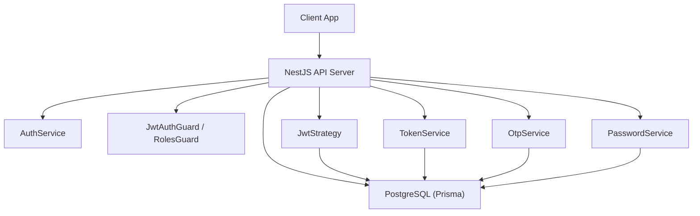

**Diagram sources**
- [main.ts:12-34](file://backend/src/main.ts#L12-L34)
- [auth.service.ts:40-48](file://backend/src/auth/auth.service.ts#L40-L48)
- [jwt.strategy.ts:10-20](file://backend/src/auth/strategies/jwt.strategy.ts#L10-L20)
- [token.service.ts:32-38](file://backend/src/auth/token.service.ts#L32-L38)
- [otp.service.ts:29-36](file://backend/src/auth/otp.service.ts#L29-L36)
- [password.service.ts:11-15](file://backend/src/common/security/password.service.ts#L11-L15)

**Section sources**
- [main.ts:12-34](file://backend/src/main.ts#L12-L34)
- [configuration.ts:48-68](file://backend/src/config/configuration.ts#L48-L68)

## Core Components
- Authentication service orchestrates registration, login, OTP verification, password reset, refresh/logout, and profile operations.
- JWT strategy validates bearer tokens and enforces active sessions.
- Token service manages short-lived access tokens, opaque rotating refresh tokens, and reset tokens.
- OTP service issues, verifies, and rate-limits numeric codes for phone-based flows.
- Password service hashes and verifies passwords using Argon2id.
- Global guards and decorators enforce public routes and role-based access control.
- Validation pipeline ensures strict input validation and safe error responses.
- Environment configuration and validation enforce secure defaults and required secrets.

**Section sources**
- [auth.service.ts:50-396](file://backend/src/auth/auth.service.ts#L50-L396)
- [jwt.strategy.ts:22-73](file://backend/src/auth/strategies/jwt.strategy.ts#L22-L73)
- [token.service.ts:27-197](file://backend/src/auth/token.service.ts#L27-L197)
- [otp.service.ts:23-162](file://backend/src/auth/otp.service.ts#L23-L162)
- [password.service.ts:4-24](file://backend/src/common/security/password.service.ts#L4-L24)
- [jwt-auth.guard.ts:11-34](file://backend/src/common/guards/jwt-auth.guard.ts#L11-L34)
- [roles.guard.ts:7-32](file://backend/src/common/guards/roles.guard.ts#L7-L32)
- [validation.ts:5-30](file://backend/src/common/utils/validation.ts#L5-L30)
- [env.validation.ts:3-44](file://backend/src/config/env.validation.ts#L3-L44)

## Architecture Overview
The authentication flow uses a layered approach:
- Clients authenticate via phone/password or OTP.
- The server issues a short-lived JWT access token and an opaque rotating refresh token stored securely as a hash in the database.
- Every protected request is validated by Passport’s JWT strategy, which checks token signature, type, expiration, and active session state.
- Role-based authorization restricts endpoints to specific roles.
- OTP-based flows provide phone verification and password reset capabilities.

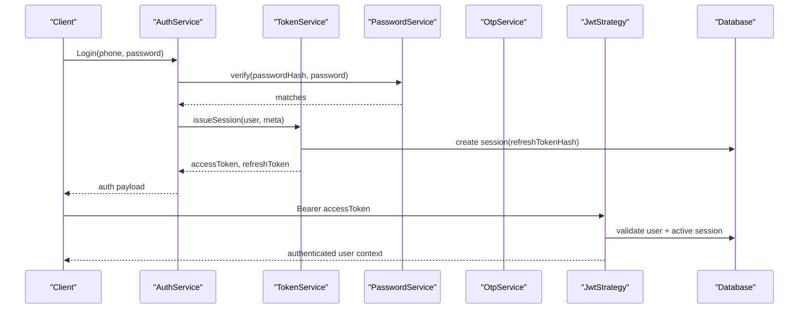

**Diagram sources**
- [auth.service.ts:163-239](file://backend/src/auth/auth.service.ts#L163-L239)
- [token.service.ts:40-67](file://backend/src/auth/token.service.ts#L40-L67)
- [jwt.strategy.ts:26-73](file://backend/src/auth/strategies/jwt.strategy.ts#L26-L73)
- [password.service.ts:17-23](file://backend/src/common/security/password.service.ts#L17-L23)

## Detailed Component Analysis

### JWT-Based Authentication and Session Management
- Access tokens are signed JWTs containing minimal claims and a session identifier. They expire quickly.
- Refresh tokens are opaque random values; only their SHA-256 hash is stored in the database. Each use rotates the token and revokes the previous one. Reuse of a rotated token revokes the entire family to detect theft.
- Sessions track IP, user agent, expiry, revocation reason, and replacement relationships.
- Logout can revoke a single session or all sessions for a user.

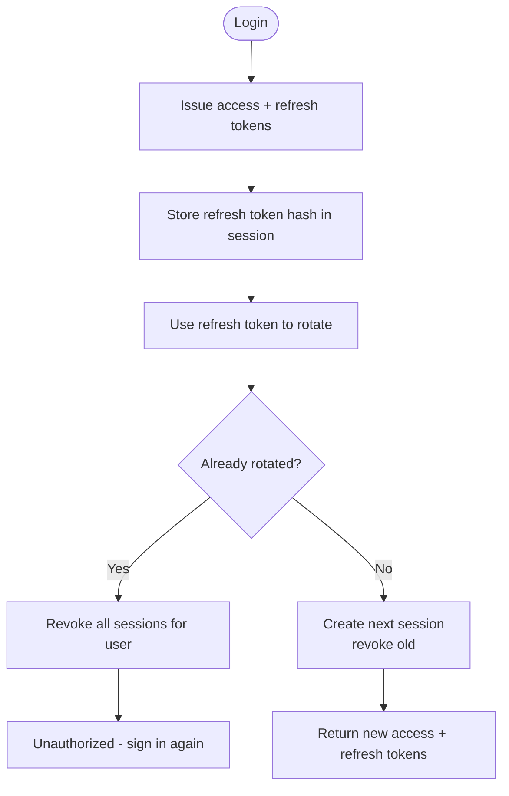

**Diagram sources**
- [token.service.ts:40-151](file://backend/src/auth/token.service.ts#L40-L151)
- [schema.prisma:172-189](file://backend/prisma/schema.prisma#L172-L189)

**Section sources**
- [token.service.ts:27-197](file://backend/src/auth/token.service.ts#L27-L197)
- [schema.prisma:137-207](file://backend/prisma/schema.prisma#L137-L207)

### Password Hashing with Argon2
- Passwords are hashed using Argon2id with OWASP-aligned parameters.
- Verification wraps exceptions to avoid leaking timing information.

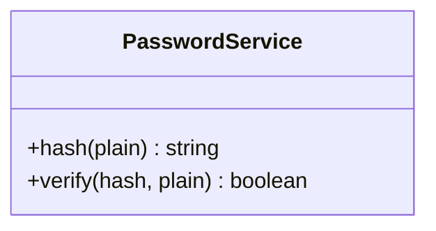

**Diagram sources**
- [password.service.ts:4-24](file://backend/src/common/security/password.service.ts#L4-L24)

**Section sources**
- [password.service.ts:4-24](file://backend/src/common/security/password.service.ts#L4-L24)

### OTP Verification System
- Numeric OTPs are generated, hashed per phone and secret, and stored with TTL, max attempts, and consumption tracking.
- Resend cooldown prevents rapid reissuance.
- Verification increments attempts on failure and marks codes consumed on success.
- Development mode may expose the code in responses for testing.

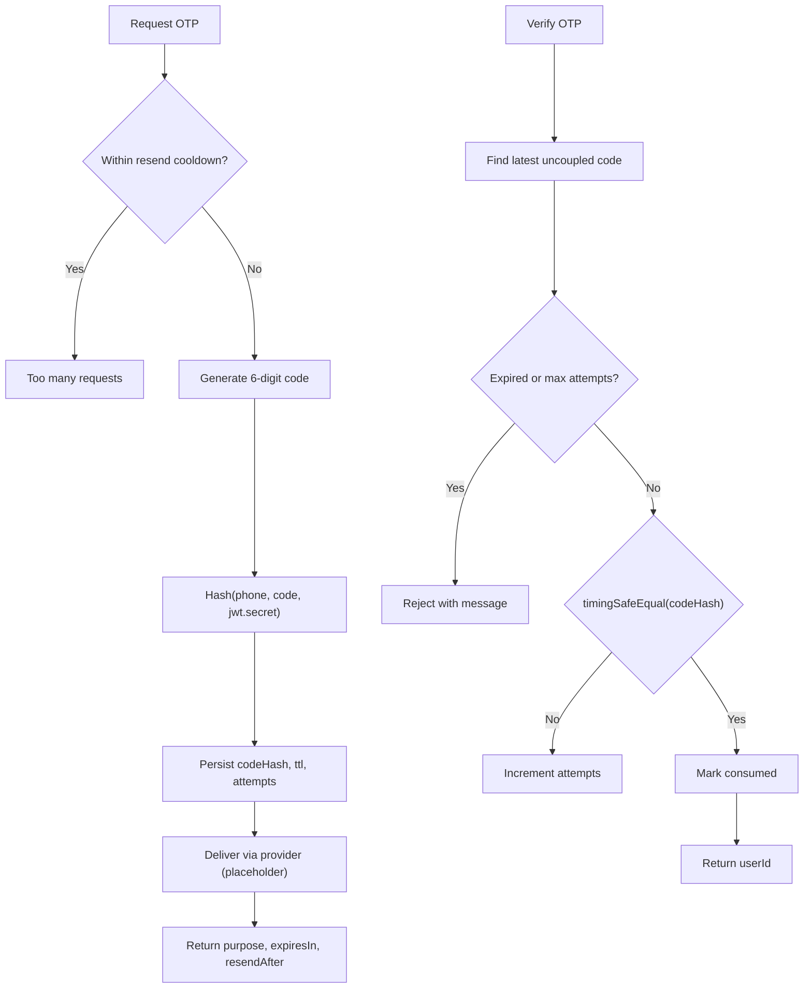

**Diagram sources**
- [otp.service.ts:38-127](file://backend/src/auth/otp.service.ts#L38-L127)
- [schema.prisma:191-207](file://backend/prisma/schema.prisma#L191-L207)

**Section sources**
- [otp.service.ts:23-162](file://backend/src/auth/otp.service.ts#L23-L162)
- [schema.prisma:191-207](file://backend/prisma/schema.prisma#L191-L207)

### Authorization Guards and Role-Based Access Control
- JwtAuthGuard allows public routes marked with a decorator and otherwise requires a valid bearer token.
- RolesGuard enforces role constraints defined via a decorator. SUPER_ADMIN bypasses role checks.
- CurrentUser decorator injects the authenticated user into handlers.

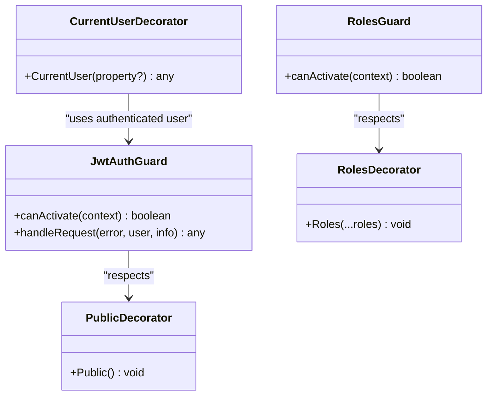

**Diagram sources**
- [jwt-auth.guard.ts:11-34](file://backend/src/common/guards/jwt-auth.guard.ts#L11-L34)
- [roles.guard.ts:7-32](file://backend/src/common/guards/roles.guard.ts#L7-L32)
- [public.decorator.ts:1-7](file://backend/src/common/decorators/public.decorator.ts#L1-L7)
- [roles.decorator.ts:1-8](file://backend/src/common/decorators/roles.decorator.ts#L1-L8)
- [current-user.decorator.ts:1-13](file://backend/src/common/decorators/current-user.decorator.ts#L1-L13)

**Section sources**
- [jwt-auth.guard.ts:11-34](file://backend/src/common/guards/jwt-auth.guard.ts#L11-L34)
- [roles.guard.ts:7-32](file://backend/src/common/guards/roles.guard.ts#L7-L32)
- [public.decorator.ts:1-7](file://backend/src/common/decorators/public.decorator.ts#L1-L7)
- [roles.decorator.ts:1-8](file://backend/src/common/decorators/roles.decorator.ts#L1-L8)
- [current-user.decorator.ts:1-13](file://backend/src/common/decorators/current-user.decorator.ts#L1-L13)

### Input Validation and Sanitization
- Global ValidationPipe whitelists allowed fields, transforms inputs, disables implicit conversion, and returns structured errors.
- Helper utilities flatten nested validation errors for consistent client feedback.
- Phone normalization and email trimming/lowercasing reduce injection risks and ensure canonical formats.

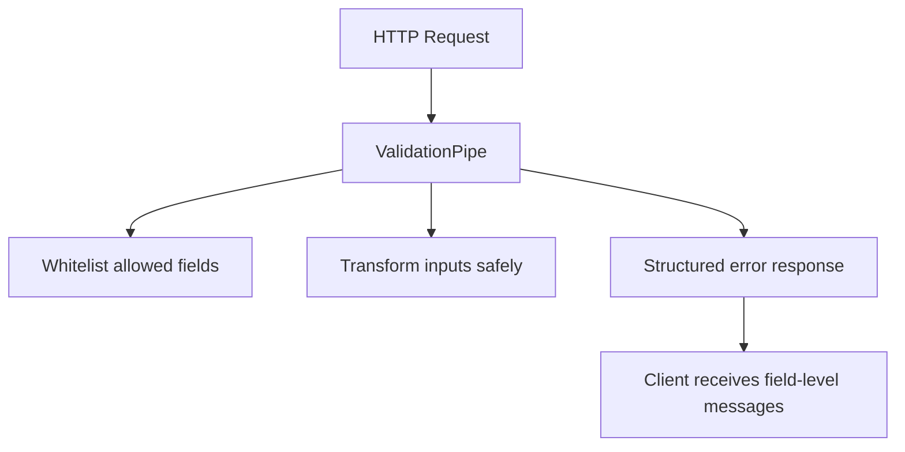

**Diagram sources**
- [main.ts:50-61](file://backend/src/main.ts#L50-L61)
- [validation.ts:5-30](file://backend/src/common/utils/validation.ts#L5-L30)

**Section sources**
- [main.ts:50-61](file://backend/src/main.ts#L50-L61)
- [validation.ts:5-30](file://backend/src/common/utils/validation.ts#L5-L30)

### API Security Headers, CORS, and HTTPS
- Helmet is enabled with selected policies disabled for compatibility; additional CSP should be configured based on frontend needs.
- CORS is configured from environment variables; if empty in production, a warning is logged and wildcard origin is used.
- HTTPS enforcement is not implemented in the application layer; it must be enforced at the reverse proxy/load balancer.

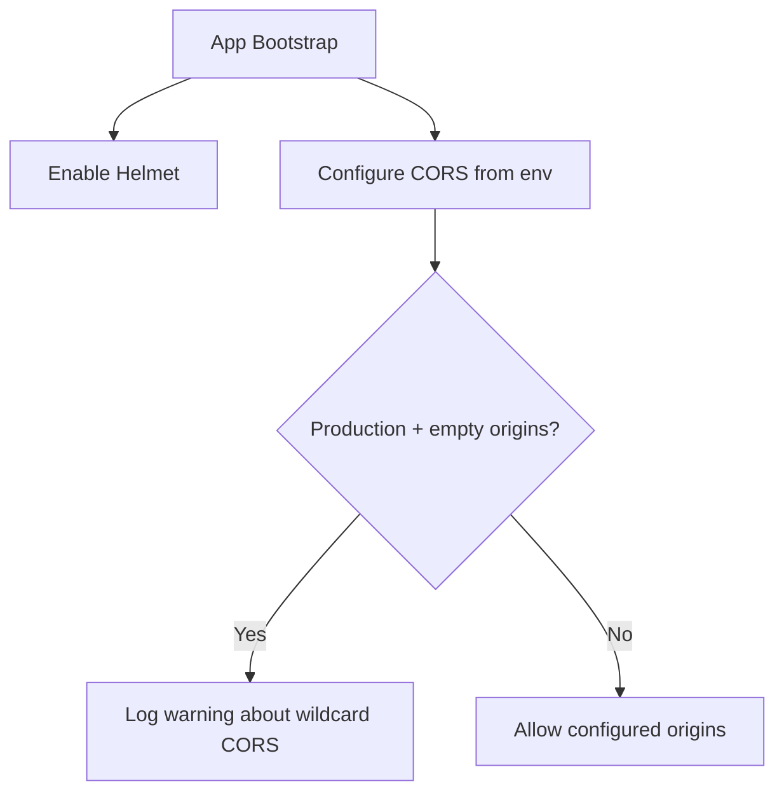

**Diagram sources**
- [main.ts:25-34](file://backend/src/main.ts#L25-L34)

**Section sources**
- [main.ts:25-34](file://backend/src/main.ts#L25-L34)

### Secure Token Management and Reset Flows
- Access tokens include minimal claims and a session ID; they are short-lived.
- Refresh tokens are opaque and rotated; reuse detection revokes all sessions for the user.
- Reset tokens are signed JWTs with a dedicated type and TTL; verified before allowing password changes.

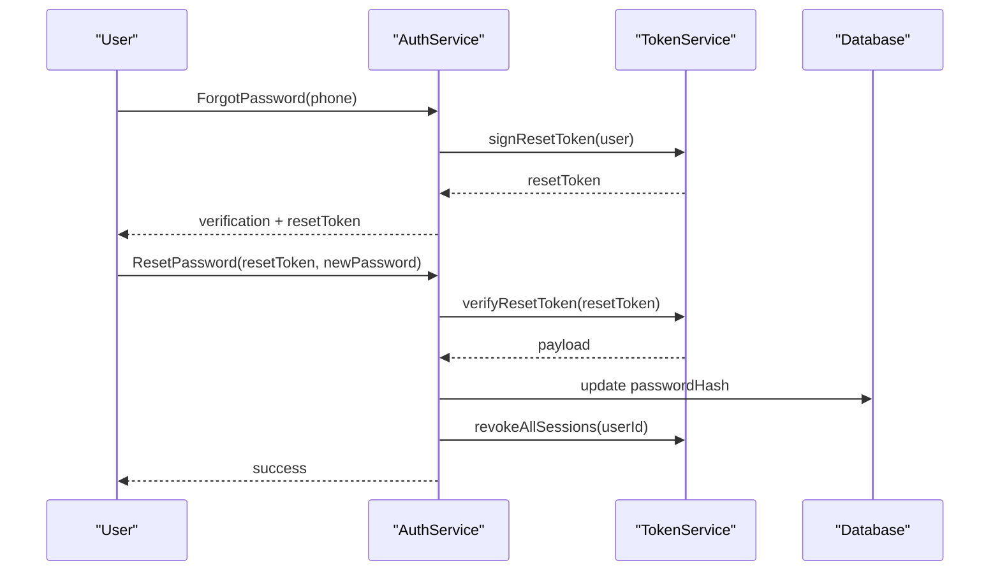

**Diagram sources**
- [auth.service.ts:357-396](file://backend/src/auth/auth.service.ts#L357-L396)
- [token.service.ts:168-183](file://backend/src/auth/token.service.ts#L168-L183)

**Section sources**
- [auth.service.ts:357-396](file://backend/src/auth/auth.service.ts#L357-L396)
- [token.service.ts:168-183](file://backend/src/auth/token.service.ts#L168-L183)

### Multi-Factor Authentication Considerations
- The current system provides OTP-based phone verification and login flows but does not implement full multi-factor authentication beyond OTP.
- To add MFA, consider binding a second factor (e.g., TOTP or SMS-based challenge) after initial OTP verification, storing factor metadata securely, and enforcing factor checks in the JWT strategy and guards.

[No sources needed since this section provides conceptual guidance]

### Secure Storage Practices and Data Encryption
- Passwords are hashed with Argon2id.
- Refresh tokens are stored as SHA-256 hashes.
- OTP codes are stored as hashes derived from phone, code, and JWT secret.
- Database schema includes sensitive fields such as password hashes, hashed refresh tokens, and hashed OTP codes.
- No explicit application-layer encryption for other fields is present; consider encrypting sensitive PII at rest if required by policy.

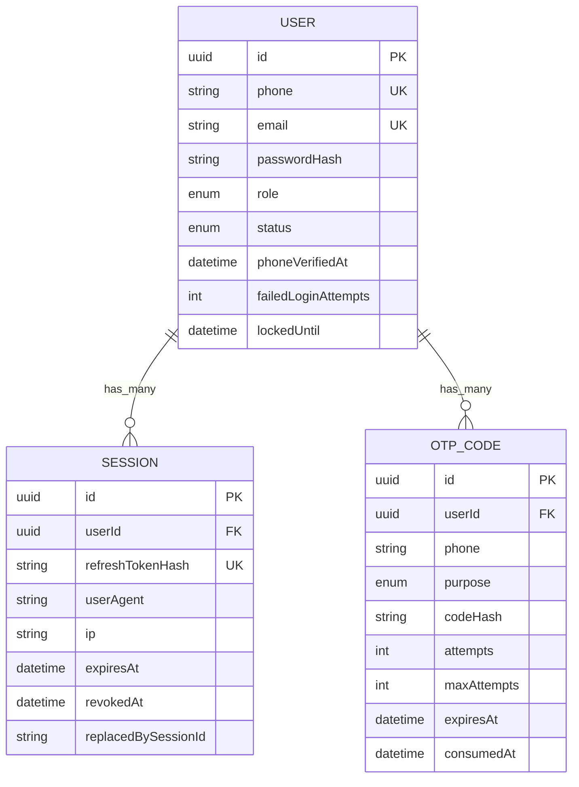

**Diagram sources**
- [schema.prisma:137-207](file://backend/prisma/schema.prisma#L137-L207)

**Section sources**
- [schema.prisma:137-207](file://backend/prisma/schema.prisma#L137-L207)

### Protection Against Common Vulnerabilities
- SQL Injection: Prisma parameterizes queries; no raw SQL is used in the analyzed files.
- XSS: Helmet is enabled; CSP is disabled by default. Ensure proper output encoding in frontends and configure CSP as needed.
- Brute Force: Account lockout after repeated failed logins; OTP resend cooldown and attempt limits.
- CSRF: Not applicable to JSON APIs behind bearer tokens; ensure cookies are not used for auth unless same-site and secure flags are set.
- Rate Limiting: OTP resend throttling; consider adding general API rate limiting.

**Section sources**
- [auth.service.ts:174-205](file://backend/src/auth/auth.service.ts#L174-L205)
- [otp.service.ts:48-60](file://backend/src/auth/otp.service.ts#L48-L60)
- [main.ts:25-34](file://backend/src/main.ts#L25-L34)

### Compliance and Security Standards Alignment
- OWASP Password Storage: Argon2id parameters align with recommendations.
- Token Lifecycle: Short-lived access tokens and rotating refresh tokens reduce exposure.
- Auditability: Audit logs capture actor, action, entity, IP, and user agent for key events.
- Secrets Management: Environment variables validated for minimum lengths and types.

**Section sources**
- [password.service.ts:4-24](file://backend/src/common/security/password.service.ts#L4-L24)
- [token.service.ts:27-197](file://backend/src/auth/token.service.ts#L27-L197)
- [env.validation.ts:3-44](file://backend/src/config/env.validation.ts#L3-L44)

## Dependency Analysis
Security components interact through well-defined services and guards:
- Controllers depend on AuthService for business logic.
- JwtStrategy depends on PrismaService to validate sessions.
- TokenService depends on JwtService and PrismaService for signing and persistence.
- OtpService depends on PrismaService and ConfigService for storage and configuration.
- PasswordService is stateless and used across auth flows.

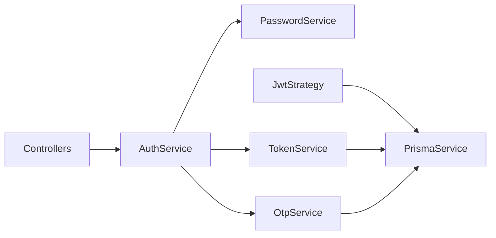

**Diagram sources**
- [auth.service.ts:40-48](file://backend/src/auth/auth.service.ts#L40-L48)
- [jwt.strategy.ts:10-20](file://backend/src/auth/strategies/jwt.strategy.ts#L10-L20)
- [token.service.ts:32-38](file://backend/src/auth/token.service.ts#L32-L38)
- [otp.service.ts:29-36](file://backend/src/auth/otp.service.ts#L29-L36)

**Section sources**
- [auth.service.ts:40-48](file://backend/src/auth/auth.service.ts#L40-L48)
- [jwt.strategy.ts:10-20](file://backend/src/auth/strategies/jwt.strategy.ts#L10-L20)
- [token.service.ts:32-38](file://backend/src/auth/token.service.ts#L32-L38)
- [otp.service.ts:29-36](file://backend/src/auth/otp.service.ts#L29-L36)

## Performance Considerations
- Argon2 hashing cost parameters balance security and latency; tune memoryCost, timeCost, and parallelism according to deployment capacity.
- JWT validation performs a database query per request to confirm session validity; consider caching user/session state if necessary while preserving revocation semantics.
- OTP verification is lightweight but includes database lookups; ensure indexes exist on phone, purpose, and createdAt columns.

[No sources needed since this section provides general guidance]

## Troubleshooting Guide
- Invalid or expired access token: Ensure the client sends a valid bearer token and that the session is active.
- Refresh token reuse detected: Indicates potential token theft; all sessions are revoked. Prompt the user to sign in again.
- OTP resend too frequent: Respect the resend cooldown returned by the server.
- Account locked due to failed logins: Wait until the lock period elapses or contact support.
- CORS warnings in production: Configure CORS_ORIGINS explicitly to avoid wildcard behavior.

**Section sources**
- [jwt.strategy.ts:26-73](file://backend/src/auth/strategies/jwt.strategy.ts#L26-L73)
- [token.service.ts:82-105](file://backend/src/auth/token.service.ts#L82-L105)
- [otp.service.ts:48-60](file://backend/src/auth/otp.service.ts#L48-L60)
- [auth.service.ts:174-205](file://backend/src/auth/auth.service.ts#L174-L205)
- [main.ts:27-34](file://backend/src/main.ts#L27-L34)

## Conclusion
FuelConnect implements a robust security foundation centered around JWT authentication, rotating refresh tokens, Argon2 password hashing, OTP-based phone verification, strict input validation, and role-based authorization. While core protections are solid, production hardening should include explicit HTTPS enforcement at the edge, refined CORS policies, comprehensive CSP configuration, and optional application-layer encryption for sensitive fields. Continuous threat modeling and vulnerability assessments will help maintain a strong security posture.

[No sources needed since this section summarizes without analyzing specific files]

## Appendices

### Configuration Reference
- JWT secret length and TTLs are validated.
- OTP TTL, resend interval, and max attempts are configurable.
- CORS origins must be explicitly set in production.

**Section sources**
- [configuration.ts:48-68](file://backend/src/config/configuration.ts#L48-L68)
- [env.validation.ts:3-44](file://backend/src/config/env.validation.ts#L3-L44)