# Backend Architecture

<cite>
**Referenced Files in This Document**
- [main.ts](file://backend/src/main.ts)
- [app.module.ts](file://backend/src/app.module.ts)
- [configuration.ts](file://backend/src/config/configuration.ts)
- [env.validation.ts](file://backend/src/config/env.validation.ts)
- [common.module.ts](file://backend/src/common/common.module.ts)
- [prisma.module.ts](file://backend/src/prisma/prisma.module.ts)
- [prisma.service.ts](file://backend/src/prisma/prisma.service.ts)
- [redis.module.ts](file://backend/src/redis/redis.module.ts)
- [auth.module.ts](file://backend/src/auth/auth.module.ts)
- [orders.module.ts](file://backend/src/orders/orders.module.ts)
- [all-exceptions.filter.ts](file://backend/src/common/filters/all-exceptions.filter.ts)
- [jwt-auth.guard.ts](file://backend/src/common/guards/jwt-auth.guard.ts)
- [audit-log.interceptor.ts](file://backend/src/common/interceptors/audit-log.interceptor.ts)
- [package.json](file://backend/package.json)
</cite>

## Table of Contents
1. [Introduction](#introduction)
2. [Project Structure](#project-structure)
3. [Core Components](#core-components)
4. [Architecture Overview](#architecture-overview)
5. [Detailed Component Analysis](#detailed-component-analysis)
6. [Dependency Analysis](#dependency-analysis)
7. [Performance Considerations](#performance-considerations)
8. [Troubleshooting Guide](#troubleshooting-guide)
9. [Conclusion](#conclusion)
10. [Appendices](#appendices)

## Introduction
This document explains the NestJS backend architecture for FuelConnect. It covers the modular monolith design, dependency injection, module organization, bootstrap process, configuration management, service layer patterns, controller-service separation, DTO validation, error handling, middleware stack, and security patterns. It also provides guidance on extending the system with new modules while maintaining clean boundaries and performance.

## Project Structure
The backend follows a feature-based modular monolith:
- Domain modules encapsulate controllers, services, DTOs, and related providers (for example, auth, orders, payments, tracking).
- Cross-cutting concerns live under common (guards, filters, interceptors, utilities, decorators).
- Shared infrastructure is exposed via global modules (Prisma, Redis, Common utilities).
- Configuration is centralized and validated at startup.

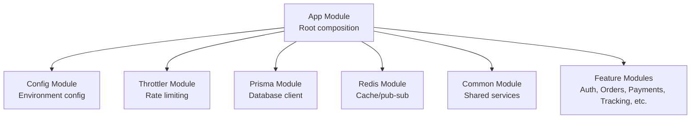

**Diagram sources**
- [app.module.ts:29-67](file://backend/src/app.module.ts#L29-L67)
- [configuration.ts:48-96](file://backend/src/config/configuration.ts#L48-L96)
- [prisma.module.ts:4-9](file://backend/src/prisma/prisma.module.ts#L4-L9)
- [redis.module.ts:4-9](file://backend/src/redis/redis.module.ts#L4-L9)
- [common.module.ts:5-10](file://backend/src/common/common.module.ts#L5-L10)

**Section sources**
- [app.module.ts:29-67](file://backend/src/app.module.ts#L29-L67)
- [package.json:25-49](file://backend/package.json#L25-L49)

## Core Components
- Application bootstrap: Initializes Express, applies security headers, CORS, global prefix, static assets, validation pipe, Swagger, shutdown hooks, and starts listening.
- Root module: Composes all feature modules, registers global guards, interceptors, and filters, and wires up configuration and rate limiting.
- Configuration: Strongly typed environment schema with defaults and validation rules.
- Global providers: Prisma database client, Redis client, and shared utilities are globally available to all modules.
- Security: JWT authentication guard, role-based guard, throttling guard, and exception filter.
- Audit logging: Interceptor records administrative mutations.

**Section sources**
- [main.ts:12-103](file://backend/src/main.ts#L12-L103)
- [app.module.ts:29-67](file://backend/src/app.module.ts#L29-L67)
- [configuration.ts:1-96](file://backend/src/config/configuration.ts#L1-L96)
- [env.validation.ts:3-44](file://backend/src/config/env.validation.ts#L3-L44)
- [prisma.module.ts:4-9](file://backend/src/prisma/prisma.module.ts#L4-L9)
- [redis.module.ts:4-9](file://backend/src/redis/redis.module.ts#L4-L9)
- [common.module.ts:5-10](file://backend/src/common/common.module.ts#L5-L10)

## Architecture Overview
The application uses a modular monolith where each domain is a NestJS module. Controllers handle HTTP requests, services implement business logic, and DTOs validate input. Global guards and interceptors enforce cross-cutting concerns like authentication, authorization, rate limiting, and audit logging.

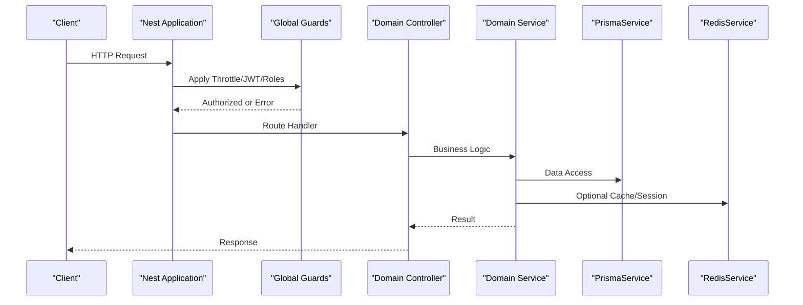

**Diagram sources**
- [main.ts:25-61](file://backend/src/main.ts#L25-L61)
- [app.module.ts:61-67](file://backend/src/app.module.ts#L61-L67)
- [prisma.service.ts:4-32](file://backend/src/prisma/prisma.service.ts#L4-L32)
- [redis.module.ts:4-9](file://backend/src/redis/redis.module.ts#L4-L9)

## Detailed Component Analysis

### Bootstrap Process and Middleware Stack
- Creates the NestExpressApplication with raw body enabled for payment webhooks.
- Applies Helmet for security headers.
- Configures CORS based on environment variables.
- Sets a global API prefix and serves a static dashboard.
- Registers a global ValidationPipe that whitelists fields, transforms payloads, and returns structured BadRequestException responses.
- Generates Swagger documentation and enables shutdown hooks.

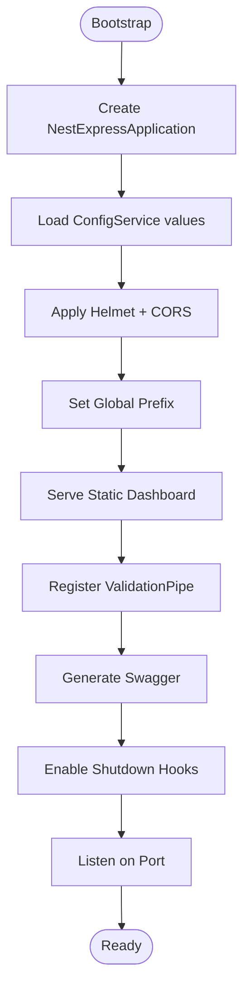

**Diagram sources**
- [main.ts:12-103](file://backend/src/main.ts#L12-L103)

**Section sources**
- [main.ts:12-103](file://backend/src/main.ts#L12-L103)

### Configuration Management
- Centralized configuration loader defines strongly typed AppConfig with nested sections for JWT, OTP, pricing, payments, and tracking.
- Environment variables are validated using Joi with defaults and constraints.
- The root module loads configuration globally and caches it.

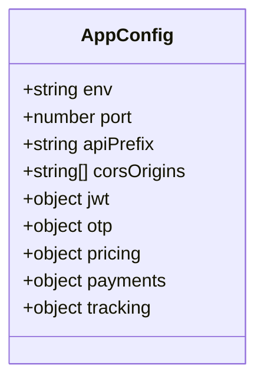

**Diagram sources**
- [configuration.ts:1-38](file://backend/src/config/configuration.ts#L1-L38)

**Section sources**
- [configuration.ts:48-96](file://backend/src/config/configuration.ts#L48-L96)
- [env.validation.ts:3-44](file://backend/src/config/env.validation.ts#L3-L44)
- [app.module.ts:31-37](file://backend/src/app.module.ts#L31-L37)

### Dependency Injection and Global Providers
- PrismaModule and RedisModule are marked global and export their services so any feature module can inject them without explicit imports.
- CommonModule exports shared services such as password hashing and geolocation utilities.

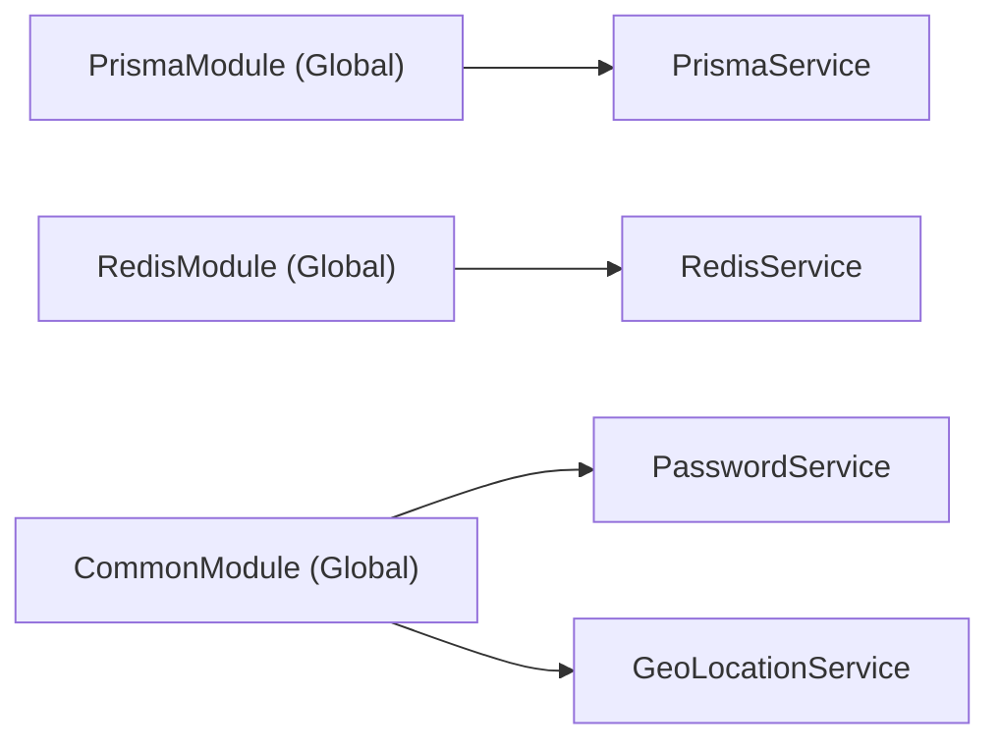

**Diagram sources**
- [prisma.module.ts:4-9](file://backend/src/prisma/prisma.module.ts#L4-L9)
- [redis.module.ts:4-9](file://backend/src/redis/redis.module.ts#L4-L9)
- [common.module.ts:5-10](file://backend/src/common/common.module.ts#L5-L10)

**Section sources**
- [prisma.module.ts:4-9](file://backend/src/prisma/prisma.module.ts#L4-L9)
- [redis.module.ts:4-9](file://backend/src/redis/redis.module.ts#L4-L9)
- [common.module.ts:5-10](file://backend/src/common/common.module.ts#L5-L10)

### Authentication and Authorization
- AuthModule configures Passport with a JWT strategy and exposes AuthService, OtpService, TokenService.
- JwtAuthGuard integrates with @nestjs/passport, respects public route decorators, and normalizes unauthorized errors.
- RolesGuard enforces role-based access control.
- ThrottlerGuard protects sensitive endpoints from abuse.

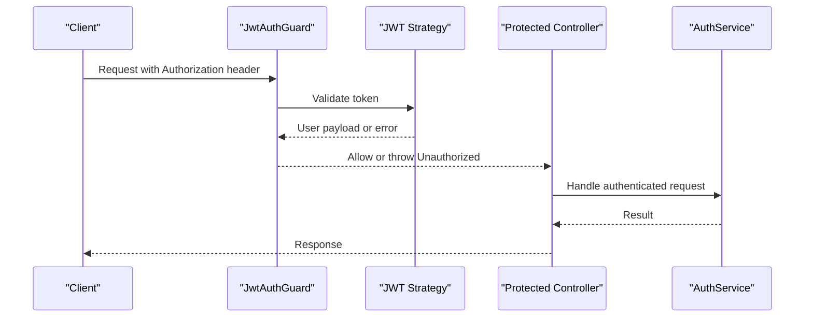

**Diagram sources**
- [auth.module.ts:11-24](file://backend/src/auth/auth.module.ts#L11-L24)
- [jwt-auth.guard.ts:11-34](file://backend/src/common/guards/jwt-auth.guard.ts#L11-L34)

**Section sources**
- [auth.module.ts:11-24](file://backend/src/auth/auth.module.ts#L11-L24)
- [jwt-auth.guard.ts:11-34](file://backend/src/common/guards/jwt-auth.guard.ts#L11-L34)

### Controller-Service Separation and DTO Validation
- Controllers are thin; they delegate business logic to services.
- DTOs define input contracts and are validated by the global ValidationPipe with whitelist and transform enabled.
- Errors are normalized into a consistent structure by the global exception filter.

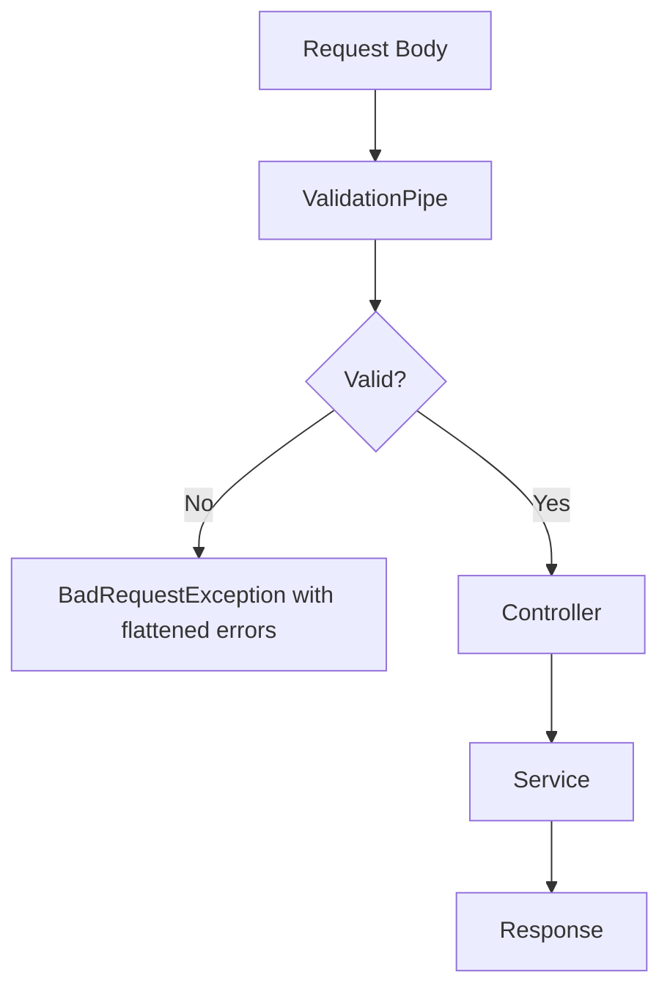

**Diagram sources**
- [main.ts:50-61](file://backend/src/main.ts#L50-L61)
- [all-exceptions.filter.ts:41-104](file://backend/src/common/filters/all-exceptions.filter.ts#L41-L104)

**Section sources**
- [main.ts:50-61](file://backend/src/main.ts#L50-L61)
- [all-exceptions.filter.ts:41-104](file://backend/src/common/filters/all-exceptions.filter.ts#L41-L104)

### Error Handling Strategy
- AllExceptionsFilter centralizes error responses, maps Prisma-specific errors to user-friendly messages, and logs appropriately.
- ValidationPipe produces structured BadRequestException responses with flattened field errors.

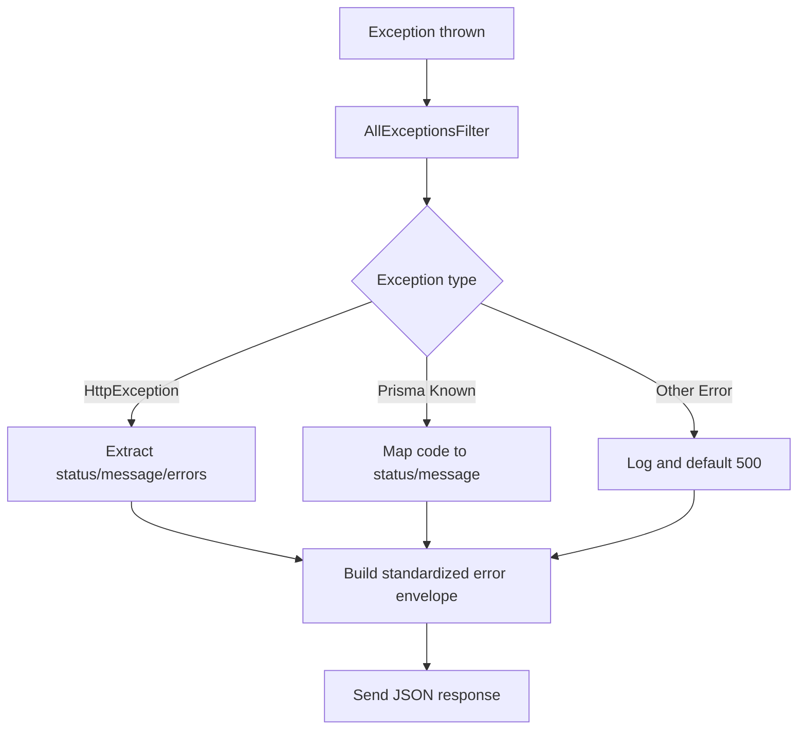

**Diagram sources**
- [all-exceptions.filter.ts:41-125](file://backend/src/common/filters/all-exceptions.filter.ts#L41-L125)
- [main.ts:50-61](file://backend/src/main.ts#L50-L61)

**Section sources**
- [all-exceptions.filter.ts:41-125](file://backend/src/common/filters/all-exceptions.filter.ts#L41-L125)

### Audit Logging
- AuditLogInterceptor records successful administrative mutations (POST/PUT/PATCH/DELETE) for specific roles, excluding auth routes.
- It is fire-and-forget so failures do not impact the response.

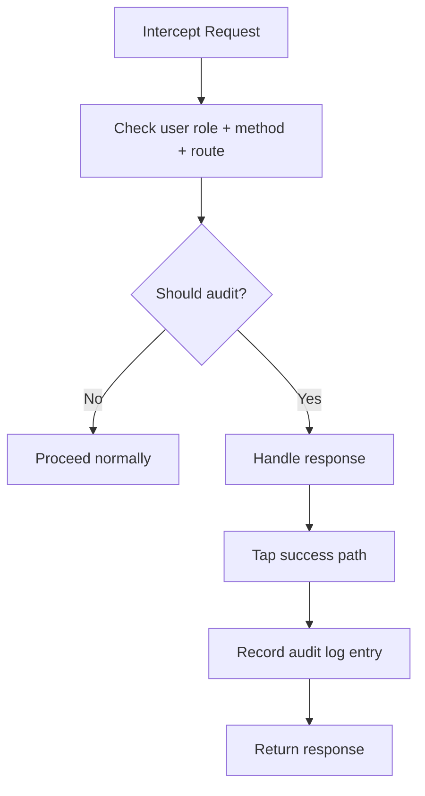

**Diagram sources**
- [audit-log.interceptor.ts:24-63](file://backend/src/common/interceptors/audit-log.interceptor.ts#L24-L63)

**Section sources**
- [audit-log.interceptor.ts:24-63](file://backend/src/common/interceptors/audit-log.interceptor.ts#L24-L63)

### Module Composition and Cross-Module Dependencies
- AppModule composes feature modules and registers global guards, interceptors, and filters.
- Feature modules import only what they need. For example, OrdersModule depends on TrackingModule and WalletsModule.

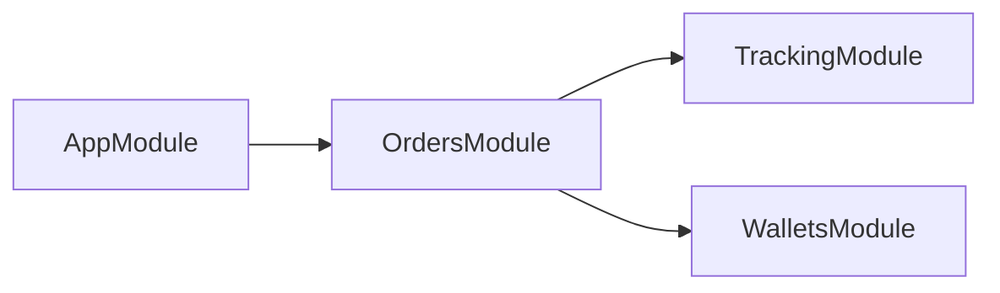

**Diagram sources**
- [app.module.ts:29-67](file://backend/src/app.module.ts#L29-L67)
- [orders.module.ts:8-14](file://backend/src/orders/orders.module.ts#L8-L14)

**Section sources**
- [app.module.ts:29-67](file://backend/src/app.module.ts#L29-L67)
- [orders.module.ts:8-14](file://backend/src/orders/orders.module.ts#L8-L14)

### Database and Persistence Layer
- PrismaService extends PrismaClient, connects on module init, disconnects on destroy, and forwards warnings/errors to the logger.
- It supports graceful shutdown integration.

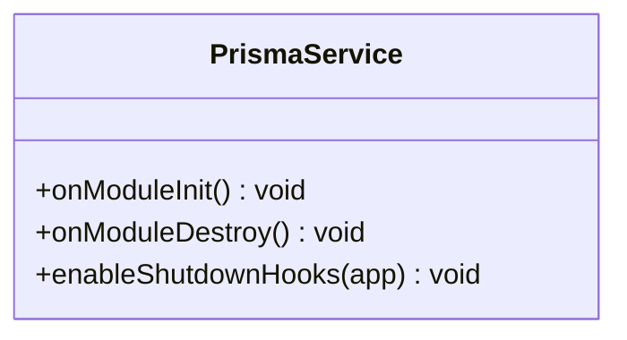

**Diagram sources**
- [prisma.service.ts:4-32](file://backend/src/prisma/prisma.service.ts#L4-L32)

**Section sources**
- [prisma.service.ts:4-32](file://backend/src/prisma/prisma.service.ts#L4-L32)

## Dependency Analysis
High-level dependencies between core components:

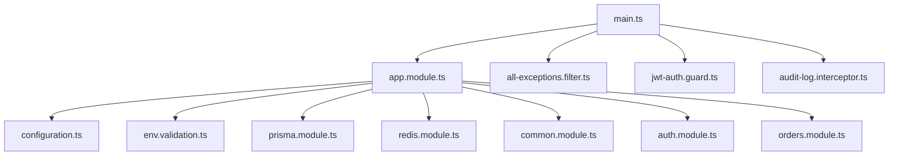

**Diagram sources**
- [main.ts:1-10](file://backend/src/main.ts#L1-L10)
- [app.module.ts:29-67](file://backend/src/app.module.ts#L29-L67)
- [configuration.ts:48-96](file://backend/src/config/configuration.ts#L48-L96)
- [env.validation.ts:3-44](file://backend/src/config/env.validation.ts#L3-L44)
- [prisma.module.ts:4-9](file://backend/src/prisma/prisma.module.ts#L4-L9)
- [redis.module.ts:4-9](file://backend/src/redis/redis.module.ts#L4-L9)
- [common.module.ts:5-10](file://backend/src/common/common.module.ts#L5-L10)
- [auth.module.ts:11-24](file://backend/src/auth/auth.module.ts#L11-L24)
- [orders.module.ts:8-14](file://backend/src/orders/orders.module.ts#L8-L14)
- [all-exceptions.filter.ts:41-104](file://backend/src/common/filters/all-exceptions.filter.ts#L41-L104)
- [jwt-auth.guard.ts:11-34](file://backend/src/common/guards/jwt-auth.guard.ts#L11-L34)
- [audit-log.interceptor.ts:24-63](file://backend/src/common/interceptors/audit-log.interceptor.ts#L24-L63)

**Section sources**
- [app.module.ts:29-67](file://backend/src/app.module.ts#L29-L67)
- [main.ts:1-10](file://backend/src/main.ts#L1-L10)

## Performance Considerations
- Rate Limiting: ThrottlerGuard is registered globally with a baseline limit; sensitive routes can be further restricted with route-level decorators.
- Connection Lifecycle: PrismaService connects/disconnects cleanly and forwards events to the logger.
- Payload Validation: Whitelist mode prevents unknown fields and reduces unnecessary processing.
- Static Assets: Dashboard is served directly from disk without build steps.
- Observability: Structured error envelopes and audit logs improve debugging and monitoring.

[No sources needed since this section provides general guidance]

## Troubleshooting Guide
- Validation Errors: Use the global ValidationPipe output format; errors are flattened and returned as a BadRequestException with a message array.
- Authentication Failures: JwtAuthGuard throws UnauthorizedException when tokens are invalid or missing.
- Database Errors: AllExceptionsFilter maps known Prisma error codes to user-friendly messages and status codes.
- Audit Logs: If audit entries are missing, verify the user role, HTTP method, and route exclusions handled by AuditLogInterceptor.

**Section sources**
- [main.ts:50-61](file://backend/src/main.ts#L50-L61)
- [jwt-auth.guard.ts:26-33](file://backend/src/common/guards/jwt-auth.guard.ts#L26-L33)
- [all-exceptions.filter.ts:74-124](file://backend/src/common/filters/all-exceptions.filter.ts#L74-L124)
- [audit-log.interceptor.ts:40-59](file://backend/src/common/interceptors/audit-log.interceptor.ts#L40-L59)

## Conclusion
The backend implements a clear modular monolith with strong separation of concerns: controllers orchestrate requests, services encapsulate business logic, and DTOs ensure data integrity. Global guards, interceptors, and filters provide consistent security, validation, and observability. Configuration is centralized and validated, and infrastructure services are globally available. This design scales well as new features are added as independent modules with explicit dependencies.

[No sources needed since this section summarizes without analyzing specific files]

## Appendices

### Extending the Architecture with New Modules
- Create a feature folder with controller, service, DTOs, and module file.
- Register the module in AppModule imports.
- Inject global services (PrismaService, RedisService, shared utilities) directly if needed.
- Expose only necessary services through module exports to maintain encapsulation.
- Add route-level guards or throttles for sensitive operations.
- Ensure DTOs align with ValidationPipe expectations (whitelist and transform).

**Section sources**
- [app.module.ts:29-67](file://backend/src/app.module.ts#L29-L67)
- [orders.module.ts:8-14](file://backend/src/orders/orders.module.ts#L8-L14)