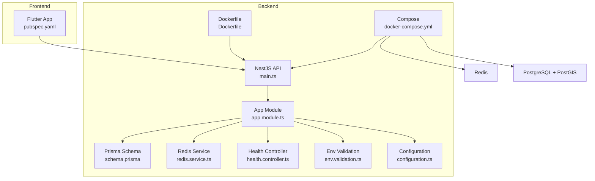
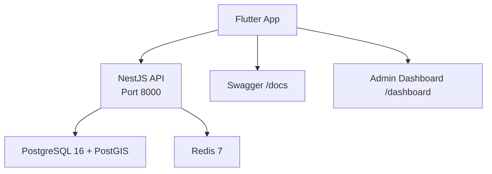
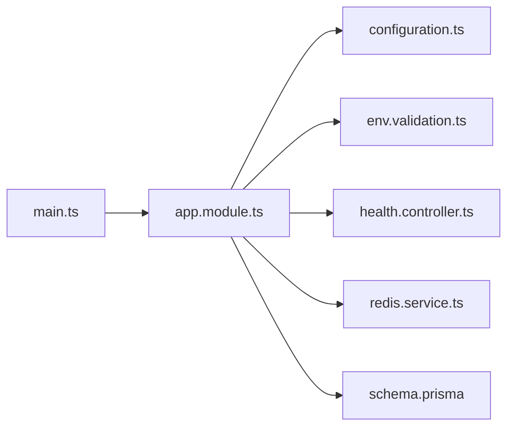
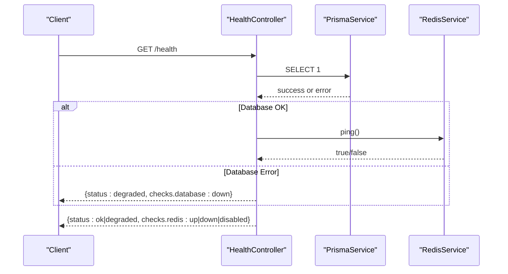

# Deployment Architecture

<cite>
**Referenced Files in This Document**
- [README.md](file://README.md)
- [backend/Dockerfile](file://backend/Dockerfile)
- [backend/docker-compose.yml](file://backend/docker-compose.yml)
- [backend/package.json](file://backend/package.json)
- [backend/src/main.ts](file://backend/src/main.ts)
- [backend/src/app.module.ts](file://backend/src/app.module.ts)
- [backend/src/config/configuration.ts](file://backend/src/config/configuration.ts)
- [backend/src/config/env.validation.ts](file://backend/src/config/env.validation.ts)
- [backend/src/health/health.controller.ts](file://backend/src/health/health.controller.ts)
- [backend/src/redis/redis.service.ts](file://backend/src/redis/redis.service.ts)
- [backend/prisma/schema.prisma](file://backend/prisma/schema.prisma)
- [flutter_app/pubspec.yaml](file://flutter_app/pubspec.yaml)
</cite>

## Table of Contents
1. [Introduction](#introduction)
2. [Project Structure](#project-structure)
3. [Core Components](#core-components)
4. [Architecture Overview](#architecture-overview)
5. [Detailed Component Analysis](#detailed-component-analysis)
6. [Dependency Analysis](#dependency-analysis)
7. [Performance Considerations](#performance-considerations)
8. [Troubleshooting Guide](#troubleshooting-guide)
9. [Conclusion](#conclusion)
10. [Appendices](#appendices)

## Introduction
This document explains the deployment architecture and infrastructure for FuelConnect, a full-stack application with a NestJS backend and a Flutter frontend. The backend provides REST APIs, Swagger documentation, Socket.IO real-time tracking, PostgreSQL with PostGIS for geospatial data, Redis for caching and scaling, and an embedded admin dashboard. The Flutter app is a mobile/web prototype that currently uses mocked data but is designed to connect to the same API contract.

The repository includes Docker artifacts for local development and production-ready containerization, environment validation, health checks, and configuration management.

**Section sources**
- [README.md:1-18](file://README.md#L1-L18)

## Project Structure
At a high level:
- `backend/` contains the NestJS API, Prisma schema, Dockerfile, docker-compose, and runtime configuration.
- `flutter_app/` contains the Flutter project definition and assets.

**Diagram sources**
- [backend/src/main.ts:1-110](file://backend/src/main.ts#L1-L110)
- [backend/src/app.module.ts:1-70](file://backend/src/app.module.ts#L1-L70)
- [backend/src/config/configuration.ts:1-97](file://backend/src/config/configuration.ts#L1-L97)
- [backend/src/config/env.validation.ts:1-45](file://backend/src/config/env.validation.ts#L1-L45)
- [backend/src/health/health.controller.ts:1-42](file://backend/src/health/health.controller.ts#L1-L42)
- [backend/src/redis/redis.service.ts:1-133](file://backend/src/redis/redis.service.ts#L1-L133)
- [backend/prisma/schema.prisma:1-14](file://backend/prisma/schema.prisma#L1-L14)
- [backend/Dockerfile:1-30](file://backend/Dockerfile#L1-L30)
- [backend/docker-compose.yml:1-54](file://backend/docker-compose.yml#L1-L54)
- [flutter_app/pubspec.yaml:1-29](file://flutter_app/pubspec.yaml#L1-L29)

**Section sources**
- [README.md:1-18](file://README.md#L1-L18)
- [backend/Dockerfile:1-30](file://backend/Dockerfile#L1-L30)
- [backend/docker-compose.yml:1-54](file://backend/docker-compose.yml#L1-L54)
- [flutter_app/pubspec.yaml:1-29](file://flutter_app/pubspec.yaml#L1-L29)

## Core Components
- Backend runtime: Node.js 22 Alpine image, compiled NestJS application exposing port 8000.
- Database: PostgreSQL 16 with PostGIS extension enabled via Prisma.
- Cache: Redis 7 with append-only persistence.
- Orchestration: docker-compose defines db, redis, and api services with health checks and dependency ordering.
- Configuration: Centralized config loader with Joi-based environment validation.
- Health endpoint: Liveness/readiness-style check covering database and Redis status.
- Frontend: Flutter app defined by pubspec; currently uses mocked data but targets the same API contract.

Key operational characteristics:
- Global prefix `/api/v1`.
- Swagger UI at `/docs`.
- Embedded admin dashboard served from `/dashboard`.
- CORS configured via environment variable list.
- Helmet security headers applied (with specific policies disabled for compatibility).
- Throttling guard enabled globally.

**Section sources**
- [backend/Dockerfile:1-30](file://backend/Dockerfile#L1-L30)
- [backend/docker-compose.yml:1-54](file://backend/docker-compose.yml#L1-L54)
- [backend/src/main.ts:1-110](file://backend/src/main.ts#L1-L110)
- [backend/src/app.module.ts:1-70](file://backend/src/app.module.ts#L1-L70)
- [backend/src/config/configuration.ts:1-97](file://backend/src/config/configuration.ts#L1-L97)
- [backend/src/config/env.validation.ts:1-45](file://backend/src/config/env.validation.ts#L1-L45)
- [backend/src/health/health.controller.ts:1-42](file://backend/src/health/health.controller.ts#L1-L42)
- [backend/prisma/schema.prisma:1-14](file://backend/prisma/schema.prisma#L1-L14)
- [flutter_app/pubspec.yaml:1-29](file://flutter_app/pubspec.yaml#L1-L29)

## Architecture Overview
The system consists of:
- A single NestJS API process inside a container.
- A PostgreSQL container running PostGIS.
- A Redis container used for caching, rate-limiting signals across replicas, and Socket.IO fan-out.
- A Flutter client connecting to the API over HTTP/WebSocket.

**Diagram sources**
- [backend/src/main.ts:63-101](file://backend/src/main.ts#L63-L101)
- [backend/docker-compose.yml:1-54](file://backend/docker-compose.yml#L1-L54)

## Detailed Component Analysis

### Containerization Strategy
- Multi-stage build:
  - Builder stage installs dependencies and compiles TypeScript to JavaScript under `/app/dist`.
  - Runner stage installs production dependencies only and serves the compiled output.
- Security and runtime:
  - Uses `node:22-alpine` base images.
  - Exposes port 8000.
  - Sets `NODE_ENV=production`.
- Static assets:
  - Copies `public/dashboard` into the runtime image for the embedded admin console.

Operational implications:
- Smaller attack surface in production due to dev dependencies excluded.
- Deterministic builds via lockfiles and explicit dependency copies.

**Section sources**
- [backend/Dockerfile:1-30](file://backend/Dockerfile#L1-L30)

### Multi-Container Orchestration with docker-compose
Services:
- `db`: PostgreSQL 16 with PostGIS, persistent volume, healthcheck using `pg_isready`.
- `redis`: Redis 7 with append-only mode, persistent volume, healthcheck using `redis-cli ping`.
- `api`: Builds from the backend directory, depends on healthy db and redis, exposes port 8000, reads `.env` file and overrides some environment variables for service discovery.

Startup order:
- API waits for both db and redis to be healthy before starting.

Networking:
- Services communicate via internal Docker network using hostnames `db` and `redis`.

Persistence:
- Named volumes for database and Redis data ensure durability across restarts.

**Section sources**
- [backend/docker-compose.yml:1-54](file://backend/docker-compose.yml#L1-L54)

### Environment Configuration Management
Configuration loading:
- Centralized configuration function maps environment variables to typed settings.
- Defaults are provided for most values; required secrets must be supplied.

Validation:
- Joi schema enforces types, ranges, and presence of critical variables such as `DATABASE_URL`, `JWT_SECRET`, and `PAYMENT_WEBHOOK_SECRET`.

Key configuration areas:
- Application: env, port, API prefix, CORS origins.
- Authentication: JWT secret and token TTLs.
- OTP policy: TTL, resend interval, max attempts, dev mode.
- Pricing and dispatch rules: fees, free kilometers, commission, radius, assignment timeout.
- Payments: webhook secret, sandbox flag, provider credentials.
- Tracking: minimum interval and history retention.

Runtime behavior:
- If `CORS_ORIGINS` is empty in production, a warning is logged and all origins are allowed.
- Raw body parsing is enabled for payment webhooks to verify HMAC signatures.

**Section sources**
- [backend/src/config/configuration.ts:1-97](file://backend/src/config/configuration.ts#L1-L97)
- [backend/src/config/env.validation.ts:1-45](file://backend/src/config/env.validation.ts#L1-L45)
- [backend/src/main.ts:15-34](file://backend/src/main.ts#L15-L34)

### Database Setup with PostgreSQL and PostGIS
- Provider: PostgreSQL 16 with PostGIS extension enabled through Prisma.
- Connection: Configured via `DATABASE_URL`.
- Data model: Comprehensive schema including users, customers, riders, stations, orders, payments, wallets, transactions, support tickets, audit logs, and geospatial columns using PostGIS geography types.

Operational notes:
- Use Prisma commands to generate client, push schema, migrate, seed, and open Studio.
- Seed script is available for initial data population.

**Section sources**
- [backend/prisma/schema.prisma:1-14](file://backend/prisma/schema.prisma#L1-L14)
- [backend/prisma/schema.prisma:137-731](file://backend/prisma/schema.prisma#L137-L731)
- [backend/package.json:14-20](file://backend/package.json#L14-L20)

### Redis Caching Layer
Purpose:
- Store latest rider positions for live map updates.
- Shared rate limiting signals across multiple API instances.
- Socket.IO adapter for cross-instance event fan-out.

Behavior:
- Optional: if `REDIS_URL` is missing or connection fails, falls back to in-process memory cache.
- Graceful degradation: operations log warnings and continue without Redis when unavailable.
- Provides methods for JSON set/get/delete/exists/ping.

Integration points:
- Health controller pings Redis to report its status.
- Socket.IO can use Redis adapter for multi-instance scaling.

**Section sources**
- [backend/src/redis/redis.service.ts:1-133](file://backend/src/redis/redis.service.ts#L1-L133)
- [backend/src/health/health.controller.ts:1-42](file://backend/src/health/health.controller.ts#L1-L42)

### External Service Integrations
- Payment providers: MTN Mobile Money and Airtel Money credentials are configurable via environment variables.
- Webhook verification: raw request bodies are preserved to validate provider signatures.
- Real-time tracking: Socket.IO namespace `/tracking` supports live location updates.

Security considerations:
- Ensure webhook secrets are strong and not committed.
- Validate provider payloads and enforce idempotency where applicable.

**Section sources**
- [backend/src/config/configuration.ts:78-91](file://backend/src/config/configuration.ts#L78-L91)
- [backend/src/main.ts:15-17](file://backend/src/main.ts#L15-L17)
- [backend/src/main.ts:63-88](file://backend/src/main.ts#L63-L88)

### CI/CD Pipeline Considerations
Recommended pipeline stages:
- Install dependencies (`npm ci`).
- Type checking (`tsc --noEmit`).
- Build backend (`nest build`).
- Generate Prisma client (`prisma generate`).
- Run tests (if added).
- Build Docker image using the existing Dockerfile.
- Push image to registry.
- Deploy to target environment (Kubernetes, ECS, or VMs).

Frontend:
- Flutter build steps should be added to the pipeline to produce web/mobile artifacts as needed.

Environment injection:
- Inject secrets via CI/CD secret managers into environment files or container runtime.

**Section sources**
- [backend/package.json:7-20](file://backend/package.json#L7-L20)
- [backend/Dockerfile:1-30](file://backend/Dockerfile#L1-L30)
- [flutter_app/pubspec.yaml:1-29](file://flutter_app/pubspec.yaml#L1-L29)

### Production Deployment Strategies
- Single-node deployment:
  - Run docker-compose for development or simple staging.
- Multi-instance deployment:
  - Scale API replicas behind a load balancer.
  - Ensure Redis is reachable from all instances for shared state and Socket.IO fan-out.
  - Use external PostgreSQL (managed service) with backups and failover.
- Reverse proxy:
  - Place Nginx/Traefik/Apache in front of the API to handle TLS termination and routing.
- Static assets:
  - Serve the embedded dashboard via the API or separate CDN if desired.

**Section sources**
- [backend/docker-compose.yml:35-49](file://backend/docker-compose.yml#L35-L49)
- [backend/src/redis/redis.service.ts:10-18](file://backend/src/redis/redis.service.ts#L10-L18)

### Health Check Configurations
- Application-level health endpoint:
  - Returns overall status, uptime, version, and dependency checks for database and Redis.
- Container-level healthchecks:
  - PostgreSQL readiness via `pg_isready`.
  - Redis readiness via `redis-cli ping`.

Monitoring integration:
- Expose `/health` to orchestrators and monitoring systems.
- Log startup messages including environment and endpoints.

**Section sources**
- [backend/src/health/health.controller.ts:1-42](file://backend/src/health/health.controller.ts#L1-L42)
- [backend/docker-compose.yml:14-18](file://backend/docker-compose.yml#L14-L18)
- [backend/docker-compose.yml:29-33](file://backend/docker-compose.yml#L29-L33)
- [backend/src/main.ts:95-102](file://backend/src/main.ts#L95-L102)

### Monitoring Setup
Recommendations:
- Collect structured logs from the API process.
- Track metrics: request latency, error rates, throughput, Redis hit ratio, DB query latency.
- Alert on health endpoint failures and dependency down states.
- Integrate with centralized logging and tracing tools.

[No sources needed since this section provides general guidance]

### Scaling Considerations and Load Balancing
- Horizontal scaling:
  - Multiple API replicas share state via Redis.
  - Ensure sticky sessions are not required unless explicitly needed.
- Rate limiting:
  - Global throttler guard protects against abuse; sensitive routes can tighten limits.
- Database scaling:
  - Use read replicas for heavy read workloads if necessary.
- Caching strategy:
  - Keep hot data (e.g., rider locations) in Redis with short TTLs.

**Section sources**
- [backend/src/app.module.ts:38-40](file://backend/src/app.module.ts#L38-L40)
- [backend/src/redis/redis.service.ts:10-18](file://backend/src/redis/redis.service.ts#L10-L18)

### Disaster Recovery Planning
- Database:
  - Enable automated backups and point-in-time recovery for PostgreSQL.
  - Test restore procedures regularly.
- Redis:
  - Use append-only file persistence and consider snapshots for durability.
  - Plan for Redis cluster or managed service upgrades.
- Secrets:
  - Rotate JWT secrets, payment webhook secrets, and provider credentials securely.
- Rollbacks:
  - Maintain previous container images and database migration versions for quick rollback.

[No sources needed since this section provides general guidance]

## Dependency Analysis
High-level runtime dependencies:
- NestJS framework and modules.
- Prisma client connected to PostgreSQL with PostGIS.
- Redis client for caching and scaling features.
- Socket.IO for real-time communication.
- Helmet for security headers.
- Joi for environment validation.

**Diagram sources**
- [backend/src/main.ts:1-110](file://backend/src/main.ts#L1-L110)
- [backend/src/app.module.ts:1-70](file://backend/src/app.module.ts#L1-L70)
- [backend/src/config/configuration.ts:1-97](file://backend/src/config/configuration.ts#L1-L97)
- [backend/src/config/env.validation.ts:1-45](file://backend/src/config/env.validation.ts#L1-L45)
- [backend/src/health/health.controller.ts:1-42](file://backend/src/health/health.controller.ts#L1-L42)
- [backend/src/redis/redis.service.ts:1-133](file://backend/src/redis/redis.service.ts#L1-L133)
- [backend/prisma/schema.prisma:1-14](file://backend/prisma/schema.prisma#L1-L14)

**Section sources**
- [backend/package.json:25-48](file://backend/package.json#L25-L48)

## Performance Considerations
- Use production build artifacts and exclude dev dependencies.
- Tune Redis TTLs for hot paths like rider locations.
- Configure appropriate throttling limits per route sensitivity.
- Optimize database queries and leverage indexes defined in the schema.
- Enable compression at the reverse proxy layer.
- Monitor and right-size container CPU/memory requests and limits.

[No sources needed since this section provides general guidance]

## Troubleshooting Guide
Common issues and resolutions:
- Database connectivity:
  - Verify `DATABASE_URL` and PostgreSQL container health.
  - Confirm PostGIS extension is enabled.
- Redis connectivity:
  - Check `REDIS_URL` and Redis container health.
  - If Redis is down, the service falls back to in-memory cache; note that this disables cross-instance features.
- CORS errors:
  - Set `CORS_ORIGINS` appropriately; empty list in production triggers a warning and allows all origins.
- Validation errors:
  - Inspect global validation pipe responses for field-level errors.
- Health endpoint:
  - Use `/health` to diagnose dependency status and overall application health.

**Section sources**
- [backend/docker-compose.yml:14-18](file://backend/docker-compose.yml#L14-L18)
- [backend/docker-compose.yml:29-33](file://backend/docker-compose.yml#L29-L33)
- [backend/src/main.ts:25-34](file://backend/src/main.ts#L25-L34)
- [backend/src/main.ts:50-61](file://backend/src/main.ts#L50-L61)
- [backend/src/health/health.controller.ts:1-42](file://backend/src/health/health.controller.ts#L1-L42)
- [backend/src/redis/redis.service.ts:28-51](file://backend/src/redis/redis.service.ts#L28-L51)

## Conclusion
FuelConnect’s deployment architecture centers on a containerized NestJS API backed by PostgreSQL with PostGIS and Redis. The docker-compose setup simplifies local development while providing a clear path to production scaling. Robust environment validation, health checks, and graceful fallbacks improve reliability. For production, adopt managed services for databases and caches, implement proper secrets management, and integrate monitoring and alerting.

[No sources needed since this section summarizes without analyzing specific files]

## Appendices

### Step-by-Step Deployment Instructions

Local development with Docker Compose:
1. Start services: `docker compose up -d`
2. Wait for db and redis to become healthy.
3. Initialize database and seed data: run Prisma commands as documented in package scripts.
4. Access Swagger UI at `/docs` and admin dashboard at `/dashboard`.

Production deployment:
1. Build the backend image using the provided Dockerfile.
2. Push the image to your container registry.
3. Provision managed PostgreSQL with PostGIS and Redis.
4. Configure environment variables for secrets and service URLs.
5. Deploy API containers behind a reverse proxy with TLS termination.
6. Configure health probes and autoscaling based on metrics.

**Section sources**
- [backend/docker-compose.yml:1-54](file://backend/docker-compose.yml#L1-L54)
- [backend/package.json:7-20](file://backend/package.json#L7-L20)
- [backend/Dockerfile:1-30](file://backend/Dockerfile#L1-L30)

### Environment Variables Reference

Application:
- `NODE_ENV`: development, test, production
- `PORT`: listening port
- `API_PREFIX`: global API prefix
- `CORS_ORIGINS`: comma-separated allowed origins

Database:
- `DATABASE_URL`: PostgreSQL connection string

Cache:
- `REDIS_URL`: Redis connection URL

Authentication:
- `JWT_SECRET`: minimum length enforced
- `JWT_ACCESS_TTL`: access token lifetime in seconds
- `REFRESH_TOKEN_TTL_DAYS`: refresh token lifetime in days
- `RESET_TOKEN_TTL`: password reset token lifetime in seconds

OTP Policy:
- `OTP_TTL_SECONDS`: OTP validity period
- `OTP_RESEND_SECONDS`: minimum resend interval
- `OTP_MAX_ATTEMPTS`: maximum attempts per OTP
- `OTP_DEV_MODE`: enable development mode

Pricing and Dispatch:
- `DELIVERY_BASE_FEE`
- `DELIVERY_PER_KM_FEE`
- `DELIVERY_FREE_KM`
- `SERVICE_FEE`
- `RIDER_COMMISSION_PERCENT`
- `DISPATCH_RADIUS_KM`
- `ASSIGNMENT_TIMEOUT_SECONDS`

Payments:
- `PAYMENT_WEBHOOK_SECRET`
- `PAYMENTS_SANDBOX`
- `MTN_MOMO_API_KEY`, `MTN_MOMO_USER_ID`, `MTN_MOMO_SUBSCRIPTION_KEY`
- `AIRTEL_MONEY_CLIENT_ID`, `AIRTEL_MONEY_CLIENT_SECRET`, `AIRTEL_MONEY_MERCHANT_CODE`

Tracking:
- `TRACKING_MIN_INTERVAL_MS`
- `TRACKING_HISTORY_RETENTION_DAYS`

**Section sources**
- [backend/src/config/env.validation.ts:1-45](file://backend/src/config/env.validation.ts#L1-L45)
- [backend/src/config/configuration.ts:1-97](file://backend/src/config/configuration.ts#L1-L97)

### Health Check Flow

**Diagram sources**
- [backend/src/health/health.controller.ts:1-42](file://backend/src/health/health.controller.ts#L1-L42)
- [backend/src/redis/redis.service.ts:124-131](file://backend/src/redis/redis.service.ts#L124-L131)