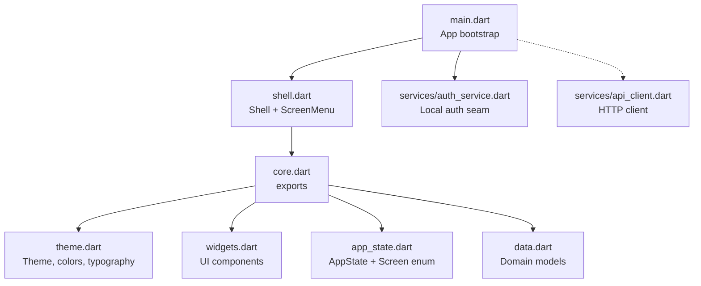
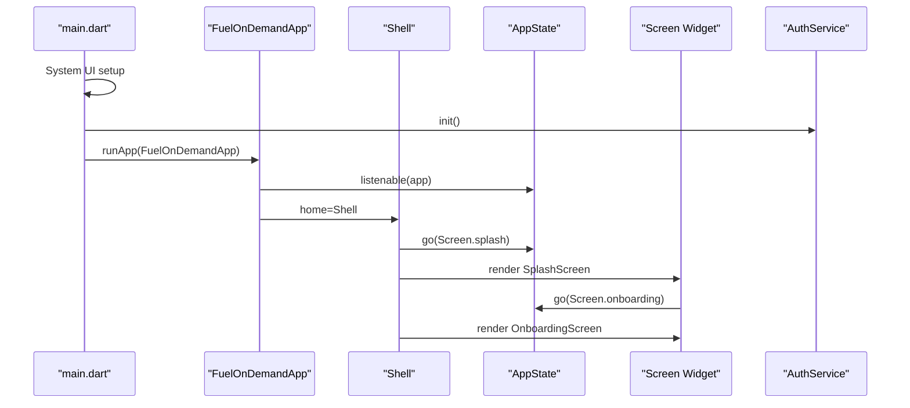
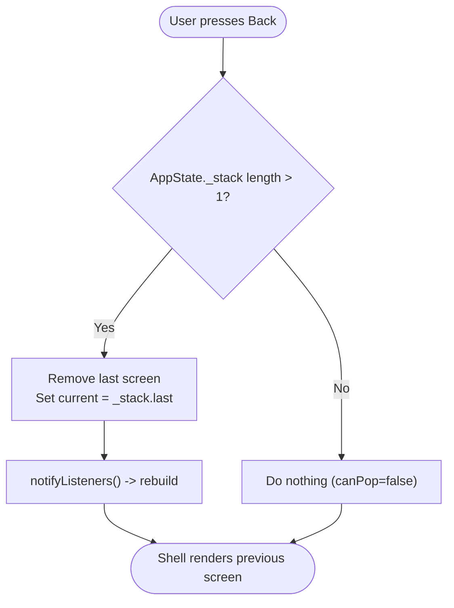
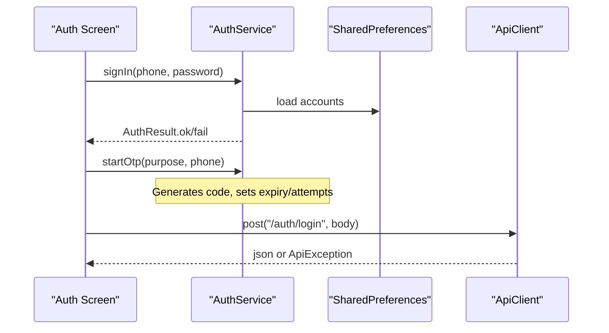
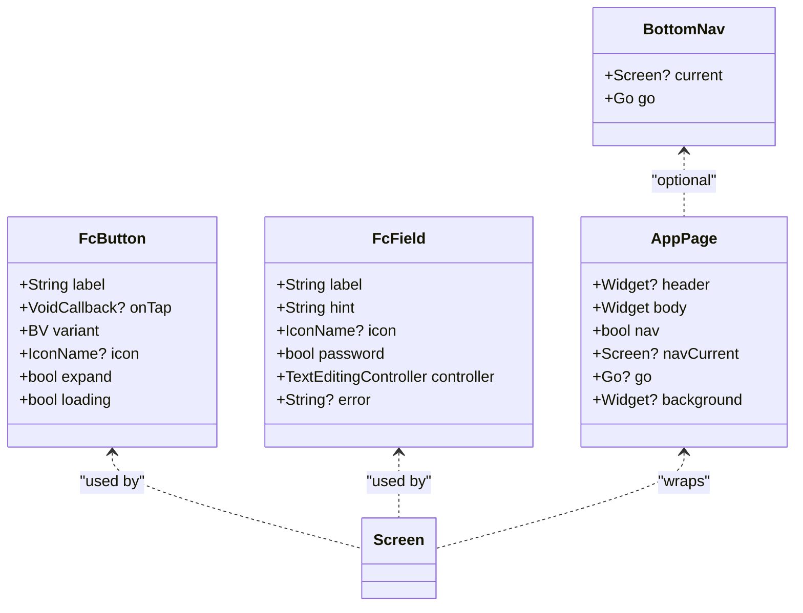
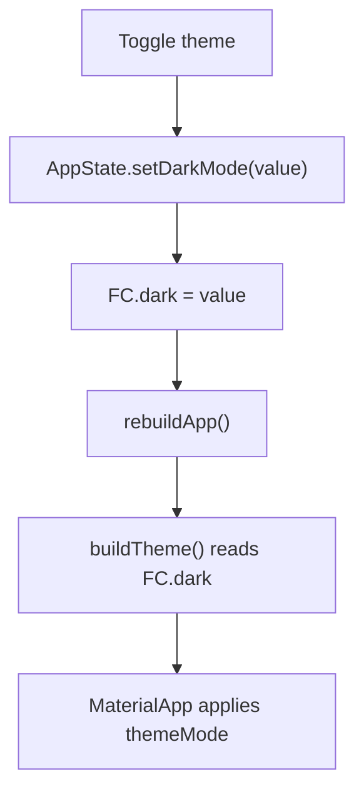
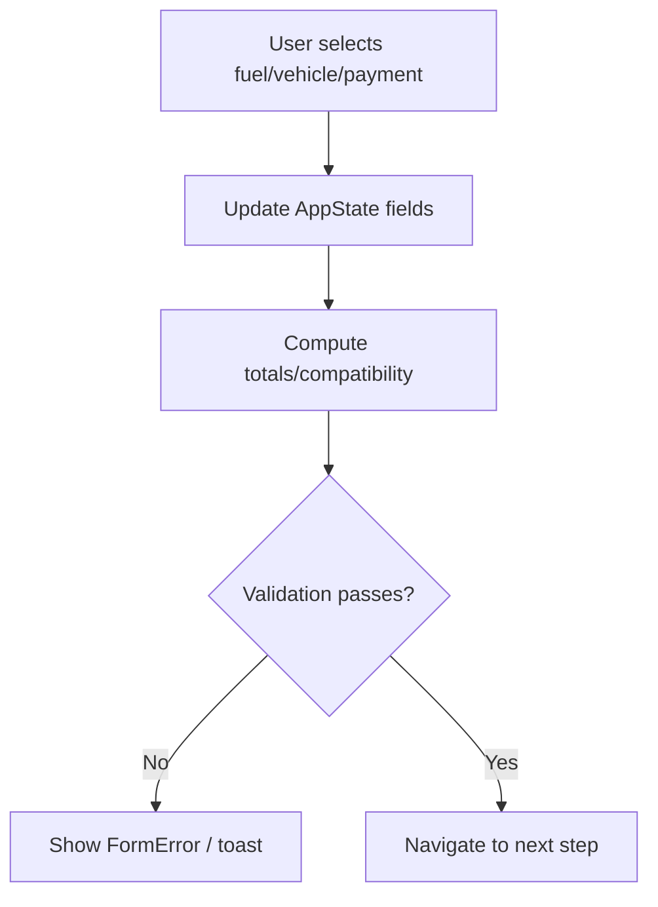
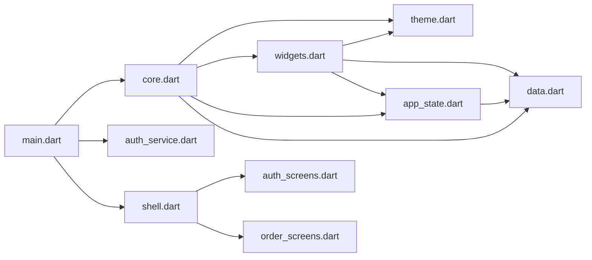

# Frontend Architecture

<cite>
**Referenced Files in This Document**
- [main.dart](file://flutter_app/lib/main.dart)
- [shell.dart](file://flutter_app/lib/shell.dart)
- [core.dart](file://flutter_app/lib/core/core.dart)
- [app_state.dart](file://flutter_app/lib/core/app_state.dart)
- [theme.dart](file://flutter_app/lib/core/theme.dart)
- [widgets.dart](file://flutter_app/lib/core/widgets.dart)
- [data.dart](file://flutter_app/lib/core/data.dart)
- [auth_service.dart](file://flutter_app/lib/services/auth_service.dart)
- [api_client.dart](file://flutter_app/lib/services/api_client.dart)
- [pubspec.yaml](file://flutter_app/pubspec.yaml)
- [README.md](file://flutter_app/README.md)
- [NEW_SCREENS.md](file://flutter_app/NEW_SCREENS.md)
- [auth_screens.dart](file://flutter_app/lib/screens/auth_screens.dart)
- [order_screens.dart](file://flutter_app/lib/screens/order_screens.dart)
</cite>

## Table of Contents
1. [Introduction](#introduction)
2. [Project Structure](#project-structure)
3. [Core Components](#core-components)
4. [Architecture Overview](#architecture-overview)
5. [Detailed Component Analysis](#detailed-component-analysis)
6. [Dependency Analysis](#dependency-analysis)
7. [Performance Considerations](#performance-considerations)
8. [Troubleshooting Guide](#troubleshooting-guide)
9. [Guidelines for Adding Screens and Features](#guidelines-for-adding-screens-and-features)
10. [Conclusion](#conclusion)

## Introduction
This document explains the Flutter frontend architecture for FuelConnect. It covers the app shell, widget tree, navigation model, state management, service layer, API client, theming, responsive design, platform-specific setup, asset configuration, and build-time options. The goal is to help developers understand how screens are organized, how data flows, and how to extend the app consistently.

## Project Structure
The Flutter application follows a layered structure:
- Entry point and app shell
- Core domain and UI primitives
- Screen modules grouped by feature
- Services for authentication and HTTP networking
- Platform assets and configuration



**Diagram sources**
- [main.dart:7-18](file://flutter_app/lib/main.dart#L7-L18)
- [shell.dart:15-129](file://flutter_app/lib/shell.dart#L15-L129)
- [core.dart:1-6](file://flutter_app/lib/core/core.dart#L1-L6)
- [theme.dart:129-158](file://flutter_app/lib/core/theme.dart#L129-L158)
- [widgets.dart:10-10](file://flutter_app/lib/core/widgets.dart#L10-L10)
- [app_state.dart:6-15](file://flutter_app/lib/core/app_state.dart#L6-L15)
- [data.dart:4-16](file://flutter_app/lib/core/data.dart#L4-L16)
- [auth_service.dart:110-118](file://flutter_app/lib/services/auth_service.dart#L110-L118)
- [api_client.dart:11-20](file://flutter_app/lib/services/api_client.dart#L11-L20)

**Section sources**
- [main.dart:7-18](file://flutter_app/lib/main.dart#L7-L18)
- [shell.dart:15-129](file://flutter_app/lib/shell.dart#L15-L129)
- [core.dart:1-6](file://flutter_app/lib/core/core.dart#L1-L6)
- [pubspec.yaml:1-29](file://flutter_app/pubspec.yaml#L1-L29)
- [README.md:1-65](file://flutter_app/README.md#L1-L65)

## Core Components
- App entrypoint initializes system UI, starts auth, and runs the app with a custom Material theme and text scaler constraints.
- Shell hosts the active screen and provides a prototype menu overlay for navigating all screens.
- AppState centralizes navigation stack, theme mode, order builder state, vehicles, places, payment methods, wallet/rewards, and notifications.
- Theme defines colors, typography, responsive helpers, and builds ThemeData based on current dark/light mode.
- Widgets provide reusable UI atoms (buttons, fields, panels, page layout, bottom nav).
- Data models represent stations, partners, vehicles, places, payments, transactions, notices, and history.
- AuthService implements local account storage, validation, OTP flow, and profile/session behavior.
- ApiClient provides secure token handling, HTTP requests, timeouts, and error mapping.

Key responsibilities:
- Navigation: AppState.go/back/backOr; Shell renders the active screen.
- State: AppState holds UI and business state; screens read/write via app.
- Theming: FC color getters and buildTheme() drive consistent visuals.
- Services: AuthService is the seam for future backend integration; ApiClient is ready for real API calls.

**Section sources**
- [main.dart:7-57](file://flutter_app/lib/main.dart#L7-L57)
- [shell.dart:15-129](file://flutter_app/lib/shell.dart#L15-L129)
- [app_state.dart:6-198](file://flutter_app/lib/core/app_state.dart#L6-L198)
- [theme.dart:29-158](file://flutter_app/lib/core/theme.dart#L29-L158)
- [widgets.dart:10-10](file://flutter_app/lib/core/widgets.dart#L10-L10)
- [data.dart:4-126](file://flutter_app/lib/core/data.dart#L4-L126)
- [auth_service.dart:110-305](file://flutter_app/lib/services/auth_service.dart#L110-L305)
- [api_client.dart:11-127](file://flutter_app/lib/services/api_client.dart#L11-L127)

## Architecture Overview
The app uses a single global AppState as the source of truth for navigation and shared UI state. Screens are rendered by Shell based on the current Screen enum value. The top-right menu allows direct navigation to any screen for prototyping. Authentication is mocked locally but structured to be replaced with an HTTP-backed implementation through AuthService and ApiClient.



**Diagram sources**
- [main.dart:7-18](file://flutter_app/lib/main.dart#L7-L18)
- [shell.dart:18-129](file://flutter_app/lib/shell.dart#L18-L129)
- [app_state.dart:69-101](file://flutter_app/lib/core/app_state.dart#L69-L101)
- [auth_screens.dart:13-32](file://flutter_app/lib/screens/auth_screens.dart#L13-L32)

## Detailed Component Analysis

### App Shell and Navigation
- Shell maintains a PopScope that delegates back navigation to AppState.back().
- A KeyedSubtree keyed by the current Screen ensures AnimatedSwitcher transitions correctly.
- ScreenMenu overlays a frosted-glass panel listing all available screens and navigates using app.go(screen, root: true).



**Diagram sources**
- [shell.dart:108-129](file://flutter_app/lib/shell.dart#L108-L129)
- [app_state.dart:69-101](file://flutter_app/lib/core/app_state.dart#L69-L101)

**Section sources**
- [shell.dart:15-129](file://flutter_app/lib/shell.dart#L15-L129)
- [app_state.dart:69-101](file://flutter_app/lib/core/app_state.dart#L69-L101)

### State Management with AppState
- AppState extends ChangeNotifier and exposes:
  - Navigation: current, stack, go(), back(), backOr()
  - Theme: themeMode, isDark, toggleTheme()
  - Order builder: fuelType, litres, vehicleId, scheduledAt, deliveryAddress/note, payId, totals, selectedVehicle/payMethod
  - Wallet/rewards: balance, points, transactions, charge(), completeDelivery(), topUp()
  - Notifications: list of Notice items
- Screens mutate state directly (e.g., selecting fuel or vehicle), which triggers rebuilds via ListenableBuilder in the app shell.

```mermaid
classDiagram
class AppState {
+Screen current
+Screen[] _stack
+go(s, {root, replace}) void
+back() bool
+backOr(fallback) void
+fuelType String
+litres int
+vehicleId String
+scheduled bool
+scheduledAt TimeOfDay?
+deliveryAddress String
+deliveryNote String
+payId String
+vehicles Vehicle[]
+places Place[]
+payMethods PayMethod[]
+walletBalance int
+points int
+txs WalletTx[]
+charge() String?
+completeDelivery() void
+topUp(amount) void
}
```

**Diagram sources**
- [app_state.dart:69-198](file://flutter_app/lib/core/app_state.dart#L69-L198)

**Section sources**
- [app_state.dart:69-198](file://flutter_app/lib/core/app_state.dart#L69-L198)

### Service Layer and API Client
- AuthService:
  - Local persistence of accounts using SharedPreferences.
  - Phone normalization, password hashing, duplicate checks.
  - OTP lifecycle: startOtp, verifyOtp, resend cooldown, expiry, attempts.
  - Profile updates and sign-out behavior.
- ApiClient:
  - Secure token storage via flutter_secure_storage.
  - Base URL configured at build time via dart-define.
  - Request/response handling, timeout, JSON decoding, error mapping.
  - 401 handling clears token and invokes onUnauthorized callback.



**Diagram sources**
- [auth_service.dart:110-305](file://flutter_app/lib/services/auth_service.dart#L110-L305)
- [api_client.dart:32-127](file://flutter_app/lib/services/api_client.dart#L32-L127)

**Section sources**
- [auth_service.dart:110-305](file://flutter_app/lib/services/auth_service.dart#L110-L305)
- [api_client.dart:11-127](file://flutter_app/lib/services/api_client.dart#L11-L127)

### Widget Tree and Custom Components
- FcText, FcButton, FcField, Panel, PageHeader, AppPage, BottomNav, SearchBox, VerifiedPill, LivePill, FcToggle, RoundAction, IconBox, SectionHeading, ContentSection, Narrow, ScrollFill, MapGrid, RouteLine, Glow, ImageShade.
- AppPage composes header/body/bottom nav and optional background.
- BottomNav routes to root screens: Home, Stations, Orders, Wallet.



**Diagram sources**
- [widgets.dart:58-160](file://flutter_app/lib/core/widgets.dart#L58-L160)
- [widgets.dart:162-266](file://flutter_app/lib/core/widgets.dart#L162-L266)
- [widgets.dart:672-698](file://flutter_app/lib/core/widgets.dart#L672-L698)
- [widgets.dart:621-670](file://flutter_app/lib/core/widgets.dart#L621-L670)

**Section sources**
- [widgets.dart:10-10](file://flutter_app/lib/core/widgets.dart#L10-L10)
- [widgets.dart:58-160](file://flutter_app/lib/core/widgets.dart#L58-L160)
- [widgets.dart:162-266](file://flutter_app/lib/core/widgets.dart#L162-L266)
- [widgets.dart:672-698](file://flutter_app/lib/core/widgets.dart#L672-L698)
- [widgets.dart:621-670](file://flutter_app/lib/core/widgets.dart#L621-L670)

### Theme Implementation and Responsive Design
- FC color getters switch between dark and light palettes based on AppState.setDarkMode().
- Typography uses Plus Jakarta Sans with responsive sizes via ts() and fs().
- Responsive helpers vw/vh/cl/isWide enable clamp-style fluid sizing and breakpoints.
- buildTheme() configures Material 3 theme with gold primary, surface colors, and selection styling.
- Text scaling is capped to prevent layout breakage on large system font settings.



**Diagram sources**
- [app_state.dart:108-119](file://flutter_app/lib/core/app_state.dart#L108-L119)
- [theme.dart:29-65](file://flutter_app/lib/core/theme.dart#L29-L65)
- [theme.dart:129-158](file://flutter_app/lib/core/theme.dart#L129-L158)
- [main.dart:25-57](file://flutter_app/lib/main.dart#L25-L57)

**Section sources**
- [theme.dart:29-158](file://flutter_app/lib/core/theme.dart#L29-L158)
- [main.dart:25-57](file://flutter_app/lib/main.dart#L25-L57)

### Data Flow Patterns
- User actions in screens update AppState fields (e.g., fuelType, litres, vehicleId, payId).
- Screens compute derived values from AppState (e.g., fuelTotal, orderTotal, selectedVehicle).
- Payment flow validates wallet balance and records transactions before proceeding.
- OTP flow manages pending verification state, timers, and attempt limits.



**Diagram sources**
- [order_screens.dart:17-121](file://flutter_app/lib/screens/order_screens.dart#L17-L121)
- [order_screens.dart:127-216](file://flutter_app/lib/screens/order_screens.dart#L127-L216)
- [order_screens.dart:366-456](file://flutter_app/lib/screens/order_screens.dart#L366-L456)
- [app_state.dart:121-189](file://flutter_app/lib/core/app_state.dart#L121-L189)

**Section sources**
- [order_screens.dart:17-121](file://flutter_app/lib/screens/order_screens.dart#L17-L121)
- [order_screens.dart:127-216](file://flutter_app/lib/screens/order_screens.dart#L127-L216)
- [order_screens.dart:366-456](file://flutter_app/lib/screens/order_screens.dart#L366-L456)
- [app_state.dart:121-189](file://flutter_app/lib/core/app_state.dart#L121-L189)

### Platform-Specific Considerations
- Android:
  - Edge-to-edge UI and transparent status/navigation bars set in main().
  - Safety screen requires tel scheme intent queries added to AndroidManifest.xml.
- iOS:
  - Standard Flutter Runner setup; no special changes required beyond standard assets and Info.plist.
- Web:
  - Static site build supported; ensure API_BASE_URL is configured for release builds.

**Section sources**
- [main.dart:7-18](file://flutter_app/lib/main.dart#L7-L18)
- [README.md:19-21](file://flutter_app/README.md#L19-L21)

### Asset Management and Build Configuration
- Assets: images under assets/images/ declared in pubspec.yaml.
- Fonts: google_fonts used; can bundle TTFs under assets/google_fonts/ if needed.
- Environment variables:
  - API_BASE_URL via --dart-define for dev/release builds.
  - Release builds enforce HTTPS base URLs.

**Section sources**
- [pubspec.yaml:25-29](file://flutter_app/pubspec.yaml#L25-L29)
- [README.md:61-65](file://flutter_app/README.md#L61-L65)
- [api_client.dart:8-20](file://flutter_app/lib/services/api_client.dart#L8-L20)

## Dependency Analysis
High-level dependencies:
- main.dart depends on core exports, services/auth_service, and shell.
- shell.dart imports screen modules and core exports.
- core.dart re-exports theme, icons, data, app_state, widgets.
- app_state.dart depends on data and icons.
- widgets.dart depends on theme, icons, data, app_state.
- auth_screens.dart and order_screens.dart depend on core and services.



**Diagram sources**
- [main.dart:1-5](file://flutter_app/lib/main.dart#L1-L5)
- [shell.dart:1-11](file://flutter_app/lib/shell.dart#L1-L11)
- [core.dart:1-6](file://flutter_app/lib/core/core.dart#L1-L6)
- [app_state.dart:1-4](file://flutter_app/lib/core/app_state.dart#L1-L4)
- [widgets.dart:1-8](file://flutter_app/lib/core/widgets.dart#L1-L8)

**Section sources**
- [main.dart:1-5](file://flutter_app/lib/main.dart#L1-L5)
- [shell.dart:1-11](file://flutter_app/lib/shell.dart#L1-L11)
- [core.dart:1-6](file://flutter_app/lib/core/core.dart#L1-L6)

## Performance Considerations
- Use ListenableBuilder around MaterialApp to minimize unnecessary rebuilds when theme changes.
- Clamp textScaler to avoid layout thrash on devices with large system fonts.
- Prefer const widgets where possible to reduce rebuild cost.
- Avoid heavy computations inside build; move logic to AppState or dedicated services.
- For animations, use AnimationController and AnimatedBuilder sparingly and dispose timers properly.

[No sources needed since this section provides general guidance]

## Troubleshooting Guide
Common issues and resolutions:
- OTP demo code not shown: Ensure kDemoMode is enabled; a toast displays the generated code.
- Incorrect phone number format: Validators.normalizePhone enforces Uganda E.164 format; validate input early.
- Password reset fails: Verify phone first; resetVerified must be true before changing password.
- Release build API errors: ApiConfig.assertSecure() throws if API_BASE_URL is not HTTPS in release mode.
- Token unauthorized: ApiClient clears token and invokes onUnauthorized; handle sign-out flow.

**Section sources**
- [auth_service.dart:15-21](file://flutter_app/lib/services/auth_service.dart#L15-L21)
- [auth_service.dart:51-97](file://flutter_app/lib/services/auth_service.dart#L51-L97)
- [auth_service.dart:267-280](file://flutter_app/lib/services/auth_service.dart#L267-L280)
- [api_client.dart:11-20](file://flutter_app/lib/services/api_client.dart#L11-L20)
- [api_client.dart:104-109](file://flutter_app/lib/services/api_client.dart#L104-L109)

## Guidelines for Adding Screens and Features
To add a new screen consistently:
1. Define a new Screen enum value in AppState.
2. Add a MenuEntry for quick access in the prototype menu.
3. Register the screen in Shell’s _screen switch.
4. Create the screen file under lib/screens/ and implement it using AppPage, PageHeader, and reusable widgets.
5. If the screen needs persistent state, add fields to AppState and expose computed properties.
6. Wire navigation using app.go(Screen.newScreen, root: true/false, replace: true/false).
7. If the screen interacts with the backend, implement calls through ApiClient and/or AuthService seams.

For rider features and extras:
- Follow the pattern established in NEW_SCREENS.md: add enum entries, register in Shell, create screen files, and optionally introduce dedicated state classes (e.g., rider_state, extras_state).

**Section sources**
- [app_state.dart:6-67](file://flutter_app/lib/core/app_state.dart#L6-L67)
- [shell.dart:18-104](file://flutter_app/lib/shell.dart#L18-L104)
- [NEW_SCREENS.md:1-49](file://flutter_app/NEW_SCREENS.md#L1-L49)

## Conclusion
The FuelConnect Flutter frontend is structured around a simple yet powerful AppState-driven navigation and state model, complemented by a comprehensive set of reusable widgets and a robust theming system. The service layer is designed to be swapped from local mocks to a real backend with minimal changes. By following the guidelines above, teams can extend the app with new screens and features while maintaining consistency, responsiveness, and clarity across the codebase.