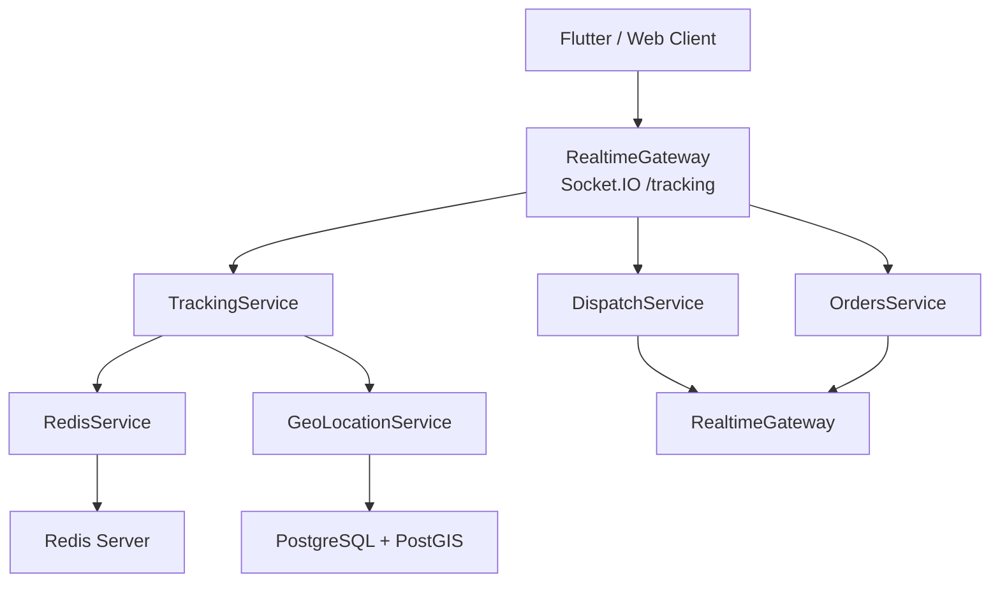
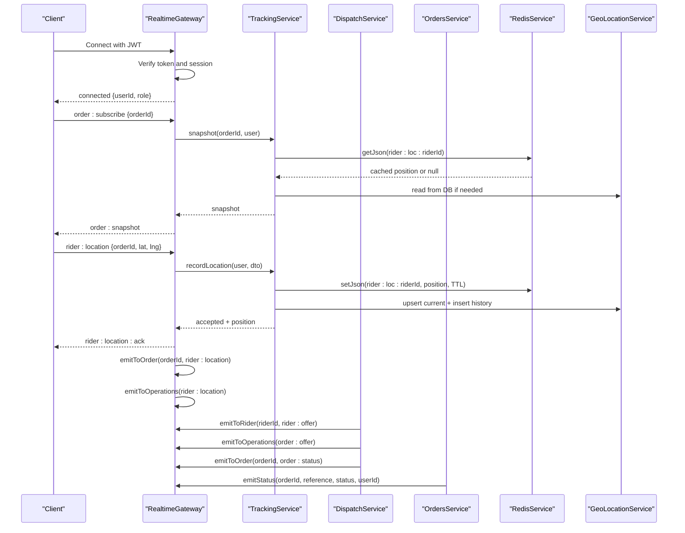
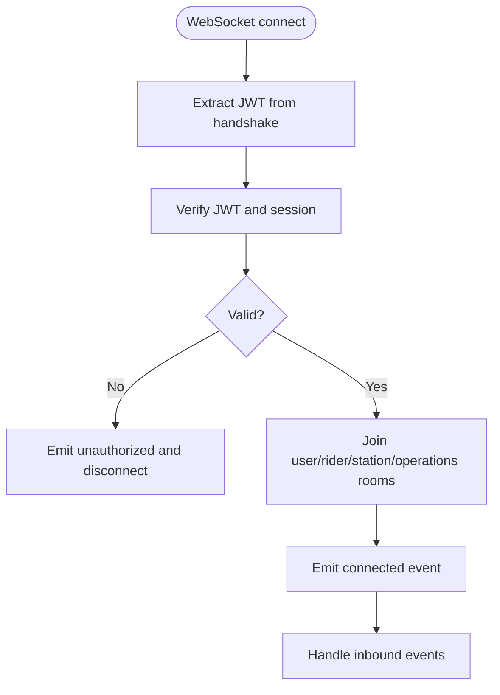
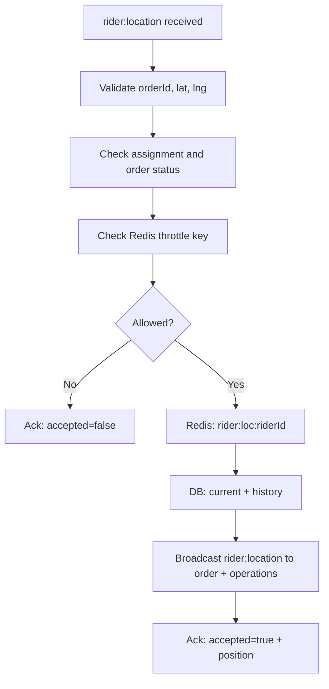
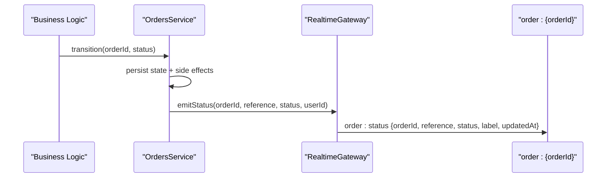
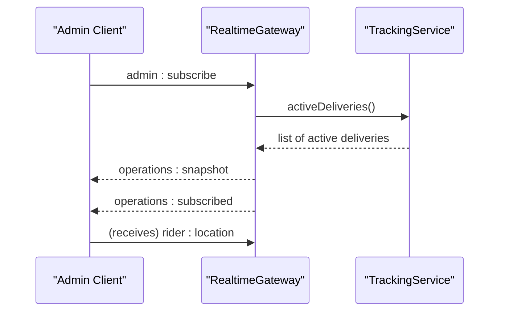
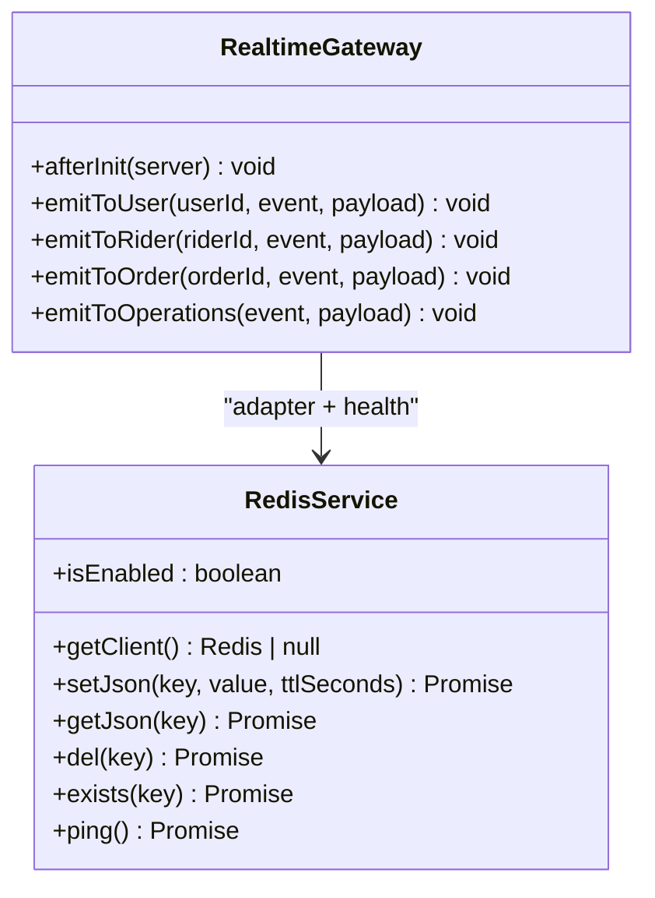
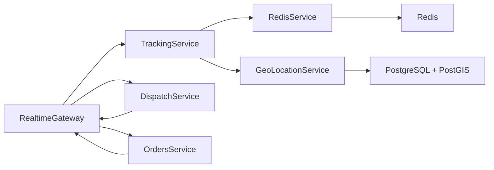

# Real-time Communication Architecture

<cite>
**Referenced Files in This Document**
- [main.ts](file://backend/src/main.ts)
- [realtime.gateway.ts](file://backend/src/tracking/realtime.gateway.ts)
- [tracking.service.ts](file://backend/src/tracking/tracking.service.ts)
- [tracking.controller.ts](file://backend/src/tracking/tracking.controller.ts)
- [dispatch.service.ts](file://backend/src/orders/dispatch.service.ts)
- [orders.service.ts](file://backend/src/orders/orders.service.ts)
- [redis.service.ts](file://backend/src/redis/redis.service.ts)
- [geo-location.service.ts](file://backend/src/common/services/geo-location.service.ts)
- [configuration.ts](file://backend/src/config/configuration.ts)
</cite>

## Table of Contents
1. [Introduction](#introduction)
2. [Project Structure](#project-structure)
3. [Core Components](#core-components)
4. [Architecture Overview](#architecture-overview)
5. [Detailed Component Analysis](#detailed-component-analysis)
6. [Dependency Analysis](#dependency-analysis)
7. [Performance Considerations](#performance-considerations)
8. [Troubleshooting Guide](#troubleshooting-guide)
9. [Conclusion](#conclusion)
10. [Appendices](#appendices)

## Introduction
This document explains the real-time communication architecture for the FuelConnect backend. It focuses on the Socket.IO gateway, WebSocket connection lifecycle, event-driven patterns, rider location tracking, live order status broadcasting, and Redis-backed scaling. It also provides guidance for implementing new real-time features, debugging connections, and optimizing for high concurrency.

The system uses:
- A NestJS application with a Socket.IO gateway under the `/tracking` namespace.
- JWT-based authentication during WebSocket handshake.
- Redis for cross-instance message fan-out and hot caching of rider positions.
- PostGIS-backed geospatial queries for rider discovery and distance calculations.
- Event-driven updates for order state changes, rider offers, and live location broadcasts.

## Project Structure
The real-time subsystem lives primarily under `backend/src/tracking`, with supporting logic in orders, redis, common geo utilities, and configuration. The bootstrap file documents that real-time tracking is exposed via the `/tracking` Socket.IO namespace.

**Diagram sources**
- [main.ts:63-88](file://backend/src/main.ts#L63-L88)
- [realtime.gateway.ts:45-61](file://backend/src/tracking/realtime.gateway.ts#L45-L61)
- [tracking.service.ts:32-39](file://backend/src/tracking/tracking.service.ts#L32-L39)
- [dispatch.service.ts:36-49](file://backend/src/orders/dispatch.service.ts#L36-L49)
- [orders.service.ts:76-85](file://backend/src/orders/orders.service.ts#L76-L85)
- [redis.service.ts:20-26](file://backend/src/redis/redis.service.ts#L20-L26)
- [geo-location.service.ts:23-27](file://backend/src/common/services/geo-location.service.ts#L23-L27)

**Section sources**
- [main.ts:12-103](file://backend/src/main.ts#L12-L103)

## Core Components
- RealtimeGateway: Handles WebSocket authentication, room management, inbound events, and outbound broadcasts.
- TrackingService: Validates access to orders, builds snapshots, records rider locations, and exposes latest position and active deliveries.
- DispatchService: Finds nearby riders, creates time-limited offers, emits offer and status events, and sweeps expired assignments.
- OrdersService: Central order state machine; emits order status events through the gateway.
- RedisService: Provides Redis client access, JSON storage with TTL, existence checks, and an in-process fallback.
- GeoLocationService: PostGIS helpers for rider discovery, current location upserts, history inserts, and pruning.
- Configuration: Typed environment configuration including Redis URL, JWT settings, pricing, and tracking intervals.

**Section sources**
- [realtime.gateway.ts:45-61](file://backend/src/tracking/realtime.gateway.ts#L45-L61)
- [tracking.service.ts:32-39](file://backend/src/tracking/tracking.service.ts#L32-L39)
- [dispatch.service.ts:36-49](file://backend/src/orders/dispatch.service.ts#L36-L49)
- [orders.service.ts:76-85](file://backend/src/orders/orders.service.ts#L76-L85)
- [redis.service.ts:20-26](file://backend/src/redis/redis.service.ts#L20-L26)
- [geo-location.service.ts:23-27](file://backend/src/common/services/geo-location.service.ts#L23-L27)
- [configuration.ts:1-38](file://backend/src/config/configuration.ts#L1-L38)

## Architecture Overview
The real-time layer is event-driven:
- Clients authenticate over WebSocket using a JWT token.
- Clients join rooms by user, rider, station, or order.
- Riders publish location updates; the server validates, throttles, persists, and broadcasts them.
- Order state transitions emit status events to relevant rooms.
- Rider offers are emitted to specific riders and operations.

**Diagram sources**
- [realtime.gateway.ts:80-143](file://backend/src/tracking/realtime.gateway.ts#L80-L143)
- [realtime.gateway.ts:151-173](file://backend/src/tracking/realtime.gateway.ts#L151-L173)
- [realtime.gateway.ts:201-252](file://backend/src/tracking/realtime.gateway.ts#L201-L252)
- [tracking.service.ts:77-144](file://backend/src/tracking/tracking.service.ts#L77-L144)
- [tracking.service.ts:155-230](file://backend/src/tracking/tracking.service.ts#L155-L230)
- [dispatch.service.ts:163-246](file://backend/src/orders/dispatch.service.ts#L163-L246)
- [orders.service.ts:796-800](file://backend/src/orders/orders.service.ts#L796-L800)

## Detailed Component Analysis

### Socket.IO Gateway and Connection Lifecycle
Responsibilities:
- Configure the `/tracking` namespace with CORS and transports.
- Authenticate clients using JWT from handshake auth, headers, or query.
- Load user principal and join rooms: `user:{id}`, `rider:{id}`, `station:{id}`, and `operations` for staff.
- Handle inbound events: order subscription/unsubscription, admin operations feed, and rider location publishing.
- Provide helper methods to broadcast to users, riders, orders, and operations.

Key behaviors:
- On connection success, the client receives a `connected` event with identity metadata.
- Unauthorized connections receive an `unauthorized` event and are disconnected.
- Admins/staff subscribe to the `operations` room for live map feeds.

**Diagram sources**
- [realtime.gateway.ts:80-143](file://backend/src/tracking/realtime.gateway.ts#L80-L143)
- [realtime.gateway.ts:279-292](file://backend/src/tracking/realtime.gateway.ts#L279-L292)

**Section sources**
- [realtime.gateway.ts:45-61](file://backend/src/tracking/realtime.gateway.ts#L45-L61)
- [realtime.gateway.ts:80-143](file://backend/src/tracking/realtime.gateway.ts#L80-L143)
- [realtime.gateway.ts:254-277](file://backend/src/tracking/realtime.gateway.ts#L254-L277)

### Location Tracking System
Responsibilities:
- Validate that only the assigned rider can publish location for an active delivery.
- Throttle location pings per rider using Redis.
- Persist the latest position to Redis (hot path) and database (cold path).
- Record historical location points.
- Provide latest position and active deliveries for admin dashboards.

Data flow:
- Client sends `rider:location`.
- Gateway validates payload and calls `TrackingService.recordLocation`.
- Service checks assignment and order status, applies throttle via Redis, then writes to Redis and Postgres.
- Gateway acknowledges acceptance and broadcasts the position to the order room and operations room.

**Diagram sources**
- [realtime.gateway.ts:201-252](file://backend/src/tracking/realtime.gateway.ts#L201-L252)
- [tracking.service.ts:155-230](file://backend/src/tracking/tracking.service.ts#L155-L230)
- [redis.service.ts:69-99](file://backend/src/redis/redis.service.ts#L69-L99)
- [geo-location.service.ts:43-86](file://backend/src/common/services/geo-location.service.ts#L43-L86)

**Section sources**
- [tracking.service.ts:128-230](file://backend/src/tracking/tracking.service.ts#L128-L230)
- [geo-location.service.ts:43-86](file://backend/src/common/services/geo-location.service.ts#L43-L86)

### Live Order Status Broadcasting
Responsibilities:
- Emit order status events whenever the central state machine transitions.
- Ensure consistent timestamps, rider earnings, wallet credits, and notifications alongside state changes.
- Broadcast to the order room and optionally to the customer’s user room.

Integration points:
- `OrdersService.transition` emits status events after successful persistence.
- `DispatchService.offer` emits order status when assigning a rider.
- `RealtimeGateway.emitToOrder` routes messages to the correct room.

**Diagram sources**
- [orders.service.ts:478-603](file://backend/src/orders/orders.service.ts#L478-L603)
- [orders.service.ts:796-800](file://backend/src/orders/orders.service.ts#L796-L800)
- [realtime.gateway.ts:265-268](file://backend/src/tracking/realtime.gateway.ts#L265-L268)

**Section sources**
- [orders.service.ts:478-603](file://backend/src/orders/orders.service.ts#L478-L603)
- [dispatch.service.ts:163-246](file://backend/src/orders/dispatch.service.ts#L163-L246)

### Rider Positioning Updates and Admin Operations Feed
Responsibilities:
- Maintain a live operations feed for admins/staff.
- Provide an operations snapshot on subscription.
- Broadcast rider location updates to the operations room.

Key flows:
- Admin subscribes to `admin:subscribe`; server joins the `operations` room and returns active deliveries.
- Rider location updates are broadcast to both the order room and the operations room.

**Diagram sources**
- [realtime.gateway.ts:186-199](file://backend/src/tracking/realtime.gateway.ts#L186-L199)
- [tracking.service.ts:232-280](file://backend/src/tracking/tracking.service.ts#L232-L280)

**Section sources**
- [realtime.gateway.ts:186-199](file://backend/src/tracking/realtime.gateway.ts#L186-L199)
- [tracking.service.ts:232-280](file://backend/src/tracking/tracking.service.ts#L232-L280)

### Redis Integration for Scaling and Message Distribution
Responsibilities:
- Provide a Redis client for Socket.IO adapter fan-out across multiple API instances.
- Cache rider positions with short TTLs for fast reads.
- Implement rate-limiting signals shared between instances.
- Gracefully fall back to in-process memory when Redis is unavailable.

Key behaviors:
- Gateway initializes the Socket.IO Redis adapter using pub/sub clients duplicated from the main Redis client.
- RedisService wraps Redis operations with logging and fallback to an in-memory Map.
- Health check and availability flags allow components to adapt behavior.

**Diagram sources**
- [redis.service.ts:20-67](file://backend/src/redis/redis.service.ts#L20-L67)
- [redis.service.ts:69-131](file://backend/src/redis/redis.service.ts#L69-L131)
- [realtime.gateway.ts:63-78](file://backend/src/tracking/realtime.gateway.ts#L63-L78)

**Section sources**
- [redis.service.ts:20-131](file://backend/src/redis/redis.service.ts#L20-L131)
- [realtime.gateway.ts:63-78](file://backend/src/tracking/realtime.gateway.ts#L63-L78)

### Client-Server Event Handling Examples
- Authentication:
  - Client connects with JWT in handshake auth or authorization header.
  - Server verifies token and session, then emits `connected`.
- Order Subscription:
  - Client sends `order:subscribe` with `orderId`.
  - Server responds with `order:snapshot` containing order, assignment, rider, and last known location.
- Rider Location Publishing:
  - Client sends `rider:location` with validated fields.
  - Server acknowledges with `rider:location:ack` and broadcasts to order and operations rooms.
- Admin Operations Feed:
  - Staff sends `admin:subscribe`.
  - Server emits `operations:snapshot` and subsequent `rider:location` updates.

These flows are implemented in the gateway and services referenced below.

**Section sources**
- [realtime.gateway.ts:80-143](file://backend/src/tracking/realtime.gateway.ts#L80-L143)
- [realtime.gateway.ts:151-173](file://backend/src/tracking/realtime.gateway.ts#L151-L173)
- [realtime.gateway.ts:186-199](file://backend/src/tracking/realtime.gateway.ts#L186-L199)
- [realtime.gateway.ts:201-252](file://backend/src/tracking/realtime.gateway.ts#L201-L252)

### Error Recovery Strategies
- Authentication failures:
  - Emit `unauthorized` and disconnect the socket.
- Invalid payloads:
  - Return structured error responses with descriptive messages.
- Redis unavailability:
  - Socket.IO runs without the Redis adapter (single instance only).
  - RedisService falls back to in-process cache for reads/writes.
- Geospatial write failures:
  - GeoLocationService wraps raw SQL writes in safe handlers to avoid breaking business flows.

**Section sources**
- [realtime.gateway.ts:136-143](file://backend/src/tracking/realtime.gateway.ts#L136-L143)
- [realtime.gateway.ts:63-78](file://backend/src/tracking/realtime.gateway.ts#L63-L78)
- [redis.service.ts:28-51](file://backend/src/redis/redis.service.ts#L28-L51)
- [geo-location.service.ts:142-153](file://backend/src/common/services/geo-location.service.ts#L142-L153)

## Dependency Analysis
The real-time system integrates several modules:

**Diagram sources**
- [realtime.gateway.ts:45-61](file://backend/src/tracking/realtime.gateway.ts#L45-L61)
- [tracking.service.ts:32-39](file://backend/src/tracking/tracking.service.ts#L32-L39)
- [dispatch.service.ts:36-49](file://backend/src/orders/dispatch.service.ts#L36-L49)
- [orders.service.ts:76-85](file://backend/src/orders/orders.service.ts#L76-L85)
- [redis.service.ts:20-26](file://backend/src/redis/redis.service.ts#L20-L26)
- [geo-location.service.ts:23-27](file://backend/src/common/services/geo-location.service.ts#L23-L27)

Coupling and cohesion:
- RealtimeGateway depends on services for business logic but keeps transport concerns isolated.
- TrackingService encapsulates location ingestion, caching, and admin data aggregation.
- DispatchService coordinates rider discovery and offer lifecycle while emitting events via the gateway.
- OrdersService centralizes order state transitions and emits consistent status events.

Potential circular dependencies:
- Services call back into the gateway for broadcasting; ensure gateway does not depend directly on service business logic beyond helper methods.

External dependencies:
- Redis for fan-out and caching.
- PostgreSQL with PostGIS for geospatial queries.
- JWT for secure WebSocket authentication.

**Section sources**
- [realtime.gateway.ts:45-61](file://backend/src/tracking/realtime.gateway.ts#L45-L61)
- [tracking.service.ts:32-39](file://backend/src/tracking/tracking.service.ts#L32-L39)
- [dispatch.service.ts:36-49](file://backend/src/orders/dispatch.service.ts#L36-L49)
- [orders.service.ts:76-85](file://backend/src/orders/orders.service.ts#L76-L85)

## Performance Considerations
- Hot path caching:
  - Rider positions are stored in Redis with a short TTL for fast reads.
  - Latest position retrieval first checks Redis, then falls back to the database.
- Throttling:
  - Per-rider throttle keys prevent excessive location pings.
  - Minimum interval is configurable via environment variables.
- Fan-out:
  - Socket.IO Redis adapter enables horizontal scaling across multiple API instances.
- Geospatial queries:
  - PostGIS indexes and distance functions optimize rider discovery within a radius.
- Concurrency:
  - Use room-based broadcasting to minimize unnecessary emissions.
  - Avoid heavy computations inside event handlers; delegate to services.

Recommendations:
- Tune `tracking.minIntervalMs` based on device capabilities and network conditions.
- Monitor Redis latency and adjust TTLs to balance freshness vs. throughput.
- Use pagination and limits for admin snapshots to reduce payload size.
- Enable connection pooling at the database level and tune Prisma pool sizes.

[No sources needed since this section provides general guidance]

## Troubleshooting Guide
Common issues and diagnostics:
- WebSocket authentication failures:
  - Verify JWT presence and validity in handshake.
  - Check session expiration and revocation status.
- Missing order snapshots:
  - Confirm the client joined the correct order room.
  - Validate user permissions for the order.
- No rider location broadcasts:
  - Ensure the rider is assigned to the order and the order is in an active state.
  - Check throttle keys and minimum interval configuration.
- Redis adapter warnings:
  - If Redis is unavailable, Socket.IO will run without cross-instance fan-out.
  - Inspect logs for Redis connection errors and fallback behavior.
- Geospatial write failures:
  - Verify PostGIS extension is enabled.
  - Review safe write wrappers for logged errors.

Operational tips:
- Use the REST fallback endpoints to inspect snapshots and last known positions.
- Log gateway events and service exceptions for end-to-end tracing.
- Monitor Redis ping and availability flags.

**Section sources**
- [realtime.gateway.ts:136-143](file://backend/src/tracking/realtime.gateway.ts#L136-L143)
- [tracking.controller.ts:13-24](file://backend/src/tracking/tracking.controller.ts#L13-L24)
- [redis.service.ts:28-51](file://backend/src/redis/redis.service.ts#L28-L51)
- [geo-location.service.ts:142-153](file://backend/src/common/services/geo-location.service.ts#L142-L153)

## Conclusion
The real-time communication system combines Socket.IO, Redis, and PostGIS to deliver low-latency updates for rider positioning, order status, and operational visibility. Authentication is enforced at the WebSocket level, and event-driven patterns ensure consistent state propagation across clients. Redis provides both scaling support and hot caching, while geospatial queries enable efficient rider discovery. By following the documented flows and recommendations, teams can implement new real-time features safely and scale effectively under high concurrency.

[No sources needed since this section summarizes without analyzing specific files]

## Appendices

### Environment Configuration Reference
Key configuration options affecting real-time behavior:
- `redisUrl`: Enables Redis integration and Socket.IO adapter.
- `tracking.minIntervalMs`: Controls minimum location update interval.
- `pricing.dispatchRadiusKm`: Radius used for rider discovery.
- `pricing.assignmentTimeoutSeconds`: Duration for rider offers.

**Section sources**
- [configuration.ts:1-38](file://backend/src/config/configuration.ts#L1-L38)
- [configuration.ts:69-95](file://backend/src/config/configuration.ts#L69-L95)

### REST Fallback Endpoints
- GET `/api/v1/tracking/orders/:id`: Returns delivery snapshot and last known rider position.
- GET `/api/v1/tracking/riders/me`: Returns last known position of the signed-in rider.

**Section sources**
- [tracking.controller.ts:13-24](file://backend/src/tracking/tracking.controller.ts#L13-L24)