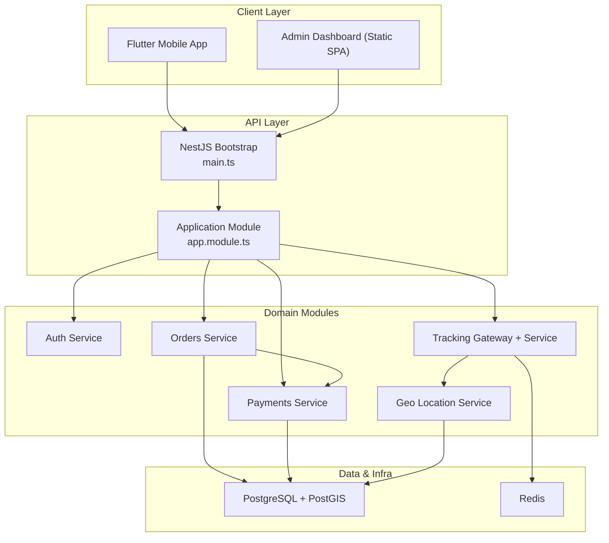
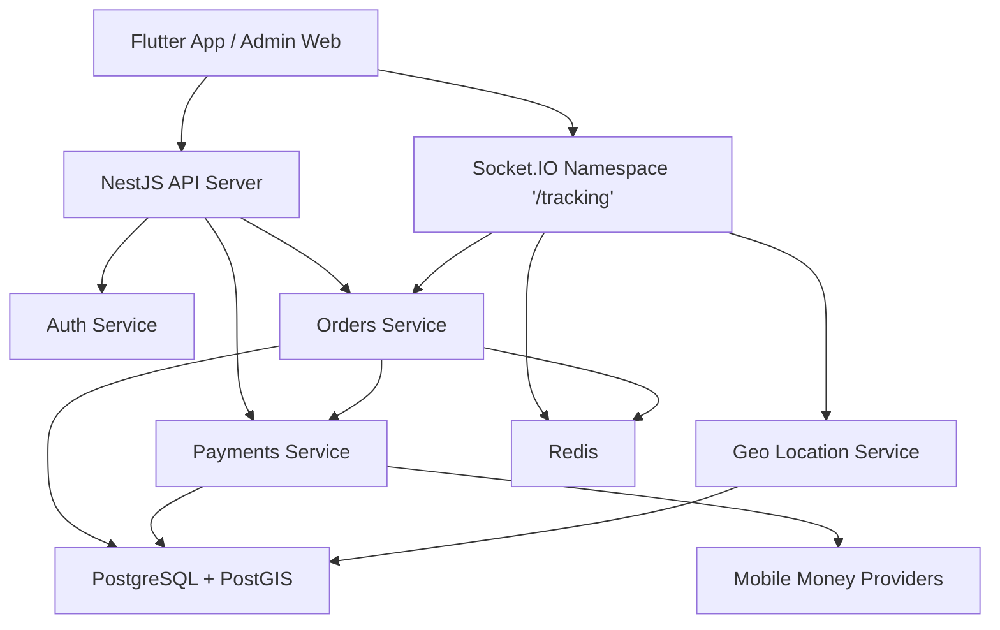
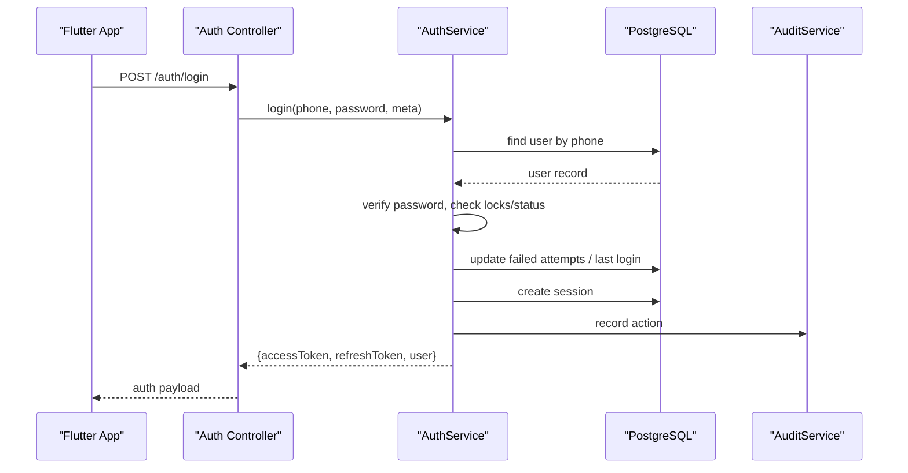
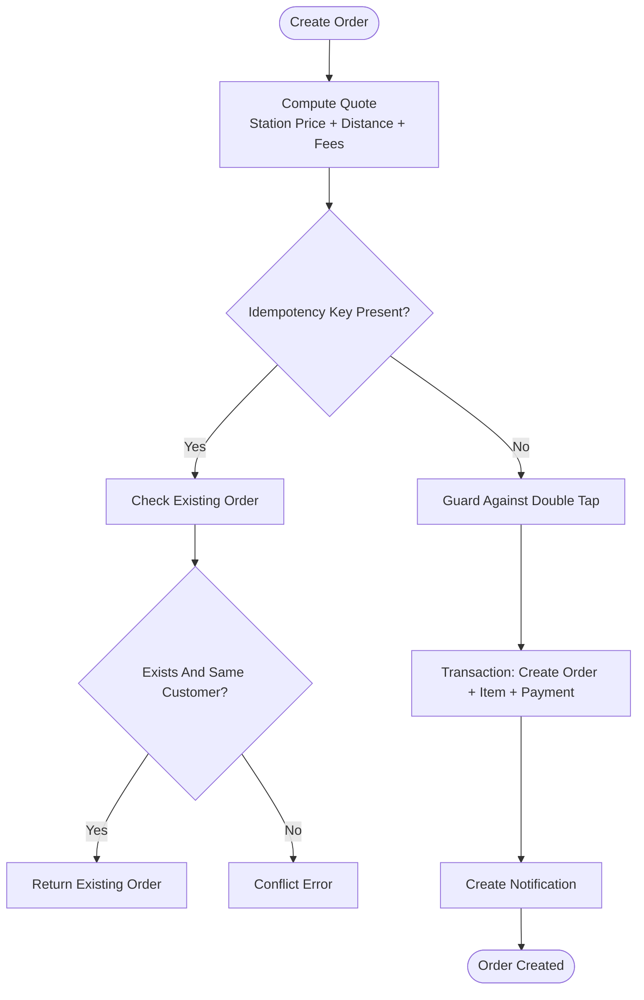
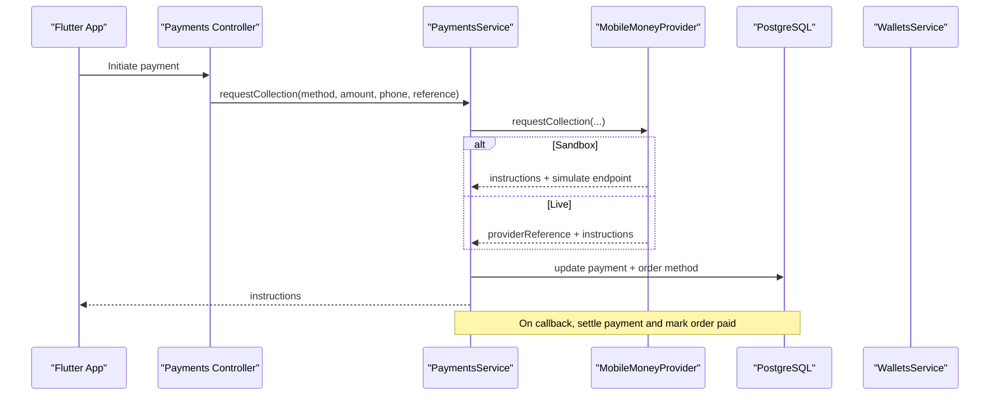
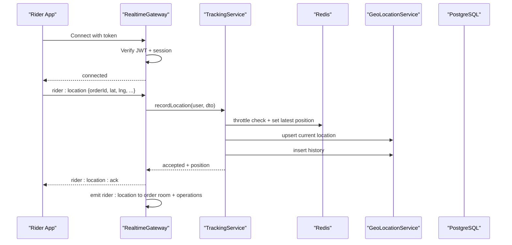
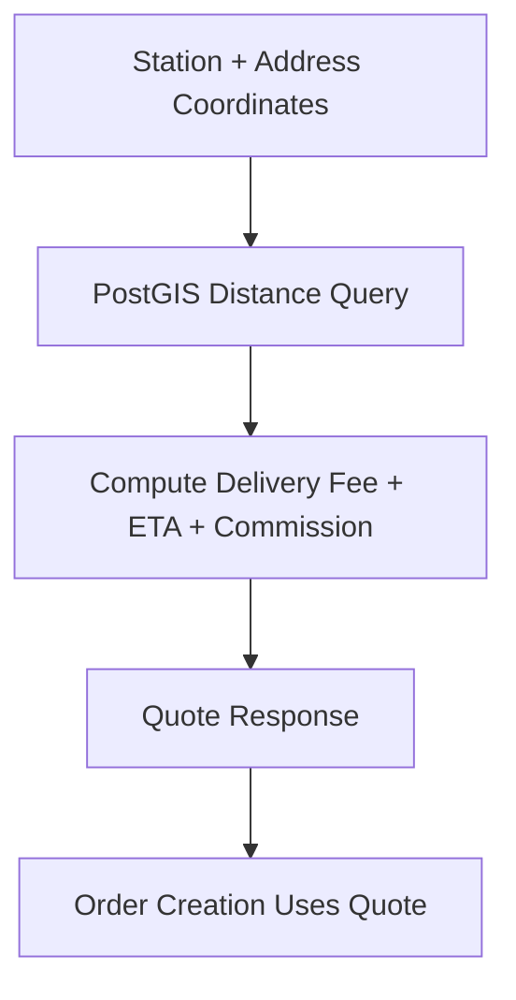
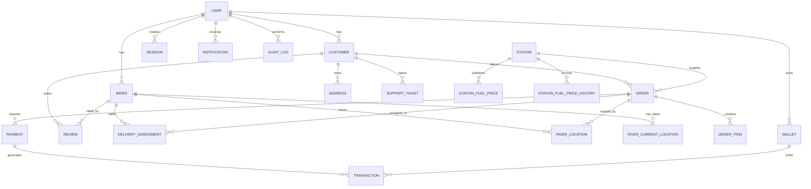
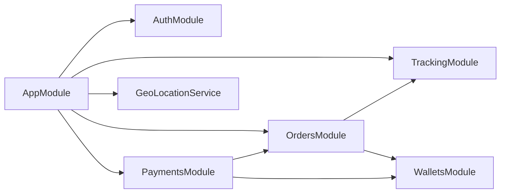

# System Architecture

<cite>
**Referenced Files in This Document**
- [README.md](file://README.md)
- [backend/src/main.ts](file://backend/src/main.ts)
- [backend/src/app.module.ts](file://backend/src/app.module.ts)
- [backend/docker-compose.yml](file://backend/docker-compose.yml)
- [backend/Dockerfile](file://backend/Dockerfile)
- [backend/prisma/schema.prisma](file://backend/prisma/schema.prisma)
- [backend/src/auth/auth.service.ts](file://backend/src/auth/auth.service.ts)
- [backend/src/orders/orders.service.ts](file://backend/src/orders/orders.service.ts)
- [backend/src/orders/orders.module.ts](file://backend/src/orders/orders.module.ts)
- [backend/src/payments/payments.service.ts](file://backend/src/payments/payments.service.ts)
- [backend/src/payments/providers/mobile-money.provider.ts](file://backend/src/payments/providers/mobile-money.provider.ts)
- [backend/src/common/services/geo-location.service.ts](file://backend/src/common/services/geo-location.service.ts)
- [backend/src/tracking/realtime.gateway.ts](file://backend/src/tracking/realtime.gateway.ts)
- [backend/src/tracking/tracking.service.ts](file://backend/src/tracking/tracking.service.ts)
- [flutter_app/pubspec.yaml](file://flutter_app/pubspec.yaml)
</cite>

## Table of Contents
1. Introduction
2. Project Structure
3. Core Components
4. Architecture Overview
5. Detailed Component Analysis
6. Dependency Analysis
7. Performance Considerations
8. Troubleshooting Guide
9. Conclusion

## Introduction
FuelConnect is a full-stack on-demand fuel delivery system with:
- A modular NestJS backend exposing REST APIs and a real-time Socket.IO tracking layer.
- A Flutter mobile application for customers and riders.
- A single-page admin dashboard served by the same API.

The backend follows a modular monolith architecture organized around domain modules such as authentication, orders, payments, riders, stations, wallets, tracking, notifications, reviews, support, and administration. The data model uses PostgreSQL with PostGIS for geospatial queries, and Redis for caching, throttling, and cross-instance WebSocket fan-out.

## Project Structure
At a high level:
- `backend/` contains the NestJS application, Prisma schema, Docker configuration, and static admin dashboard.
- `flutter_app/` contains the Flutter frontend package definition and platform-specific scaffolding.
- The root `README.md` documents how to run both sides and the integration contract between the app and API.

**Diagram sources**
- [backend/src/main.ts:11-90](file://backend/src/main.ts#L11-L90)
- [backend/src/app.module.ts:29-67](file://backend/src/app.module.ts#L29-L67)
- [backend/prisma/schema.prisma:10-14](file://backend/prisma/schema.prisma#L10-L14)
- [backend/docker-compose.yml:1-54](file://backend/docker-compose.yml#L1-L54)

**Section sources**
- [README.md:1-18](file://README.md#L1-L18)
- [backend/src/main.ts:11-90](file://backend/src/main.ts#L11-L90)
- [backend/src/app.module.ts:29-67](file://backend/src/app.module.ts#L29-L67)
- [backend/docker-compose.yml:1-54](file://backend/docker-compose.yml#L1-L54)

## Core Components
- Application bootstrap and global middleware:
  - Helmet, CORS, global validation pipe, Swagger UI, static dashboard, shutdown hooks.
- Domain modules:
  - Authentication and sessions.
  - Order lifecycle and state machine.
  - Payments and mobile money provider abstraction.
  - Real-time tracking via Socket.IO with Redis adapter.
  - Geospatial utilities backed by PostGIS.
- Data persistence:
  - Prisma client over PostgreSQL with PostGIS extension.
- Caching and coordination:
  - Redis for rate limiting, location cache, and Socket.IO adapter.

Key responsibilities:
- `main.ts`: HTTP server setup, security headers, CORS policy, API prefix, Swagger, static assets.
- `app.module.ts`: Global guards, interceptors, filters, module imports, and default throttling.
- `auth.service.ts`: Registration, OTP verification, login, session management, password reset, profile updates.
- `orders.service.ts`: Quoting, creation, payment marking, cancellation, delivery confirmation, central state transitions, rider earnings, notifications, and real-time status events.
- `payments.service.ts`: Payment initiation, sandbox simulation, provider callbacks, wallet top-ups, order settlement.
- `mobile-money.provider.ts`: Provider selection, configuration checks, collection request stubs.
- `tracking.realtime.gateway.ts`: WebSocket authentication, room-based subscriptions, rider location ingestion, and event broadcasting.
- `tracking.tracking.service.ts`: Access control for order snapshots, live position retrieval, location ingestion with throttling, history writes, and active deliveries listing.
- `common/services/geo-location.service.ts`: PostGIS helpers for distance calculations, nearby rider search, and history pruning.

**Section sources**
- [backend/src/main.ts:11-90](file://backend/src/main.ts#L11-L90)
- [backend/src/app.module.ts:29-67](file://backend/src/app.module.ts#L29-L67)
- [backend/src/auth/auth.service.ts:50-331](file://backend/src/auth/auth.service.ts#L50-L331)
- [backend/src/orders/orders.service.ts:87-254](file://backend/src/orders/orders.service.ts#L87-L254)
- [backend/src/payments/payments.service.ts:236-279](file://backend/src/payments/payments.service.ts#L236-L279)
- [backend/src/payments/providers/mobile-money.provider.ts:40-107](file://backend/src/payments/providers/mobile-money.provider.ts#L40-L107)
- [backend/src/tracking/realtime.gateway.ts:45-78](file://backend/src/tracking/realtime.gateway.ts#L45-L78)
- [backend/src/tracking/tracking.service.ts:146-230](file://backend/src/tracking/tracking.service.ts#L146-L230)
- [backend/src/common/services/geo-location.service.ts:15-155](file://backend/src/common/services/geo-location.service.ts#L15-L155)

## Architecture Overview
The system is a modular monolith with clear boundaries:
- Clients connect to the NestJS API over HTTPS.
- The API exposes REST endpoints under `/api/v1`.
- Real-time features use the `/tracking` Socket.IO namespace.
- Data is persisted in PostgreSQL with PostGIS; Redis provides caching, throttling, and multi-instance WebSocket fan-out.
- External integrations include mobile money providers and optional email/SMS services behind OTP flows.

**Diagram sources**
- [backend/src/main.ts:19-38](file://backend/src/main.ts#L19-L38)
- [backend/src/app.module.ts:38-59](file://backend/src/app.module.ts#L38-L59)
- [backend/src/tracking/realtime.gateway.ts:45-78](file://backend/src/tracking/realtime.gateway.ts#L45-L78)
- [backend/src/orders/orders.module.ts:8-13](file://backend/src/orders/orders.module.ts#L8-L13)
- [backend/src/payments/payments.module.ts:8-13](file://backend/src/payments/payments.module.ts#L8-L13)
- [backend/docker-compose.yml:1-54](file://backend/docker-compose.yml#L1-L54)

## Detailed Component Analysis

### Authentication and Session Management
Authentication handles registration, OTP verification, login, refresh, logout, password changes, and profile updates. It issues short-lived access tokens and rotating refresh tokens, enforces account lockout after repeated failures, and records audit events.

**Diagram sources**
- [backend/src/auth/auth.service.ts:163-239](file://backend/src/auth/auth.service.ts#L163-L239)
- [backend/src/auth/auth.service.ts:456-465](file://backend/src/auth/auth.service.ts#L456-L465)

**Section sources**
- [backend/src/auth/auth.service.ts:50-331](file://backend/src/auth/auth.service.ts#L50-L331)
- [backend/src/auth/auth.service.ts:456-465](file://backend/src/auth/auth.service.ts#L456-L465)

### Order Lifecycle and State Machine
Order creation computes quotes using station prices, distances, and pricing rules. Creation is idempotent and transactional. Payment marking transitions the order to paid and emits real-time status events. Delivery completion credits rider earnings and updates customer loyalty metrics.

**Diagram sources**
- [backend/src/orders/orders.service.ts:87-125](file://backend/src/orders/orders.service.ts#L87-L125)
- [backend/src/orders/orders.service.ts:127-254](file://backend/src/orders/orders.service.ts#L127-L254)

**Section sources**
- [backend/src/orders/orders.service.ts:87-254](file://backend/src/orders/orders.service.ts#L87-L254)
- [backend/src/orders/orders.service.ts:478-603](file://backend/src/orders/orders.service.ts#L478-L603)

### Payments and Mobile Money Integration
Payments service supports wallet top-ups and order payments. For mobile money, it selects providers, validates configuration, and returns instructions or sandbox simulation details. Callbacks settle payments and mark orders paid.

**Diagram sources**
- [backend/src/payments/payments.service.ts:236-279](file://backend/src/payments/payments.service.ts#L236-L279)
- [backend/src/payments/providers/mobile-money.provider.ts:85-107](file://backend/src/payments/providers/mobile-money.provider.ts#L85-L107)

**Section sources**
- [backend/src/payments/payments.service.ts:236-279](file://backend/src/payments/payments.service.ts#L236-L279)
- [backend/src/payments/providers/mobile-money.provider.ts:40-107](file://backend/src/payments/providers/mobile-money.provider.ts#L40-L107)

### Real-Time Tracking and Location Ingestion
The Socket.IO gateway authenticates clients, joins rooms per user, rider, station, order, and operations feed. Riders publish location pings that are validated, throttled, stored in Redis and PostGIS, and broadcast to subscribers.

**Diagram sources**
- [backend/src/tracking/realtime.gateway.ts:80-143](file://backend/src/tracking/realtime.gateway.ts#L80-L143)
- [backend/src/tracking/realtime.gateway.ts:201-252](file://backend/src/tracking/realtime.gateway.ts#L201-L252)
- [backend/src/tracking/tracking.service.ts:146-230](file://backend/src/tracking/tracking.service.ts#L146-L230)
- [backend/src/common/services/geo-location.service.ts:43-86](file://backend/src/common/services/geo-location.service.ts#L43-L86)

**Section sources**
- [backend/src/tracking/realtime.gateway.ts:45-78](file://backend/src/tracking/realtime.gateway.ts#L45-L78)
- [backend/src/tracking/realtime.gateway.ts:80-143](file://backend/src/tracking/realtime.gateway.ts#L80-L143)
- [backend/src/tracking/realtime.gateway.ts:201-252](file://backend/src/tracking/realtime.gateway.ts#L201-L252)
- [backend/src/tracking/tracking.service.ts:146-230](file://backend/src/tracking/tracking.service.ts#L146-L230)
- [backend/src/common/services/geo-location.service.ts:43-86](file://backend/src/common/services/geo-location.service.ts#L43-L86)

### Geospatial Services and Pricing
Geospatial utilities compute distances using PostGIS geography columns, find nearby available riders, and prune historical location data. Order quoting uses these distances to calculate delivery fees, ETAs, and rider earnings.

**Diagram sources**
- [backend/src/common/services/geo-location.service.ts:88-100](file://backend/src/common/services/geo-location.service.ts#L88-L100)
- [backend/src/orders/orders.service.ts:750-794](file://backend/src/orders/orders.service.ts#L750-L794)

**Section sources**
- [backend/src/common/services/geo-location.service.ts:15-155](file://backend/src/common/services/geo-location.service.ts#L15-L155)
- [backend/src/orders/orders.service.ts:750-794](file://backend/src/orders/orders.service.ts#L750-L794)

### Data Model and Domain Boundaries
The Prisma schema defines core entities including users, customers, riders, stations, fuel types, orders, assignments, payments, wallets, transactions, notifications, reviews, support tickets, and audit logs. Geospatial columns are maintained alongside latitude/longitude pairs for efficient reads and accurate distance computations.

**Diagram sources**
- [backend/prisma/schema.prisma:137-731](file://backend/prisma/schema.prisma#L137-L731)

**Section sources**
- [backend/prisma/schema.prisma:137-731](file://backend/prisma/schema.prisma#L137-L731)

## Dependency Analysis
Module-level dependencies show clear separation of concerns:
- Orders depends on Tracking and Wallets.
- Payments depends on Orders and Wallets.
- Tracking depends on Prisma, Redis, and GeoLocationService.
- Common services provide shared capabilities across domains.

**Diagram sources**
- [backend/src/app.module.ts:29-67](file://backend/src/app.module.ts#L29-L67)
- [backend/src/orders/orders.module.ts:8-13](file://backend/src/orders/orders.module.ts#L8-L13)
- [backend/src/payments/payments.module.ts:8-13](file://backend/src/payments/payments.module.ts#L8-L13)

**Section sources**
- [backend/src/app.module.ts:29-67](file://backend/src/app.module.ts#L29-L67)
- [backend/src/orders/orders.module.ts:8-13](file://backend/src/orders/orders.module.ts#L8-L13)
- [backend/src/payments/payments.module.ts:8-13](file://backend/src/payments/payments.module.ts#L8-L13)

## Performance Considerations
- Database:
  - Use PostGIS geography columns for accurate distance queries and indexing where appropriate.
  - Keep rider location history pruned periodically to avoid unbounded growth.
- Caching:
  - Latest rider positions are cached in Redis with TTL to reduce database load.
  - Throttling prevents excessive location pings per rider.
- Real-time scaling:
  - Socket.IO Redis adapter enables horizontal scaling of WebSocket instances.
- API hardening:
  - Global validation pipe ensures consistent input handling.
  - Default throttler limits requests per IP; sensitive routes can be further restricted.
- Deployment:
  - Multi-stage Docker build reduces runtime image size.
  - Health checks ensure dependent services are ready before API starts.

[No sources needed since this section provides general guidance]

## Troubleshooting Guide
Common operational issues and mitigations:
- Missing PostGIS extension:
  - Geo writes are best-effort; business flows continue even if PostGIS fails.
- Socket.IO without Redis adapter:
  - Events fan out only within a single process; enable Redis for multi-instance deployments.
- Mobile money not configured:
  - Provider checks prevent initiating collections when credentials are missing; fall back to wallet or cash.
- Excessive location pings:
  - Server-side throttling rejects rapid pings; adjust minimum interval via configuration.
- CORS misconfiguration:
  - Empty production origins allow all origins with a warning; configure explicit origins in production.

**Section sources**
- [backend/src/common/services/geo-location.service.ts:142-155](file://backend/src/common/services/geo-location.service.ts#L142-L155)
- [backend/src/tracking/realtime.gateway.ts:63-78](file://backend/src/tracking/realtime.gateway.ts#L63-L78)
- [backend/src/payments/providers/mobile-money.provider.ts:74-100](file://backend/src/payments/providers/mobile-money.provider.ts#L74-L100)
- [backend/src/tracking/tracking.service.ts:181-188](file://backend/src/tracking/tracking.service.ts#L181-L188)
- [backend/src/main.ts:24-33](file://backend/src/main.ts#L24-L33)

## Conclusion
FuelConnect’s architecture combines a modular NestJS backend with a Flutter frontend and a robust real-time tracking layer. The system leverages PostgreSQL with PostGIS for geospatial accuracy, Redis for performance and scalability, and Socket.IO for live updates. Domain-driven modules encapsulate authentication, orders, payments, tracking, and geospatial logic, while infrastructure patterns like Dockerization, health checks, and global guards ensure reliability. The design supports horizontal scaling through Redis-backed WebSocket fan-out and provides clear integration points for external payment providers and future messaging systems.

[No sources needed since this section summarizes without analyzing specific files]