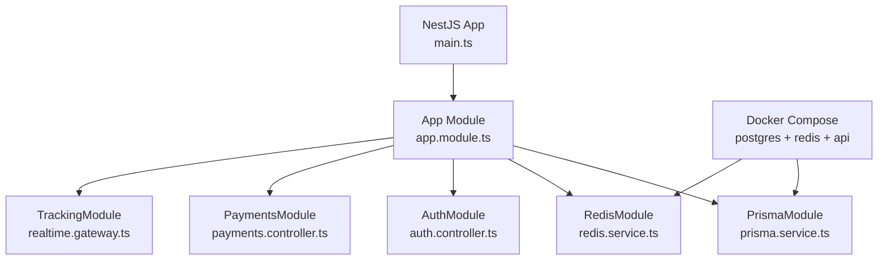
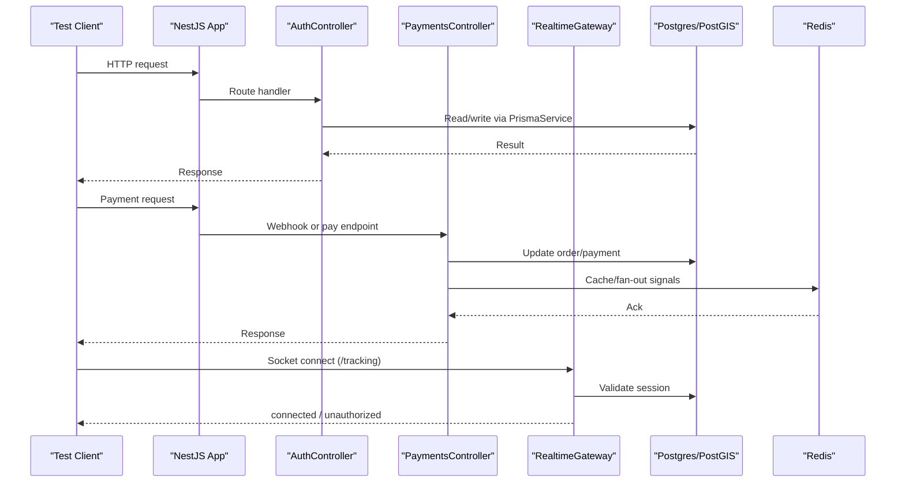
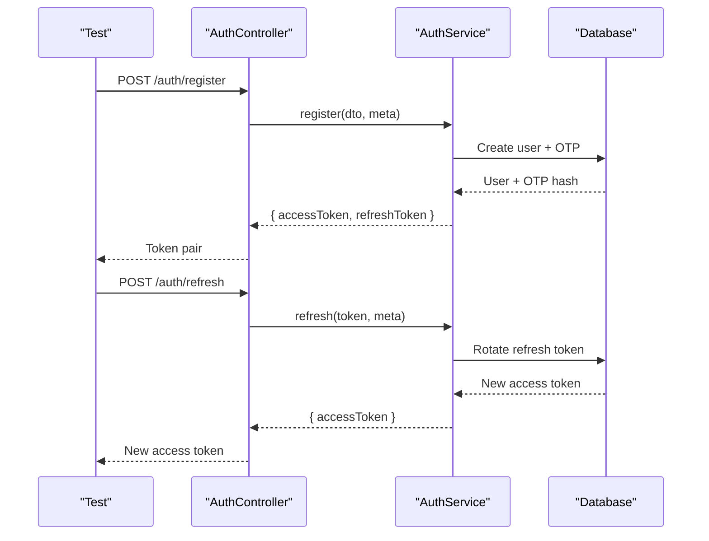
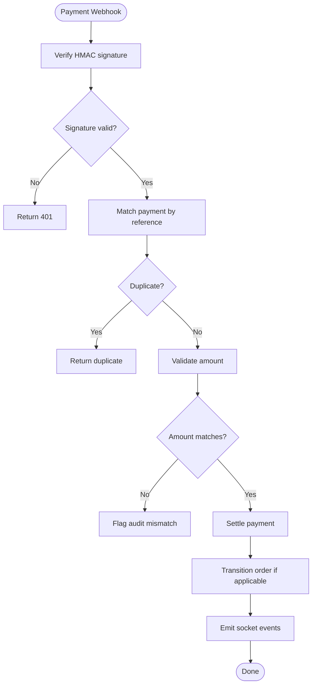
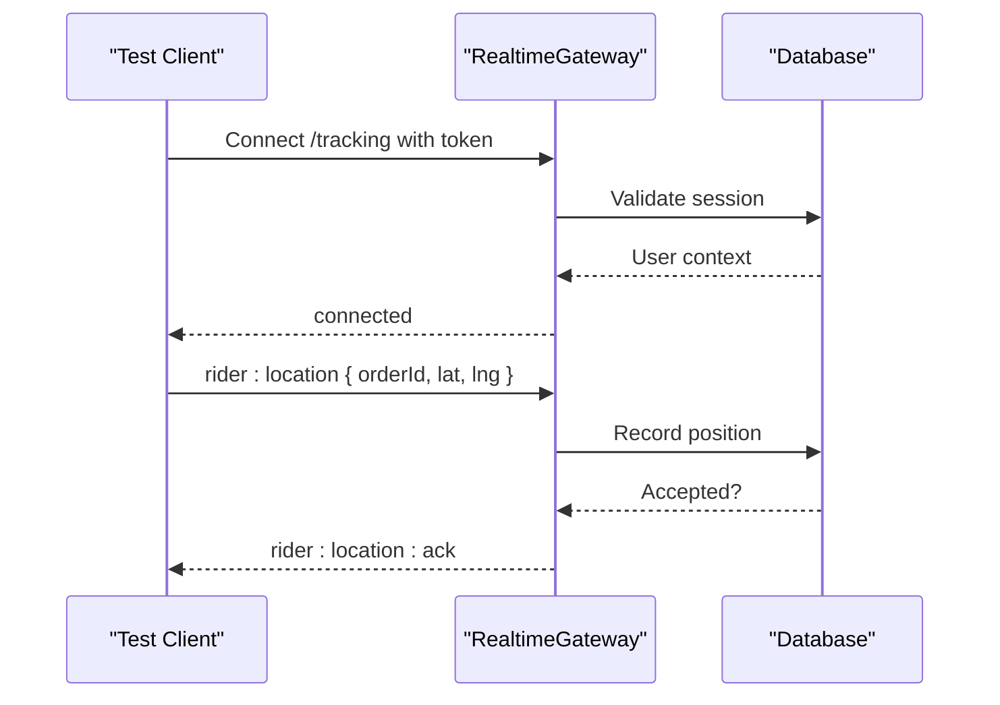
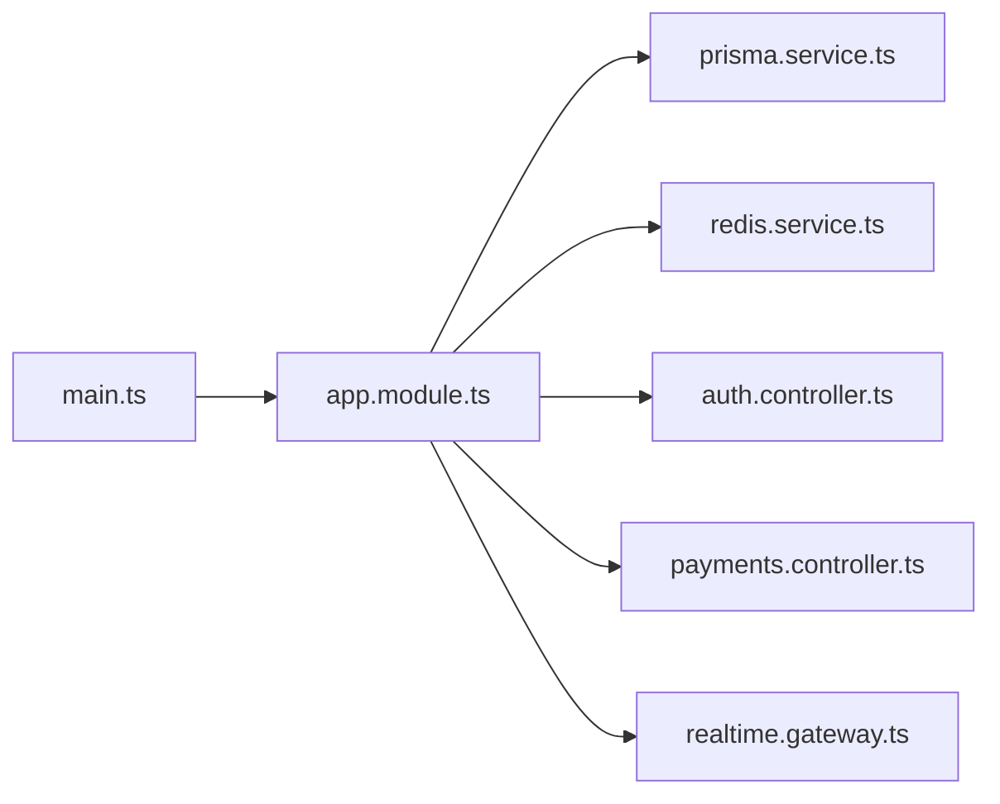

# Backend Testing

<cite>
**Referenced Files in This Document**
- [package.json](file://backend/package.json)
- [README.md](file://backend/README.md)
- [docker-compose.yml](file://backend/docker-compose.yml)
- [main.ts](file://backend/src/main.ts)
- [app.module.ts](file://backend/src/app.module.ts)
- [prisma.service.ts](file://backend/src/prisma/prisma.service.ts)
- [redis.service.ts](file://backend/src/redis/redis.service.ts)
- [auth.controller.ts](file://backend/src/auth/auth.controller.ts)
- [payments.controller.ts](file://backend/src/payments/payments.controller.ts)
- [realtime.gateway.ts](file://backend/src/tracking/realtime.gateway.ts)
</cite>

## Table of Contents
1. [Introduction](#introduction)
2. [Project Structure](#project-structure)
3. [Core Components](#core-components)
4. [Architecture Overview](#architecture-overview)
5. [Detailed Component Analysis](#detailed-component-analysis)
6. [Dependency Analysis](#dependency-analysis)
7. [Performance Considerations](#performance-considerations)
8. [Troubleshooting Guide](#troubleshooting-guide)
9. [Conclusion](#conclusion)
10. [Appendices](#appendices)

## Introduction
This document defines the backend testing strategy for the FuelConnect NestJS application. It covers unit testing with Jest and TypeScript, integration testing for REST endpoints and Socket.IO events, database testing using Prisma with containerized Postgres/PostGIS and Redis, mocking external dependencies such as payment providers, email services, and Redis, and guidance for guards, interceptors, real-time features, performance testing, code coverage, test organization, and continuous integration.

The repository currently ships no spec files; tests should be added alongside existing modules following the patterns described here.

**Section sources**
- [README.md:714-724](file://backend/README.md#L714-L724)

## Project Structure
The backend is a NestJS application with feature modules under `src/`. Infrastructure includes Prisma (PostgreSQL + PostGIS), Redis, Socket.IO, JWT authentication, throttling, Swagger, and an admin dashboard served statically.

**Diagram sources**
- [main.ts:12-103](file://backend/src/main.ts#L12-L103)
- [app.module.ts:29-67](file://backend/src/app.module.ts#L29-L67)
- [prisma.service.ts:4-33](file://backend/src/prisma/prisma.service.ts#L4-L33)
- [redis.service.ts:20-52](file://backend/src/redis/redis.service.ts#L20-L52)
- [auth.controller.ts:42-165](file://backend/src/auth/auth.controller.ts#L42-L165)
- [payments.controller.ts:26-99](file://backend/src/payments/payments.controller.ts#L26-L99)
- [realtime.gateway.ts:45-78](file://backend/src/tracking/realtime.gateway.ts#L45-L78)

**Section sources**
- [README.md:19-46](file://backend/README.md#L19-L46)
- [docker-compose.yml:1-54](file://backend/docker-compose.yml#L1-L54)

## Core Components
This section outlines the key runtime components that must be considered when designing tests.

- Application bootstrap and global configuration
  - Helmet, CORS, global prefix, static dashboard, validation pipe, Swagger, shutdown hooks.
- Global guards, filters, and interceptors
  - ThrottlerGuard, JwtAuthGuard, RolesGuard, AuditLogInterceptor, AllExceptionsFilter.
- Database layer
  - PrismaService extends PrismaClient, connects/disconnects on lifecycle, logs warnings/errors.
- Cache and fan-out
  - RedisService supports JSON get/set/del/exists/ping with in-process fallback when Redis is unavailable.
- Authentication controller
  - Public and protected endpoints for register, login, OTP, refresh, password reset, profile, sessions.
- Payments controller
  - Order payment, wallet top-up, history, sandbox simulate, HMAC webhook, status polling.
- Real-time gateway
  - Socket.IO namespace `/tracking`, JWT handshake, rooms, location recording, operations feed.

**Section sources**
- [main.ts:12-103](file://backend/src/main.ts#L12-L103)
- [app.module.ts:29-67](file://backend/src/app.module.ts#L29-L67)
- [prisma.service.ts:4-33](file://backend/src/prisma/prisma.service.ts#L4-L33)
- [redis.service.ts:20-132](file://backend/src/redis/redis.service.ts#L20-L132)
- [auth.controller.ts:42-165](file://backend/src/auth/auth.controller.ts#L42-L165)
- [payments.controller.ts:26-99](file://backend/src/payments/payments.controller.ts#L26-L99)
- [realtime.gateway.ts:45-293](file://backend/src/tracking/realtime.gateway.ts#L45-L293)

## Architecture Overview
The system uses NestJS modules with shared infrastructure. Tests should cover:
- Unit tests for services and utilities
- Controller tests with Nest’s Test module
- Integration tests against containerized Postgres/PostGIS and Redis
- WebSocket event flows through the Socket.IO gateway
- Mocked external integrations (payment providers, email/SMS)

**Diagram sources**
- [auth.controller.ts:42-165](file://backend/src/auth/auth.controller.ts#L42-L165)
- [payments.controller.ts:26-99](file://backend/src/payments/payments.controller.ts#L26-L99)
- [realtime.gateway.ts:80-143](file://backend/src/tracking/realtime.gateway.ts#L80-L143)
- [prisma.service.ts:19-26](file://backend/src/prisma/prisma.service.ts#L19-L26)
- [redis.service.ts:69-131](file://backend/src/redis/redis.service.ts#L69-L131)

## Detailed Component Analysis

### Unit Testing Strategy (Jest + TypeScript)
- Use NestJS testing utilities to create isolated module instances per feature.
- Inject mocked PrismaService and RedisService where appropriate.
- For services that call external APIs (e.g., mobile money providers), mock HTTP clients or provider classes.
- Validate DTOs using class-validator decorators by sending payloads through controllers.

Recommended patterns:
- Arrange: build Nest testing module with only required providers.
- Act: invoke service methods or controller endpoints.
- Assert: check returned values, side effects (mock calls), and error shapes.

[No sources needed since this section provides general guidance]

### Controller Testing
Focus on:
- Input validation and transformation
- Authorization via guards
- Correct delegation to services
- Consistent error envelope

Examples to implement:
- POST `/auth/register` and `/auth/login` with valid/invalid bodies
- POST `/payments/orders/:orderId/pay` with role checks
- GET `/payments` pagination behavior

**Section sources**
- [auth.controller.ts:42-165](file://backend/src/auth/auth.controller.ts#L42-L165)
- [payments.controller.ts:26-99](file://backend/src/payments/payments.controller.ts#L26-L99)

### Service Testing
Services encapsulate business logic. Test:
- Pricing and dispatch rules
- Wallet ledger integrity
- Order state transitions
- OTP generation and verification constraints
- Idempotency handling

Use dependency injection to replace PrismaService and RedisService with test doubles.

[No sources needed since this section provides general guidance]

### Database Testing with Prisma and Containers
- Spin up Postgres/PostGIS and Redis via Docker Compose for integration tests.
- Use Prisma migrations or schema push before running tests.
- Seed deterministic data per test suite or use transactions to isolate tests.
- Ensure PostGIS extension is enabled as configured in the project.

Key references:
- Container definitions for Postgres and Redis
- Prisma client lifecycle management
- Environment variables for connection strings

**Section sources**
- [docker-compose.yml:1-54](file://backend/docker-compose.yml#L1-L54)
- [prisma.service.ts:4-33](file://backend/src/prisma/prisma.service.ts#L4-L33)
- [README.md:63-80](file://backend/README.md#L63-L80)

### Integration Testing for API Endpoints
- Use Nest’s `Testing.createTestingModule` with a real PrismaService and RedisService backed by containers.
- Verify end-to-end flows:
  - Register → OTP request → OTP verify → Login → Refresh
  - Quote → Order → Pay → Simulate settlement
  - Rider availability and job workflow
- Validate response shape, status codes, and headers (e.g., `x-request-id`).

**Section sources**
- [README.md:214-276](file://backend/README.md#L214-L276)
- [README.md:320-407](file://backend/README.md#L320-L407)
- [main.ts:50-61](file://backend/src/main.ts#L50-L61)

### Authentication Flow Testing
Cover:
- Password hashing and validation
- JWT access token issuance and expiry
- Rotating refresh tokens and session revocation
- OTP TTL, resend cooldown, attempt limits
- Role-based access control

**Diagram sources**
- [auth.controller.ts:48-98](file://backend/src/auth/auth.controller.ts#L48-L98)

**Section sources**
- [auth.controller.ts:48-165](file://backend/src/auth/auth.controller.ts#L48-L165)
- [README.md:214-276](file://backend/README.md#L214-L276)

### Payments and Webhook Testing
Cover:
- Wallet debit atomicity and balance checks
- Cash flow and collection confirmation
- Mobile money sandbox simulation
- HMAC signature verification for webhooks
- Duplicate callback idempotency and amount mismatch handling

**Diagram sources**
- [payments.controller.ts:74-90](file://backend/src/payments/payments.controller.ts#L74-L90)
- [README.md:373-407](file://backend/README.md#L373-L407)

**Section sources**
- [payments.controller.ts:26-99](file://backend/src/payments/payments.controller.ts#L26-L99)
- [README.md:361-407](file://backend/README.md#L361-L407)

### Real-Time Features Testing with Socket.IO
Cover:
- Connection handshake with JWT
- Room joins/unjoins
- Location throttling and validation
- Operations feed access for staff roles

**Diagram sources**
- [realtime.gateway.ts:80-143](file://backend/src/tracking/realtime.gateway.ts#L80-L143)
- [realtime.gateway.ts:201-252](file://backend/src/tracking/realtime.gateway.ts#L201-L252)

**Section sources**
- [realtime.gateway.ts:45-293](file://backend/src/tracking/realtime.gateway.ts#L45-L293)
- [README.md:536-591](file://backend/README.md#L536-L591)

### Guards and Interceptors Testing
- JwtAuthGuard and RolesGuard are registered globally; ensure tests assert authorization failures and successes across controllers.
- AuditLogInterceptor writes audit entries; verify audit creation for admin mutations.
- ValidationPipe transforms and whitelists inputs; assert structured validation errors.

**Section sources**
- [app.module.ts:61-67](file://backend/src/app.module.ts#L61-L67)
- [main.ts:50-61](file://backend/src/main.ts#L50-L61)

### Mocking External Dependencies
- Payment providers: mock HTTP calls or provider implementations; prefer sandbox simulation paths.
- Email/SMS: stub delivery functions; OTP dev mode returns codes without sending.
- Redis: inject a test double for RedisService to avoid network calls; validate both Redis and in-memory fallback behaviors.

[No sources needed since this section provides general guidance]

### Test Utilities and Common Patterns
- Create a helper to spin up containerized Postgres/PostGIS and Redis for integration suites.
- Provide a factory for seeding minimal data per test (users, stations, orders).
- Build a reusable Nest testing module builder that configures PrismaService and RedisService based on environment flags.
- Centralize assertions for the standard error envelope and pagination responses.

[No sources needed since this section provides general guidance]

## Dependency Analysis
The application composes multiple modules and infrastructure services. Tests should respect these boundaries:

**Diagram sources**
- [main.ts:12-103](file://backend/src/main.ts#L12-L103)
- [app.module.ts:29-67](file://backend/src/app.module.ts#L29-L67)
- [prisma.service.ts:4-33](file://backend/src/prisma/prisma.service.ts#L4-L33)
- [redis.service.ts:20-52](file://backend/src/redis/redis.service.ts#L20-L52)
- [auth.controller.ts:42-165](file://backend/src/auth/auth.controller.ts#L42-L165)
- [payments.controller.ts:26-99](file://backend/src/payments/payments.controller.ts#L26-L99)
- [realtime.gateway.ts:45-78](file://backend/src/tracking/realtime.gateway.ts#L45-L78)

**Section sources**
- [app.module.ts:29-67](file://backend/src/app.module.ts#L29-L67)

## Performance Considerations
- Keep unit tests fast by mocking I/O and external services.
- Use transactional isolation for integration tests to avoid cross-test interference.
- Limit database queries in integration tests; seed minimal data.
- Avoid heavy computations in tests; precompute expected results where possible.
- For real-time tests, throttle events and limit room sizes.

[No sources needed since this section provides general guidance]

## Troubleshooting Guide
Common issues and resolutions:
- Missing environment variables: ensure `.env` contains required keys (JWT secrets, database URL, Redis URL).
- PostGIS extension not enabled: use `prisma db push` as documented to enable extensions.
- Redis unavailable: RedisService falls back to in-process cache; tests can assert graceful degradation.
- Validation errors: expect structured error envelopes with field-level messages.
- Webhook signature mismatches: ensure raw body is used for HMAC verification.

**Section sources**
- [README.md:158-190](file://backend/README.md#L158-L190)
- [README.md:63-80](file://backend/README.md#L63-L80)
- [redis.service.ts:28-52](file://backend/src/redis/redis.service.ts#L28-L52)
- [main.ts:50-61](file://backend/src/main.ts#L50-L61)
- [payments.controller.ts:74-90](file://backend/src/payments/payments.controller.ts#L74-L90)

## Conclusion
Adopt a layered testing approach:
- Unit tests for pure logic and services with mocked dependencies
- Controller tests for validation, guards, and routing
- Integration tests against containerized Postgres/PostGIS and Redis
- WebSocket tests for real-time flows
- Mock external providers and rely on sandbox simulation for payments
- Enforce code coverage thresholds and automate tests in CI

This strategy ensures reliability, security, and performance while keeping tests maintainable and fast.

[No sources needed since this section summarizes without analyzing specific files]

## Appendices

### Test Organization Patterns
- Place unit tests next to source files (`*.service.spec.ts`)
- Group integration tests by feature (`integration/auth.spec.ts`, `integration/payments.spec.ts`)
- Store shared helpers under `test/helpers` and fixtures under `test/fixtures`

[No sources needed since this section provides general guidance]

### Continuous Integration Setup
- Install dependencies, generate Prisma client, run type checks
- Start Postgres/PostGIS and Redis containers
- Run unit tests, then integration tests
- Collect coverage reports and upload artifacts

[No sources needed since this section provides general guidance]

### Code Coverage Requirements
- Aim for high branch and line coverage on critical paths (auth, payments, orders)
- Exclude generated code and test utilities from coverage
- Fail CI if coverage drops below thresholds

[No sources needed since this section provides general guidance]