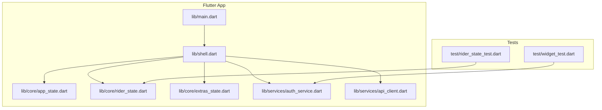
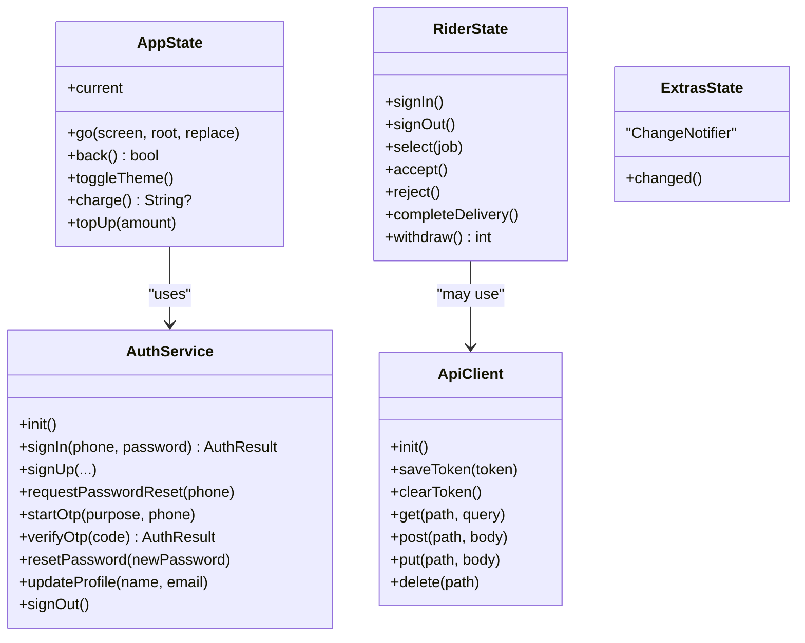
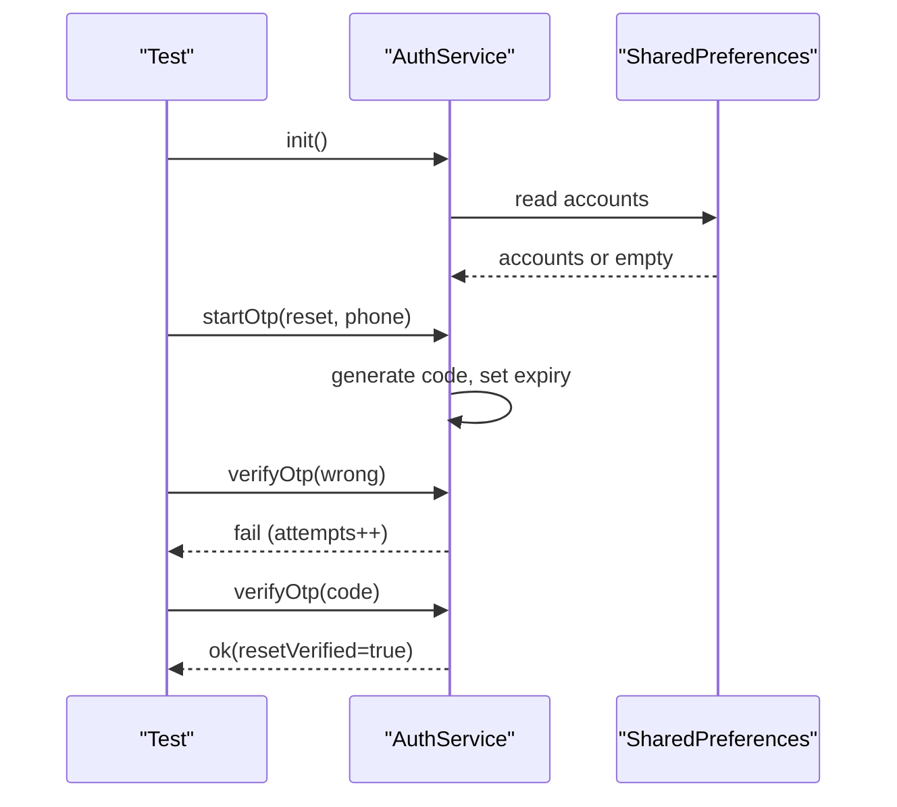
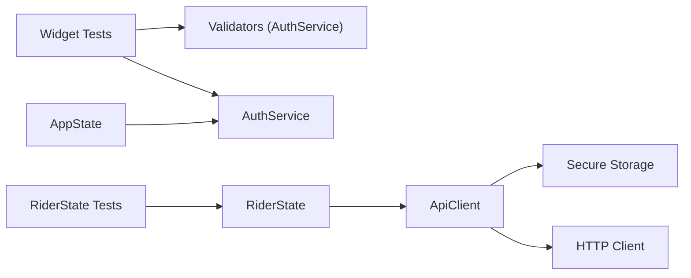

# Frontend Testing

<cite>
**Referenced Files in This Document**
- [pubspec.yaml](file://flutter_app/pubspec.yaml)
- [widget_test.dart](file://flutter_app/test/widget_test.dart)
- [rider_state_test.dart](file://flutter_app/test/rider_state_test.dart)
- [app_state.dart](file://flutter_app/lib/core/app_state.dart)
- [rider_state.dart](file://flutter_app/lib/core/rider_state.dart)
- [extras_state.dart](file://flutter_app/lib/core/extras_state.dart)
- [auth_service.dart](file://flutter_app/lib/services/auth_service.dart)
- [api_client.dart](file://flutter_app/lib/services/api_client.dart)
</cite>

## Table of Contents
1. [Introduction](#introduction)
2. [Project Structure](#project-structure)
3. [Core Components](#core-components)
4. [Architecture Overview](#architecture-overview)
5. [Detailed Component Analysis](#detailed-component-analysis)
6. [Dependency Analysis](#dependency-analysis)
7. [Performance Considerations](#performance-considerations)
8. [Troubleshooting Guide](#troubleshooting-guide)
9. [Conclusion](#conclusion)
10. [Appendices](#appendices)

## Introduction
This document provides a comprehensive guide to frontend testing for the Flutter mobile application. It covers widget testing strategies, state management testing with Provider, mock data strategies for APIs and external services, authentication flow tests, order and rider interface tests, real-time features, animations, performance testing, test organization, coverage requirements, and continuous integration setup. The guidance is grounded in the existing codebase and current tests.

## Project Structure
The Flutter app uses standard Flutter project layout:
- Application entry points and shell are under lib/.
- Core domain state lives in lib/core/ (AppState, RiderState, ExtrasState).
- Services include auth and HTTP client logic under lib/services/.
- Tests live under flutter_app/test/.

**Diagram sources**
- [app_state.dart:1-200](file://flutter_app/lib/core/app_state.dart#L1-L200)
- [rider_state.dart:1-180](file://flutter_app/lib/core/rider_state.dart#L1-L180)
- [extras_state.dart:1-18](file://flutter_app/lib/core/extras_state.dart#L1-L18)
- [auth_service.dart:1-305](file://flutter_app/lib/services/auth_service.dart#L1-L305)
- [api_client.dart:1-127](file://flutter_app/lib/services/api_client.dart#L1-L127)
- [widget_test.dart:1-48](file://flutter_app/test/widget_test.dart#L1-L48)
- [rider_state_test.dart:1-42](file://flutter_app/test/rider_state_test.dart#L1-L42)

**Section sources**
- [pubspec.yaml:1-29](file://flutter_app/pubspec.yaml#L1-L29)

## Core Components
This section outlines the primary state and service components that drive UI behavior and should be tested.

- AppState
  - Manages navigation stack, theme mode, location flags, order builder fields, selected vehicle, payment methods, wallet/rewards, notifications, and order totals.
  - Exposes change notification via ChangeNotifier.
  - Key behaviors to test: navigation push/pop semantics, theme toggling, order total computation, wallet charge/top-up flows.

- RiderState
  - Models rider session, availability, job list, active trip, earnings, and recent transactions.
  - Provides actions like signIn/signOut, toggleOnline, select/accept/reject jobs, refreshJobs, completeDelivery, withdraw.
  - Key behaviors to test: job lifecycle, earnings updates, withdrawal, sign-in/out state transitions.

- ExtrasState
  - Holds small customer settings such as emergency contact, notification toggles, biometric, and language selection.
  - Emits changes via notifyListeners.

- AuthService
  - Frontend-only auth stand-in with phone/email validation, OTP generation/verification, password reset, profile update, and persistence via SharedPreferences.
  - Contains demo accounts and constants for OTP length/alphanumeric mode.
  - Key behaviors to test: phone normalization/validation, password rules/strength meter, OTP single-use verification, sign-in/up flows, reset password flow.

- ApiClient
  - Secure HTTP client with token storage, timeouts, error mapping, and unauthorized handling.
  - Uses environment-based base URL configuration and enforces HTTPS in release builds.
  - Key behaviors to test: secure URL assertion, token persistence, timeout/error mapping, 401 handling.

**Section sources**
- [app_state.dart:1-200](file://flutter_app/lib/core/app_state.dart#L1-L200)
- [rider_state.dart:1-180](file://flutter_app/lib/core/rider_state.dart#L1-L180)
- [extras_state.dart:1-18](file://flutter_app/lib/core/extras_state.dart#L1-L18)
- [auth_service.dart:1-305](file://flutter_app/lib/services/auth_service.dart#L1-L305)
- [api_client.dart:1-127](file://flutter_app/lib/services/api_client.dart#L1-L127)

## Architecture Overview
The app follows a Provider-driven architecture where screens consume ChangeNotifier instances (AppState, RiderState, ExtrasState) and services (AuthService, ApiClient). Tests validate both pure logic (state classes, validators) and UI interactions (widgets).

**Diagram sources**
- [app_state.dart:1-200](file://flutter_app/lib/core/app_state.dart#L1-L200)
- [rider_state.dart:1-180](file://flutter_app/lib/core/rider_state.dart#L1-L180)
- [extras_state.dart:1-18](file://flutter_app/lib/core/extras_state.dart#L1-L18)
- [auth_service.dart:1-305](file://flutter_app/lib/services/auth_service.dart#L1-L305)
- [api_client.dart:1-127](file://flutter_app/lib/services/api_client.dart#L1-L127)

## Detailed Component Analysis

### Widget Testing Strategy
- Use flutter_test to build widgets, pump them, and assert on rendered output.
- Validate user interactions by tapping buttons, entering text, and asserting state changes or navigation outcomes.
- For forms, assert validation messages and input normalization.

Current example scope:
- Phone normalization and validation rules.
- Password strength and policy checks.
- OTP verification flow using AuthService.

Recommended patterns:
- Wrap widgets with necessary providers (e.g., Provider<AppState>, Provider<RiderState>) when testing UI that consumes them.
- Use tester.pumpAndSettle for async animations or Future-based updates.
- Isolate widget tests from network by mocking ApiClient or replacing it with a test double.

**Section sources**
- [widget_test.dart:1-48](file://flutter_app/test/widget_test.dart#L1-L48)

### State Management Testing with Provider Pattern
- Provider pattern relies on ChangeNotifier; tests can instantiate states directly or wrap widgets with Provider.
- Verify state transitions and side effects without relying on UI.

AppState testing focus:
- Navigation stack operations: go(), back(), backOr().
- Theme toggling and rebuild triggers.
- Order builder calculations: fuelTotal, orderTotal, product name derivation.
- Wallet operations: charge(), topUp(), transaction insertion.

RiderState testing focus:
- Job lifecycle: select(), accept(), reject(), refreshJobs().
- Trip completion: completeDelivery() updates earnings and clears activeTrip.
- Withdrawal: withdraw() empties available balance and returns amount.

ExtrasState testing focus:
- Toggle preferences and ensure listeners are notified.

Existing coverage:
- RiderState unit tests cover acceptance, completion, withdrawal, and rejection flows.

**Section sources**
- [app_state.dart:1-200](file://flutter_app/lib/core/app_state.dart#L1-L200)
- [rider_state.dart:1-180](file://flutter_app/lib/core/rider_state.dart#L1-L180)
- [extras_state.dart:1-18](file://flutter_app/lib/core/extras_state.dart#L1-L18)
- [rider_state_test.dart:1-42](file://flutter_app/test/rider_state_test.dart#L1-L42)

### Mock Data Strategies
- API responses: Replace ApiClient with a test double that returns predefined JSON payloads for success, failure, and edge cases (timeouts, 401, 429).
- Database operations: If using local storage (SharedPreferences), isolate tests by clearing keys before each test or using a temporary instance.
- External services: Mock geolocation, payments, and WebSocket clients with deterministic outputs.

For AuthService:
- Use provided demoPhone/demoPassword for sign-in tests.
- Leverage startOtp()/verifyOtp() to simulate OTP flows deterministically.

For ApiClient:
- Configure ApiConfig.baseUrl via dart-define in tests if needed.
- Assert on ApiException messages for different status codes.

**Section sources**
- [auth_service.dart:1-305](file://flutter_app/lib/services/auth_service.dart#L1-L305)
- [api_client.dart:1-127](file://flutter_app/lib/services/api_client.dart#L1-L127)

### Authentication Flow Testing
Coverage includes:
- Phone normalization and validation.
- Password policy and strength meter.
- OTP generation, expiration, attempts limit, and single-use behavior.
- Sign-in/up, password reset, and profile updates.

**Diagram sources**
- [auth_service.dart:134-148](file://flutter_app/lib/services/auth_service.dart#L134-L148)
- [auth_service.dart:214-265](file://flutter_app/lib/services/auth_service.dart#L214-L265)

**Section sources**
- [widget_test.dart:1-48](file://flutter_app/test/widget_test.dart#L1-L48)
- [auth_service.dart:1-305](file://flutter_app/lib/services/auth_service.dart#L1-L305)

### Order Management Screens Testing
Focus areas:
- Fuel type selection, litres, scheduled delivery, delivery address/note.
- Vehicle selection and price calculation.
- Payment method selection and wallet balance checks.
- Checkout and payment confirmation flows.

Testing approach:
- Build the order screen with Provider<AppState>.
- Interact with inputs and assert computed totals and selections.
- Simulate payment via AppState.charge() and verify error messages or transaction updates.

**Section sources**
- [app_state.dart:121-189](file://flutter_app/lib/core/app_state.dart#L121-L189)

### Rider Interface Components Testing
Focus areas:
- Job listing, request details, accept/reject decision, pickup/delivery confirmations, earnings dashboard.

Testing approach:
- Provide Provider<RiderState> around the UI.
- Trigger actions (select, accept, reject, completeDelivery) and assert UI-visible state changes (earnings, trips, available balance).

**Section sources**
- [rider_state.dart:46-179](file://flutter_app/lib/core/rider_state.dart#L46-L179)
- [rider_state_test.dart:1-42](file://flutter_app/test/rider_state_test.dart#L1-L42)

### Real-Time Features (WebSocket) Testing
Recommendations:
- Abstract WebSocket connections behind an interface (e.g., TrackingService).
- In tests, provide a mock that emits deterministic events and verifies consumer reactions.
- Assert that UI updates occur upon receiving tracking events and that reconnection/backoff logic behaves correctly.

[No sources needed since this section provides general guidance]

### Animations and Transitions Testing
Recommendations:
- Use tester.pump() and tester.pumpAndSettle() to advance animation frames.
- Assert intermediate states during transitions (e.g., progress indicators, route transitions).
- Avoid timing-dependent assertions; rely on frame pumping.

[No sources needed since this section provides general guidance]

### Performance Testing Approaches
Recommendations:
- Use Flutter DevTools to profile widget rebuilds and memory usage.
- Write benchmarks for critical computations (e.g., order totals, large lists).
- Ensure heavy work is offloaded to isolates or background tasks.

[No sources needed since this section provides general guidance]

## Dependency Analysis
Key dependencies and relationships relevant to testing:

**Diagram sources**
- [widget_test.dart:1-48](file://flutter_app/test/widget_test.dart#L1-L48)
- [auth_service.dart:1-305](file://flutter_app/lib/services/auth_service.dart#L1-L305)
- [rider_state_test.dart:1-42](file://flutter_app/test/rider_state_test.dart#L1-L42)
- [rider_state.dart:1-180](file://flutter_app/lib/core/rider_state.dart#L1-L180)
- [api_client.dart:1-127](file://flutter_app/lib/services/api_client.dart#L1-L127)

**Section sources**
- [pubspec.yaml:10-23](file://flutter_app/pubspec.yaml#L10-L23)

## Performance Considerations
- Keep widget tests fast by avoiding heavy assets and unnecessary provider initialization.
- Use fake/mock implementations for I/O-bound services (network, storage).
- Minimize rebuilds in tests by providing stable provider values and avoiding global mutable state where possible.

[No sources needed since this section provides general guidance]

## Troubleshooting Guide
Common issues and resolutions:
- OTP tests failing due to time-sensitive logic:
  - Ensure tests do not depend on real time; consider mocking DateTime.now() or adjusting validFor/resendAfter constants in tests.
- Network errors in tests:
  - Mock ApiClient or configure ApiConfig.baseUrl to a test server; assert ApiException messages for expected statuses.
- SharedPreferences persistence interfering between tests:
  - Clear stored keys before each test or use isolated instances.

**Section sources**
- [auth_service.dart:214-265](file://flutter_app/lib/services/auth_service.dart#L214-L265)
- [api_client.dart:74-125](file://flutter_app/lib/services/api_client.dart#L74-L125)

## Conclusion
The Flutter frontend has clear opportunities to expand testing coverage across widgets, state, and services. Existing tests validate core validation and rider state flows. By adopting Provider-based widget tests, robust mocks for ApiClient and external services, and structured CI pipelines, the team can ensure reliability across authentication, order management, and rider interfaces while maintaining performance and responsiveness.

[No sources needed since this section summarizes without analyzing specific files]

## Appendices

### Test Organization Patterns
- Unit tests under test/ for pure logic (validators, state classes).
- Widget tests grouped by feature (auth, orders, rider).
- Integration tests for multi-step flows (authentication + order placement).

[No sources needed since this section provides general guidance]

### Code Coverage Requirements
- Aim for >80% line coverage on core logic (AppState, RiderState, AuthService).
- Enforce coverage thresholds in CI to prevent regressions.

[No sources needed since this section provides general guidance]

### Continuous Integration Setup
- Run flutter test with coverage reports.
- Lint and analyze with flutter analyze.
- Cache dependencies and artifacts to speed up builds.

[No sources needed since this section provides general guidance]