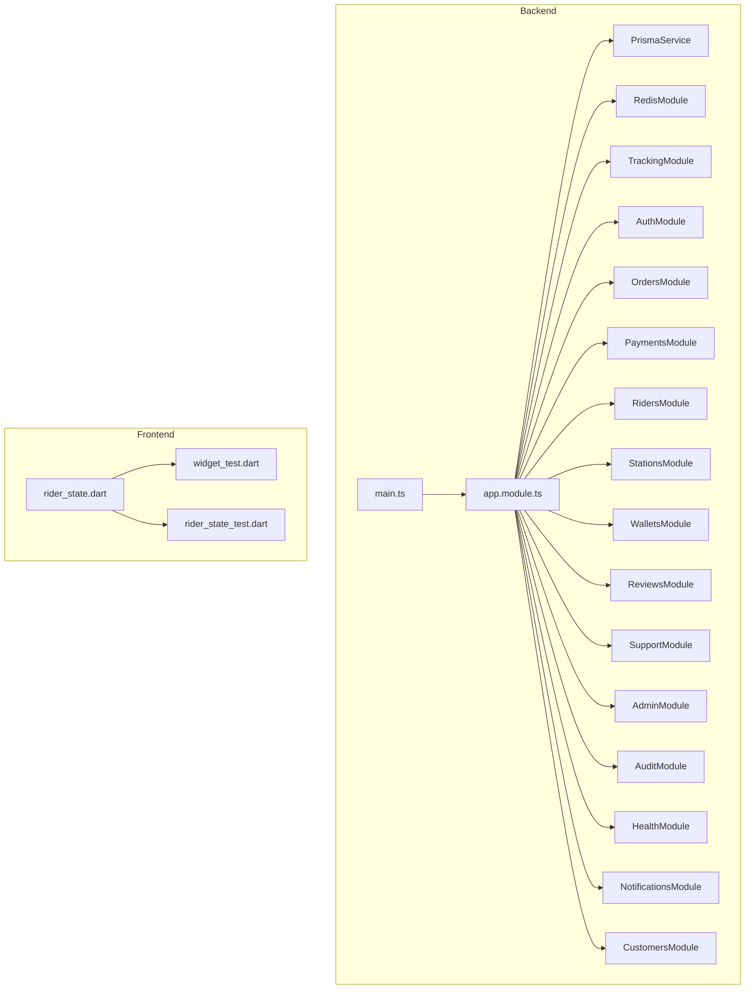
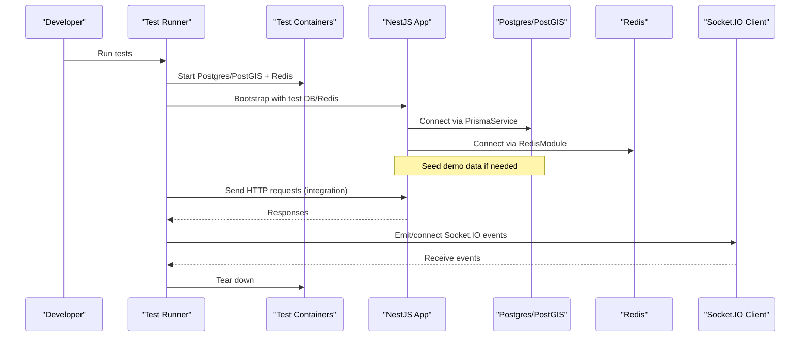
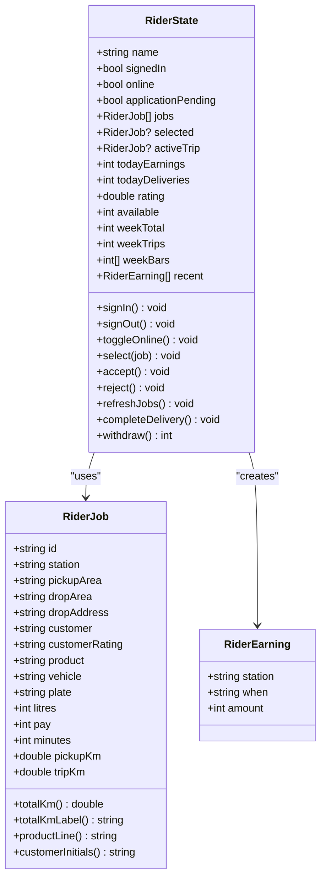
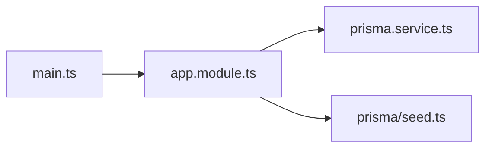

# Testing Strategy

<cite>
**Referenced Files in This Document**
- [backend/package.json](file://backend/package.json)
- [backend/src/main.ts](file://backend/src/main.ts)
- [backend/src/app.module.ts](file://backend/src/app.module.ts)
- [backend/src/prisma/prisma.service.ts](file://backend/src/prisma/prisma.service.ts)
- [backend/prisma/seed.ts](file://backend/prisma/seed.ts)
- [flutter_app/pubspec.yaml](file://flutter_app/pubspec.yaml)
- [flutter_app/test/widget_test.dart](file://flutter_app/test/widget_test.dart)
- [flutter_app/test/rider_state_test.dart](file://flutter_app/test/rider_state_test.dart)
- [flutter_app/lib/core/rider_state.dart](file://flutter_app/lib/core/rider_state.dart)
- [flutter_app/lib/core/app_state.dart](file://flutter_app/lib/core/app_state.dart)
</cite>

## Table of Contents
1. [Introduction](#introduction)
2. [Project Structure](#project-structure)
3. [Core Components](#core-components)
4. [Architecture Overview](#architecture-overview)
5. [Detailed Component Analysis](#detailed-component-analysis)
6. [Dependency Analysis](#dependency-analysis)
7. [Performance Considerations](#performance-considerations)
8. [Troubleshooting Guide](#troubleshooting-guide)
9. [Conclusion](#conclusion)

## Introduction
This document defines the testing strategy for the FuelConnect platform, covering both backend (NestJS + Prisma + Redis + Socket.IO) and frontend (Flutter). It explains unit testing with Jest, integration testing for API endpoints, database testing with test containers, Flutter widget/state testing, mocking strategies, real-time feature testing, performance testing, CI/CD setup, code coverage, and debugging failed tests.

## Project Structure
The repository is a full-stack application:
- Backend: NestJS application with modules for auth, orders, payments, tracking, riders, stations, wallets, reviews, support, admin, audit, health, notifications, customers, prisma, redis.
- Frontend: Flutter app with core state classes, screens, services, and tests under flutter_app/test.

**Diagram sources**
- [backend/src/main.ts:12-100](file://backend/src/main.ts#L12-L100)
- [backend/src/app.module.ts:29-69](file://backend/src/app.module.ts#L29-L69)
- [flutter_app/lib/core/rider_state.dart:44-177](file://flutter_app/lib/core/rider_state.dart#L44-L177)
- [flutter_app/test/widget_test.dart:1-48](file://flutter_app/test/widget_test.dart#L1-L48)
- [flutter_app/test/rider_state_test.dart:1-42](file://flutter_app/test/rider_state_test.dart#L1-L42)

**Section sources**
- [backend/src/main.ts:12-100](file://backend/src/main.ts#L12-L100)
- [backend/src/app.module.ts:29-69](file://backend/src/app.module.ts#L29-L69)
- [flutter_app/lib/core/rider_state.dart:44-177](file://flutter_app/lib/core/rider_state.dart#L44-L177)
- [flutter_app/test/widget_test.dart:1-48](file://flutter_app/test/widget_test.dart#L1-L48)
- [flutter_app/test/rider_state_test.dart:1-42](file://flutter_app/test/rider_state_test.dart#L1-L42)

## Core Components
- Backend entrypoint configures global pipes, CORS, Swagger, guards, interceptors, and module imports.
- Prisma service manages lifecycle hooks for DB connections.
- Seed script populates demo data used by the Flutter prototype.
- Flutter rider state encapsulates delivery flow logic and earnings calculations.
- Flutter tests validate phone/password validation and rider state transitions.

Key responsibilities:
- Bootstrap and configure the NestJS application.
- Provide global guards and filters for security and error handling.
- Manage database connectivity and shutdown behavior.
- Provide deterministic demo data for UI flows.
- Encapsulate rider business logic and notify listeners on state changes.

**Section sources**
- [backend/src/main.ts:12-100](file://backend/src/main.ts#L12-L100)
- [backend/src/app.module.ts:29-69](file://backend/src/app.module.ts#L29-L69)
- [backend/src/prisma/prisma.service.ts:4-33](file://backend/src/prisma/prisma.service.ts#L4-L33)
- [backend/prisma/seed.ts:1-221](file://backend/prisma/seed.ts#L1-L221)
- [flutter_app/lib/core/rider_state.dart:44-177](file://flutter_app/lib/core/rider_state.dart#L44-L177)
- [flutter_app/test/widget_test.dart:1-48](file://flutter_app/test/widget_test.dart#L1-L48)
- [flutter_app/test/rider_state_test.dart:1-42](file://flutter_app/test/rider_state_test.dart#L1-L42)

## Architecture Overview
Testing spans multiple layers:
- Unit tests for pure functions and state classes.
- Integration tests for controllers/services using NestJS testing utilities.
- Database tests using test containers to spin up Postgres/PostGIS and Redis.
- Widget/state tests for Flutter components and state machines.
- Real-time tests for Socket.IO events.
- Performance tests for hot paths and network calls.

[No sources needed since this diagram shows conceptual workflow, not actual code structure]

## Detailed Component Analysis

### Backend Unit Testing with Jest
- Use Jest for unit tests of services, DTOs, validators, and utilities.
- Isolate external dependencies (database, Redis, email/SMS providers) with mocks or stubs.
- Validate input/output contracts using class-validator decorators and DTOs.

Recommendations:
- Place unit tests next to source files or under a dedicated test directory.
- Mock third-party integrations (payment providers, OTP services, geolocation).
- Assert guard and interceptor behaviors independently.

[No sources needed since this section provides general guidance]

### Backend Integration Testing for API Endpoints
- Use NestJS testing utilities to bootstrap modules and controllers.
- Create an in-memory or container-backed database for each test suite.
- Exercise authentication flows (JWT), role-based access, throttling, and validation.
- Verify response shapes, status codes, and side effects (e.g., audit logs).

Best practices:
- Group tests by feature (auth, orders, payments, tracking).
- Use factories to build request payloads and expected responses.
- Reset or seed the database between tests to ensure isolation.

[No sources needed since this section provides general guidance]

### Backend Database Testing with Test Containers
- Spin up Postgres/PostGIS and Redis using test containers during integration tests.
- Configure Prisma to connect to the containerized database.
- Seed deterministic data before running tests that depend on specific records.

Implementation notes:
- Ensure migrations are applied before tests run.
- Use transactional rollback where possible; otherwise, clean up seeded data after tests.
- Parallelize tests safely by isolating databases per process or using unique schemas.

[No sources needed since this section provides general guidance]

### Flutter Widget Testing
- Use flutter_test to render widgets and assert UI states.
- Validate user interactions such as form inputs, navigation, and feedback messages.
- Mock services and state objects to isolate UI behavior.

Current tests:
- Phone normalization and password validation rules.
- Verification code generation and single-use verification.

**Section sources**
- [flutter_app/test/widget_test.dart:1-48](file://flutter_app/test/widget_test.dart#L1-L48)

### Flutter State Management Testing
- Test state classes like RiderState and AppState for correctness of business logic.
- Assert state transitions, computed values, and listener notifications.
- Use deterministic sample data to avoid flaky tests.

Current tests:
- Rider job selection, acceptance, rejection, completion, and withdrawal.
- Earnings and delivery counters update correctly.

**Diagram sources**
- [flutter_app/lib/core/rider_state.dart:3-177](file://flutter_app/lib/core/rider_state.dart#L3-L177)

**Section sources**
- [flutter_app/test/rider_state_test.dart:1-42](file://flutter_app/test/rider_state_test.dart#L1-L42)
- [flutter_app/lib/core/rider_state.dart:44-177](file://flutter_app/lib/core/rider_state.dart#L44-L177)

### Flutter Wallet and Payment Logic Testing
- Test wallet balance updates, transaction history, and payment method selection.
- Validate charge logic and insufficient funds scenarios.
- Ensure points/rewards increment correctly upon delivery completion.

Current references:
- Wallet balance and transactions are managed in AppState.
- Charge method deducts from wallet and records transactions.

**Section sources**
- [flutter_app/lib/core/app_state.dart:155-200](file://flutter_app/lib/core/app_state.dart#L155-L200)

### Mocking External Dependencies
- Backend:
  - Mock OTP/email/SMS providers, payment gateways, and geolocation services.
  - Stub Redis operations for rate limiting and caching.
  - Replace JWT strategy with test tokens.
- Frontend:
  - Mock AuthService and network calls using fake implementations.
  - Provide deterministic demo data for screens and state.

[No sources needed since this section provides general guidance]

### Testing Real-Time Features
- Backend:
  - Use Socket.IO client libraries to emit and assert events.
  - Verify namespace routing (/tracking) and event payloads.
  - Test room management and broadcasting patterns.
- Frontend:
  - Simulate incoming events and assert UI updates.
  - Handle connection lifecycle (connect/disconnect/reconnect).

[No sources needed since this section provides general guidance]

### Performance Testing Approaches
- Backend:
  - Load test critical endpoints (auth, order creation, payment webhooks).
  - Measure latency and throughput under realistic traffic patterns.
  - Profile database queries and Redis operations.
- Frontend:
  - Benchmark widget rendering and state updates.
  - Measure startup time and memory usage on devices/emulators.

[No sources needed since this section provides general guidance]

### Test Organization Patterns
- Backend:
  - Organize tests by feature modules (auth, orders, payments, tracking).
  - Separate unit, integration, and e2e tests into distinct directories.
  - Use shared fixtures and factories for consistent test data.
- Frontend:
  - Group tests by screen or feature.
  - Keep widget tests separate from state tests.
  - Centralize mock implementations and helpers.

[No sources needed since this section provides general guidance]

### Continuous Integration Setup
- Backend:
  - Install dependencies, generate Prisma client, apply migrations, seed data.
  - Run unit and integration tests with containerized Postgres/PostGIS and Redis.
  - Generate coverage reports and upload artifacts.
- Frontend:
  - Install Flutter dependencies, run analyzer and tests.
  - Upload coverage reports and screenshots for failing widgets.

[No sources needed since this section provides general guidance]

### Code Coverage Requirements
- Backend:
  - Enforce minimum coverage thresholds for critical modules (auth, orders, payments).
  - Exclude generated code and configuration files.
- Frontend:
  - Track line and branch coverage for core state and services.
  - Focus on high-value areas (validation, state transitions, payment logic).

[No sources needed since this section provides general guidance]

### Debugging Failed Tests
- Backend:
  - Enable verbose logging for failed tests.
  - Inspect request/response bodies and error stacks.
  - Use interactive debugging with Node.js debuggers.
- Frontend:
  - Print state snapshots before assertions.
  - Use Flutter inspector to inspect widget trees.
  - Reproduce failures locally with deterministic data.

[No sources needed since this section provides general guidance]

## Dependency Analysis
The backend bootstraps global guards, interceptors, and modules. The Prisma service connects to the database and handles lifecycle events. The seed script populates demo data used by the Flutter prototype.

**Diagram sources**
- [backend/src/main.ts:12-100](file://backend/src/main.ts#L12-L100)
- [backend/src/app.module.ts:29-69](file://backend/src/app.module.ts#L29-L69)
- [backend/src/prisma/prisma.service.ts:4-33](file://backend/src/prisma/prisma.service.ts#L4-L33)
- [backend/prisma/seed.ts:1-221](file://backend/prisma/seed.ts#L1-L221)

**Section sources**
- [backend/src/main.ts:12-100](file://backend/src/main.ts#L12-L100)
- [backend/src/app.module.ts:29-69](file://backend/src/app.module.ts#L29-L69)
- [backend/src/prisma/prisma.service.ts:4-33](file://backend/src/prisma/prisma.service.ts#L4-L33)
- [backend/prisma/seed.ts:1-221](file://backend/prisma/seed.ts#L1-L221)

## Performance Considerations
- Prefer in-memory databases for fast unit tests; use containers only for integration tests.
- Minimize network calls in tests by mocking external services.
- Avoid heavy seeds in CI; use minimal datasets for speed.
- For Flutter, avoid rebuilding large widget trees unnecessarily in tests.

[No sources needed since this section provides general guidance]

## Troubleshooting Guide
Common issues and resolutions:
- Database connection failures:
  - Ensure containers are running and credentials match.
  - Apply migrations before tests.
- Redis connectivity errors:
  - Verify Redis container availability and port mapping.
- Authentication test failures:
  - Confirm JWT secrets and token expiration settings in tests.
- Socket.IO event mismatches:
  - Check namespaces and event names; assert payloads precisely.
- Flutter widget tests failing due to missing assets:
  - Include required fonts/images in test environment.

[No sources needed since this section provides general guidance]

## Conclusion
This testing strategy ensures robust validation across backend and frontend layers. By combining unit, integration, and real-time tests with containerized infrastructure and comprehensive mocking, the FuelConnect platform maintains reliability, performance, and developer productivity. Adopting these practices in CI/CD pipelines will catch regressions early and provide confidence for releases.